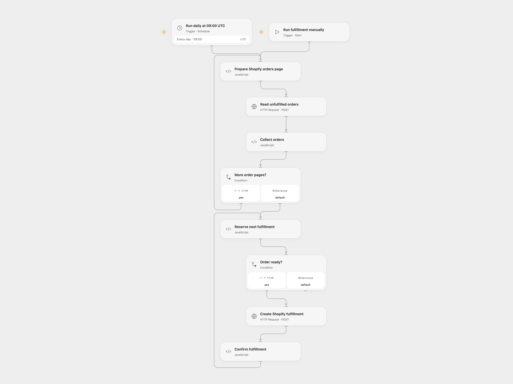

# Fulfill Aged Shopify Orders

Find unfulfilled Shopify orders older than one day and create fulfillments with customer notifications.

<!-- template-actions:start -->
 
<!-- template-actions:end -->

<picture>
  <source media="(prefers-color-scheme: dark)" srcset="preview-dark.png">
  
</picture>

## Setup

Use a Shopify app with order read and appropriate fulfillment-order read/write scopes, plus a user permitted to fulfill orders. The workflow uses the [Shopify 2026-07 fulfillmentCreate API](https://shopify.dev/docs/api/admin-graphql/2026-07/mutations/fulfillmentCreate). Shopify normally limits order access to the most recent 60 days unless the app has all-orders access. Configure the store subdomain in **Prepare Shopify orders page** and bind secret variable `SHOPIFY_ADMIN_ACCESS_TOKEN`. Enable persistent State and prevent overlapping runs.

## Behavior

A manual or daily 09:00 UTC run reads available open, unfulfilled or partially fulfilled orders and selects those strictly older than 24 hours. It uses the first fulfillment order for each order and creates a fulfillment for all its remaining line items with customer notification enabled. Orders without a fulfillment order are skipped. The source is intended for stores selling digital downloads or using fulfillment services; confirm the selected orders are appropriate for automatic fulfillment. Shopify can reject a fulfillment based on its status or permissions. Open Flow Code inputs and outputs must each fit within 1 MiB.

A fulfillment with an unknown result may already exist. Inspect Shopify and complete any missing action manually. In Open Flow enter the fulfillment order ID in **Reserve next fulfillment**, run once to acknowledge the reconciled action, then clear it. Do not overlap runs.

In n8n

In n8n configure the store subdomain in **Configure Shopify**, a Header Auth credential with header X-Shopify-Access-Token, and a Data Table with item_key and status text columns. In n8n inspect the pending Data Table row and Shopify, then mark the row done if fulfilled or delete it only if absent.

Inspiration &amp; credits

Use Shopify GraphQL and checkpoint fulfillment writes.

Adapted from [Shopify Fulfillment Automation with n8n](https://github.com/Zie619/n8n-workflows/blob/ae8cf6dc5b873cbb4f74587aa9180ed3a9f70682/workflows/Filter/0801_Filter_Schedule_Import_Webhook.json) in [Zie619/n8n-workflows](https://github.com/Zie619/n8n-workflows). The source export does not identify a separate template author or license.

The collection’s [MIT notice](https://github.com/Zie619/n8n-workflows/blob/94007c1445d9258a7da116646b79473e7c7c3282/LICENSE) is pinned at a later revision. This is the collection notice at that revision; it does not establish a separate original template author's license. Our changes are listed above; see [repository licensing](../../README.md#licensing).

> MIT License
>
> Copyright (c) 2025 Zie619
>
> Permission is hereby granted, free of charge, to any person obtaining a copy
> of this software and associated documentation files (the "Software"), to deal
> in the Software without restriction, including without limitation the rights
> to use, copy, modify, merge, publish, distribute, sublicense, and/or sell
> copies of the Software, and to permit persons to whom the Software is
> furnished to do so, subject to the following conditions:
>
> The above copyright notice and this permission notice shall be included in all
> copies or substantial portions of the Software.
>
> THE SOFTWARE IS PROVIDED "AS IS", WITHOUT WARRANTY OF ANY KIND, EXPRESS OR
> IMPLIED, INCLUDING BUT NOT LIMITED TO THE WARRANTIES OF MERCHANTABILITY,
> FITNESS FOR A PARTICULAR PURPOSE AND NONINFRINGEMENT. IN NO EVENT SHALL THE
> AUTHORS OR COPYRIGHT HOLDERS BE LIABLE FOR ANY CLAIM, DAMAGES OR OTHER
> LIABILITY, WHETHER IN AN ACTION OF CONTRACT, TORT OR OTHERWISE, ARISING FROM,
> OUT OF OR IN CONNECTION WITH THE SOFTWARE OR THE USE OR OTHER DEALINGS IN THE
> SOFTWARE.

