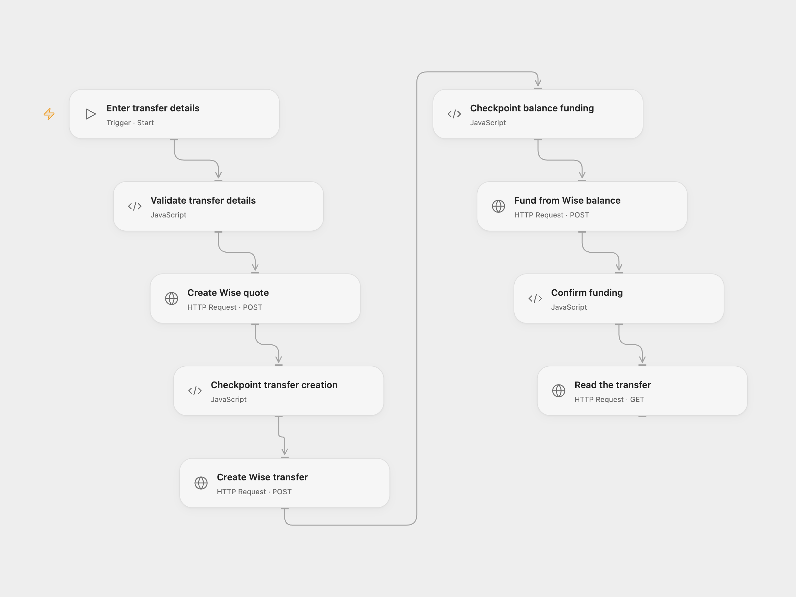

# Fund a Wise Transfer from Balance

Create a Wise quote and transfer, fund it from balance, and read its status.

<picture>
  <source media="(prefers-color-scheme: dark)" srcset="preview-dark.png">
  
</picture>

[Open Flow JSON](templates/fund-wise-transfer-from-balance.openflow.json) · [n8n JSON](templates/fund-wise-transfer-from-balance.n8n.json)

## Setup

This workflow sends money from a Wise balance when run. Use a Wise profile that permits API balance funding, a valid recipient account, sufficient balance and a supported currency route. Wise restricts personal-token funding by account region and may require strong customer authentication. Bind Secret Variable `WISE_API_TOKEN`, enable persistent State and prevent overlapping runs.

Start Open Flow manually with the profile and recipient IDs, positive source amount, three-letter source and target currencies, payment reference and a unique transaction UUID for this payment. For n8n, import the workflow, connect Wise, configure these values in **Configure payment**, create an n8n Data Table with text column `transaction_id`, and set its ID in the two checkpoint nodes. Activate only one format.

## Behavior

A manual run requests a quote, creates a transfer, funds it from the Wise balance, then reads that transfer. A completed funding response confirms funding, not final delivery to the recipient. No real payment is made by importing the template.

If creation or funding fails or the outcome is uncertain, inspect the Wise transfer before taking further action. The Open Flow transaction UUID and n8n Data Table checkpoint prevent automatic replay. Do not clear checkpoints or use a new UUID for an unresolved payment. If Wise requests additional authentication, complete the payment using Wise's supported authentication flow; this Open Flow template does not automate that challenge.

Inspiration &amp; credits

## Changes to the source

- Replace private profile and recipient IDs and sample payment details with required manual inputs.
- Add transaction checkpoints and require confirmed balance funding before retrieving status.

Adapted from [Create and execute a Wise transfer](https://github.com/Zie619/n8n-workflows/blob/ae8cf6dc5b873cbb4f74587aa9180ed3a9f70682/workflows/Wise/1229_Wise_Automate.json) in [Zie619/n8n-workflows](https://github.com/Zie619/n8n-workflows). The source export does not identify a separate template author or license.

The collection’s [MIT notice](https://github.com/Zie619/n8n-workflows/blob/94007c1445d9258a7da116646b79473e7c7c3282/LICENSE) is pinned at a later revision. This is the collection notice at that revision; it does not establish a separate original template author's license. Our changes are listed above; see [repository licensing](../../README.md#licensing).

> MIT License
>
> Copyright (c) 2025 Zie619
>
> Permission is hereby granted, free of charge, to any person obtaining a copy
> of this software and associated documentation files (the "Software"), to deal
> in the Software without restriction, including without limitation the rights
> to use, copy, modify, merge, publish, distribute, sublicense, and/or sell
> copies of the Software, and to permit persons to whom the Software is
> furnished to do so, subject to the following conditions:
>
> The above copyright notice and this permission notice shall be included in all
> copies or substantial portions of the Software.
>
> THE SOFTWARE IS PROVIDED "AS IS", WITHOUT WARRANTY OF ANY KIND, EXPRESS OR
> IMPLIED, INCLUDING BUT NOT LIMITED TO THE WARRANTIES OF MERCHANTABILITY,
> FITNESS FOR A PARTICULAR PURPOSE AND NONINFRINGEMENT. IN NO EVENT SHALL THE
> AUTHORS OR COPYRIGHT HOLDERS BE LIABLE FOR ANY CLAIM, DAMAGES OR OTHER
> LIABILITY, WHETHER IN AN ACTION OF CONTRACT, TORT OR OTHERWISE, ARISING FROM,
> OUT OF OR IN CONNECTION WITH THE SOFTWARE OR THE USE OR OTHER DEALINGS IN THE
> SOFTWARE.

