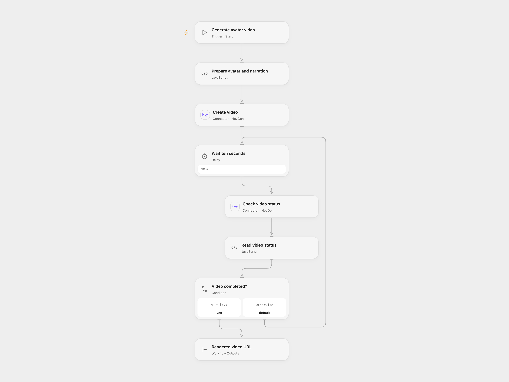

# Generate a HeyGen Avatar Video

Generate a narrated avatar video and return its finished URL.

<picture>
  <source media="(prefers-color-scheme: dark)" srcset="preview-dark.png">
  
</picture>

[Open Flow JSON](templates/generate-a-heygen-avatar-video.openflow.json) · [n8n JSON](templates/generate-a-heygen-avatar-video.n8n.json)

## Setup and use

Connect HeyGen and run with your avatar ID, voice ID and narration text. In n8n configure HTTP Header Auth with header name X-Api-Key and your HeyGen API key as its value and replace the IDs and text in Config. Use one format.

## Behavior

The workflow creates a captioned 1080×1920 video, checks its status every ten seconds and returns the video URL when complete. Open Flow stops when HeyGen reports failure; the n8n version keeps polling until completed, so stop a failed run manually. Video generation can incur charges. If the creation request has an unknown outcome, inspect HeyGen before retrying to avoid duplicate jobs.

Inspiration &amp; credits

## Changes to the source

- Open Flow uses the HeyGen connector, accepts configurable inputs and stops on a reported generation failure. The n8n request serializes narration safely and replaces source-specific identifiers.

Adapted from [Generate a HeyGen avatar video](https://github.com/Zie619/n8n-workflows/blob/ae8cf6dc5b873cbb4f74587aa9180ed3a9f70682/workflows/Manual/0770_Manual_Stickynote_Create_Webhook.json) in [Zie619/n8n-workflows](https://github.com/Zie619/n8n-workflows). The source export does not identify a separate template author or license.

The collection’s [MIT notice](https://github.com/Zie619/n8n-workflows/blob/94007c1445d9258a7da116646b79473e7c7c3282/LICENSE) is pinned at a later revision. This is the collection notice at that revision; it does not establish a separate original template author's license. Our changes are listed above; see [repository licensing](../../README.md#licensing).

> MIT License
>
> Copyright (c) 2025 Zie619
>
> Permission is hereby granted, free of charge, to any person obtaining a copy
> of this software and associated documentation files (the "Software"), to deal
> in the Software without restriction, including without limitation the rights
> to use, copy, modify, merge, publish, distribute, sublicense, and/or sell
> copies of the Software, and to permit persons to whom the Software is
> furnished to do so, subject to the following conditions:
>
> The above copyright notice and this permission notice shall be included in all
> copies or substantial portions of the Software.
>
> THE SOFTWARE IS PROVIDED "AS IS", WITHOUT WARRANTY OF ANY KIND, EXPRESS OR
> IMPLIED, INCLUDING BUT NOT LIMITED TO THE WARRANTIES OF MERCHANTABILITY,
> FITNESS FOR A PARTICULAR PURPOSE AND NONINFRINGEMENT. IN NO EVENT SHALL THE
> AUTHORS OR COPYRIGHT HOLDERS BE LIABLE FOR ANY CLAIM, DAMAGES OR OTHER
> LIABILITY, WHETHER IN AN ACTION OF CONTRACT, TORT OR OTHERWISE, ARISING FROM,
> OUT OF OR IN CONNECTION WITH THE SOFTWARE OR THE USE OR OTHER DEALINGS IN THE
> SOFTWARE.

