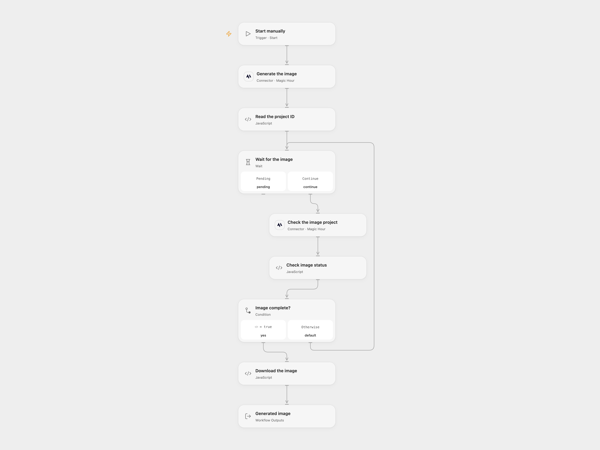

# Generate a Product Image with Magic Hour

Generate a product image, wait for it to finish and retrieve the file.

<picture>
  <source media="(prefers-color-scheme: dark)" srcset="preview-dark.png">
  
</picture>

[Open Flow JSON](templates/generate-a-product-image-with-magic-hour.openflow.json) · [n8n JSON](templates/generate-a-product-image-with-magic-hour.n8n.json)

## Setup

Connect Magic Hour in **Generate the image** and **Check the image project**. Replace the prompt in **Generate the image**. The template requests one square image with flux-2-klein at 640px. Allow the image download hostname in **Download the image**; the default is videos.magichour.ai and the returned URL may use another host.

In n8n, install the Magic Hour community node (the source used version 1.0.3), connect its API credential and replace the prompt in **Magic Hour**. Run either format manually.

## Behavior

The workflow creates one image project and waits 10 seconds between status checks. Open Flow makes at most 60 checks; request time can extend the run beyond 10 minutes. n8n polls for roughly 10 minutes. A completed image is downloaded. Open Flow returns the download URL, project ID and run-owned image artifact; the temporary vendor URL can expire. n8n returns the downloaded binary. Generated images may differ between runs; review the result.

Generation, polling or download failure stops the workflow. A lost response or timeout can occur after the project was created. Inspect Magic Hour and use the project ID in the execution before retrying; a new run creates another project. Open Flow accepts PNG or JPEG downloads up to 1 MiB, and its artifact is available to subsequent workflow steps. Restrict access to temporary URLs and generated content.

Inspiration &amp; credits

## Changes to the source

- Open Flow uses Magic Hour's formal create and project-status Actions with a visible polling loop and artifact download. It validates image bytes and returns the project ID and temporary URL.

Adapted from [Generate a product image with Magic Hour](https://github.com/enescingoz/awesome-n8n-templates/blob/827110332c21cbe000ab13f6d292d5adb1f1f8db/Other_Integrations_and_Use_Cases/Generate%20a%20product%20image%20with%20Magic%20Hour.json) in [enescingoz/awesome-n8n-templates](https://github.com/enescingoz/awesome-n8n-templates).

Source collection notice: © 2024–2026 Enes Cingoz, [CC BY 4.0](https://github.com/enescingoz/awesome-n8n-templates/blob/827110332c21cbe000ab13f6d292d5adb1f1f8db/LICENSE). The source includes a separate MIT notice for these workflows, reproduced below. See [repository licensing](../../README.md#licensing) for the scope of OOMOL contributions and third-party material.

[Magic Hour workflow license](https://github.com/enescingoz/awesome-n8n-templates/blob/827110332c21cbe000ab13f6d292d5adb1f1f8db/docs/Magic%20Hour%20workflow%20license.txt):

> MIT License
>
> Copyright (c) 2025 Magic Hour AI
>
> Permission is hereby granted, free of charge, to any person obtaining a copy
> of this software and associated documentation files (the "Software"), to deal
> in the Software without restriction, including without limitation the rights
> to use, copy, modify, merge, publish, distribute, sublicense, and/or sell
> copies of the Software, and to permit persons to whom the Software is
> furnished to do so, subject to the following conditions:
>
> The above copyright notice and this permission notice shall be included in all
> copies or substantial portions of the Software.
>
> THE SOFTWARE IS PROVIDED "AS IS", WITHOUT WARRANTY OF ANY KIND, EXPRESS OR
> IMPLIED, INCLUDING BUT NOT LIMITED TO THE WARRANTIES OF MERCHANTABILITY,
> FITNESS FOR A PARTICULAR PURPOSE AND NONINFRINGEMENT. IN NO EVENT SHALL THE
> AUTHORS OR COPYRIGHT HOLDERS BE LIABLE FOR ANY CLAIM, DAMAGES OR OTHER
> LIABILITY, WHETHER IN AN ACTION OF CONTRACT, TORT OR OTHERWISE, ARISING FROM,
> OUT OF OR IN CONNECTION WITH THE SOFTWARE OR THE USE OR OTHER DEALINGS IN THE
> SOFTWARE.

