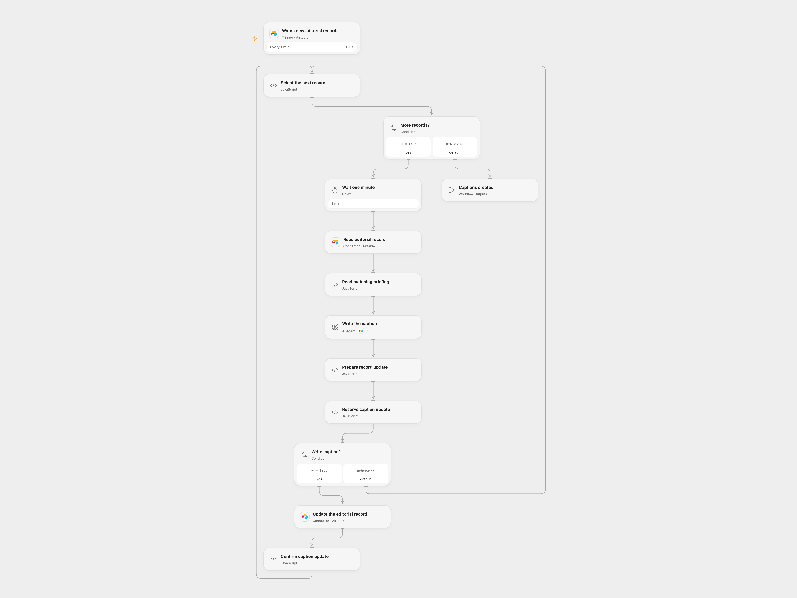

# Generate Airtable Editorial Captions with Background

Create Instagram captions for new Airtable editorial records using audience background.

<!-- template-actions:start -->
 
<!-- template-actions:end -->

<picture>
  <source media="(prefers-color-scheme: dark)" srcset="preview-dark.png">
  
</picture>

## Setup

Connect Airtable and configure the same base and editorial table in the trigger, read and update nodes. Configure the background table and record in the Agent tool. The editorial table needs created_at, Briefing, SoMe_Text_KI, Posten and Werbeanzeige fields. Configure a tool-capable model with access to gpt-5.4-mini. Enable persistent State and prevent overlapping executions. In n8n configure the same tables, background record, model and a Data Table with item_key and status columns. Activate one format.

## Behavior

Every minute the workflow processes new records, waits one minute, reads the briefing, asks the Agent to consult the audience background and writes the resulting caption to the same record while setting both checkboxes false. Open Flow processes batch records sequentially, so later records wait longer. Its initial Airtable query establishes a baseline; records created during that query can be absorbed into it. Review captions before publication. Briefing and background data go to the configured model and may appear in execution history.

If an update is uncertain, inspect the Airtable record before resolving its pending State or Data Table entry. Do not replay an unresolved update.

Inspiration &amp; credits

Original workflow by [Friedemann Schuetz](https://www.linkedin.com/in/friedemann-schuetz/).

Adapted from [AI Social Media Caption Creator creates social media post captions in Airtable](https://github.com/enescingoz/awesome-n8n-templates/blob/827110332c21cbe000ab13f6d292d5adb1f1f8db/OpenAI_and_LLMs/AI%20Social%20Media%20Caption%20Creator%20creates%20social%20media%20post%20captions%20in%20Airtable.json) in [enescingoz/awesome-n8n-templates](https://github.com/enescingoz/awesome-n8n-templates).

Source collection notice: © 2024–2026 Enes Cingoz, [CC BY 4.0](https://github.com/enescingoz/awesome-n8n-templates/blob/827110332c21cbe000ab13f6d292d5adb1f1f8db/LICENSE). The source export does not identify a separate template author or license. See [repository licensing](../../README.md#licensing) for the scope of OOMOL contributions and third-party material.

