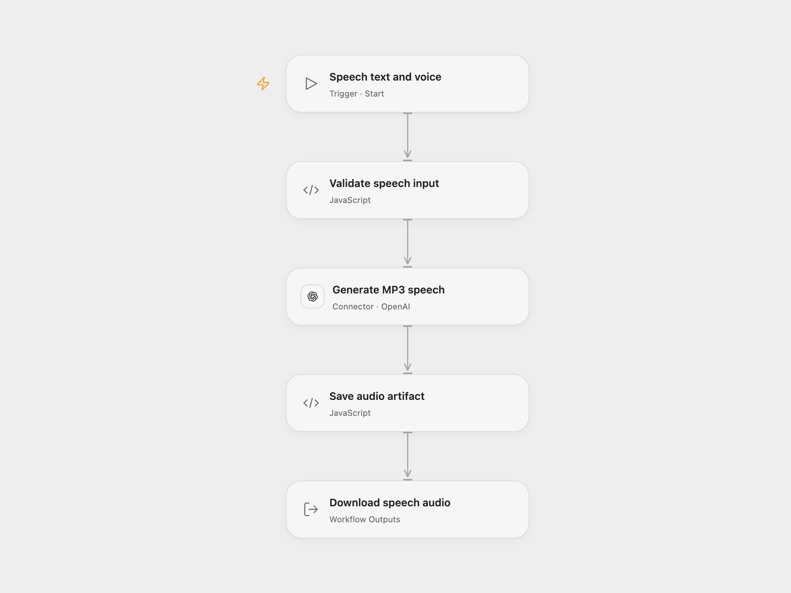

# Generate an OpenAI Speech MP3

Convert text into an MP3 using OpenAI speech synthesis.

<picture>
  <source media="(prefers-color-scheme: dark)" srcset="preview-dark.png">
  
</picture>

[Open Flow JSON](templates/generate-an-openai-speech-mp3.openflow.json) · [n8n JSON](templates/generate-an-openai-speech-mp3.n8n.json)

## Setup and use

Connect OpenAI in **Generate MP3 speech**. Run Open Flow with text and a voice; the source example is `The quick brown fox jumped over the lazy dog.` with `alloy`. In n8n, edit **Set input text and TTS voice** and connect an OpenAI credential to the HTTP node. Input is limited to 4,096 characters.

## Behavior

One request sends the text to `tts-1` and returns MP3 audio. Open Flow produces a downloadable `speech.mp3` artifact; n8n returns binary `data`. Failed synthesis or invalid audio stops the run. If you share the recording, disclose that the voice is AI-generated.

OpenAI has [announced the shutdown of `tts-1` on January 6, 2027](https://developers.openai.com/api/docs/guides/text-to-speech). The recommended Realtime API replacement uses a different workflow.

Inspiration &amp; credits

## Changes to the source

- Remove the redundant literal Authorization header; use the OpenAI connection instead.
- Validate input and MP3 output, correct the source's input limit and preserve the audio as a downloadable artifact.

Adapted from [Text to Speech (OpenAI)](https://github.com/Zie619/n8n-workflows/blob/ae8cf6dc5b873cbb4f74587aa9180ed3a9f70682/workflows/Manual/1105_Manual_Stickynote_Automation_Webhook.json) in [Zie619/n8n-workflows](https://github.com/Zie619/n8n-workflows). The source export does not identify a separate template author or license.

The collection’s [MIT notice](https://github.com/Zie619/n8n-workflows/blob/94007c1445d9258a7da116646b79473e7c7c3282/LICENSE) is pinned at a later revision. This is the collection notice at that revision; it does not establish a separate original template author's license. Our changes are listed above; see [repository licensing](../../README.md#licensing).

> MIT License
>
> Copyright (c) 2025 Zie619
>
> Permission is hereby granted, free of charge, to any person obtaining a copy
> of this software and associated documentation files (the "Software"), to deal
> in the Software without restriction, including without limitation the rights
> to use, copy, modify, merge, publish, distribute, sublicense, and/or sell
> copies of the Software, and to permit persons to whom the Software is
> furnished to do so, subject to the following conditions:
>
> The above copyright notice and this permission notice shall be included in all
> copies or substantial portions of the Software.
>
> THE SOFTWARE IS PROVIDED "AS IS", WITHOUT WARRANTY OF ANY KIND, EXPRESS OR
> IMPLIED, INCLUDING BUT NOT LIMITED TO THE WARRANTIES OF MERCHANTABILITY,
> FITNESS FOR A PARTICULAR PURPOSE AND NONINFRINGEMENT. IN NO EVENT SHALL THE
> AUTHORS OR COPYRIGHT HOLDERS BE LIABLE FOR ANY CLAIM, DAMAGES OR OTHER
> LIABILITY, WHETHER IN AN ACTION OF CONTRACT, TORT OR OTHERWISE, ARISING FROM,
> OUT OF OR IN CONNECTION WITH THE SOFTWARE OR THE USE OR OTHER DEALINGS IN THE
> SOFTWARE.

