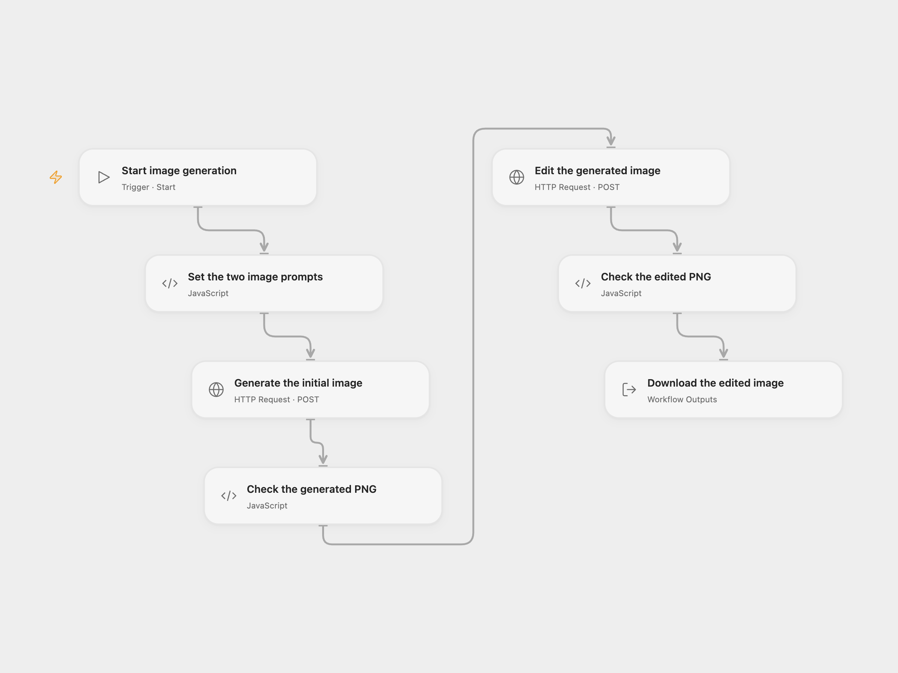

# Generate and Edit an OpenAI Image

Generate an image from one prompt, edit the same image with a second prompt, and download the edited PNG.

<!-- template-actions:start -->
 
<!-- template-actions:end -->

<picture>
  <source media="(prefers-color-scheme: dark)" srcset="preview-dark.png">
  
</picture>

## Setup

1. Create an OpenAI API key with GPT Image 2.5 Sunburst access. Store it in the secret variable `OPENAI_API_KEY` and bind the variable to the bearer token input in both image requests.
2. In **Set the two image prompts**, describe the initial image and the changes to make to that image.
3. Run the workflow manually. Download `edited.png` from **Download the edited image**.

## Behavior

The workflow generates one 1024 × 1024 PNG. It then sends those image bytes with the edit prompt in a multipart request and returns the edited 1024 × 1024 PNG. The edit requests high quality. The workflow uses the standard moderation setting and stops if either request fails or returns invalid image data.

Both API responses pass through Run Artifacts. The hosted runtime accepts up to 10 MiB per response artifact, including the Base64 encoding and JSON. Each decoded PNG can be up to 7,500,000 bytes. The workflow also checks the image format and dimensions before passing it to the next step.

In n8n

Select the same OpenAI credential in **Generate the initial image** and **Edit the generated image**. Set both prompts in **Set the two image prompts** and run manually. Download `edited.png` from the binary `data` output of **Prepare the edited PNG**.

Inspiration &amp; credits

Adapted from [Generate and Edit Images with OpenAI’s GPT-Image-1 Model](https://github.com/Zie619/n8n-workflows/blob/ae8cf6dc5b873cbb4f74587aa9180ed3a9f70682/workflows/Manual/0887_Manual_Stickynote_Create_Webhook.json) in [Zie619/n8n-workflows](https://github.com/Zie619/n8n-workflows). Attribution: Edoardo Guzzi (original workflow) / Zie619 (collection). See the [original n8n gallery template](https://n8n.io/workflows/3696-generate-and-edit-images-with-openais-gpt-image-1-model/).

## Changes to the source

Both image requests use `gpt-image-2.5-sunburst` after the retirement of the original GPT Image 1 model. [OpenAI image generation guide](https://developers.openai.com/api/docs/guides/image-generation)

The collection’s [MIT notice](https://github.com/Zie619/n8n-workflows/blob/94007c1445d9258a7da116646b79473e7c7c3282/LICENSE) is pinned at a later revision. This is the collection notice at that revision; it does not establish a separate original template author's license. Our changes are listed above; see [repository licensing](../../README.md#licensing).

> MIT License
>
> Copyright (c) 2025 Zie619
>
> Permission is hereby granted, free of charge, to any person obtaining a copy
> of this software and associated documentation files (the "Software"), to deal
> in the Software without restriction, including without limitation the rights
> to use, copy, modify, merge, publish, distribute, sublicense, and/or sell
> copies of the Software, and to permit persons to whom the Software is
> furnished to do so, subject to the following conditions:
>
> The above copyright notice and this permission notice shall be included in all
> copies or substantial portions of the Software.
>
> THE SOFTWARE IS PROVIDED "AS IS", WITHOUT WARRANTY OF ANY KIND, EXPRESS OR
> IMPLIED, INCLUDING BUT NOT LIMITED TO THE WARRANTIES OF MERCHANTABILITY,
> FITNESS FOR A PARTICULAR PURPOSE AND NONINFRINGEMENT. IN NO EVENT SHALL THE
> AUTHORS OR COPYRIGHT HOLDERS BE LIABLE FOR ANY CLAIM, DAMAGES OR OTHER
> LIABILITY, WHETHER IN AN ACTION OF CONTRACT, TORT OR OTHERWISE, ARISING FROM,
> OUT OF OR IN CONNECTION WITH THE SOFTWARE OR THE USE OR OTHER DEALINGS IN THE
> SOFTWARE.

