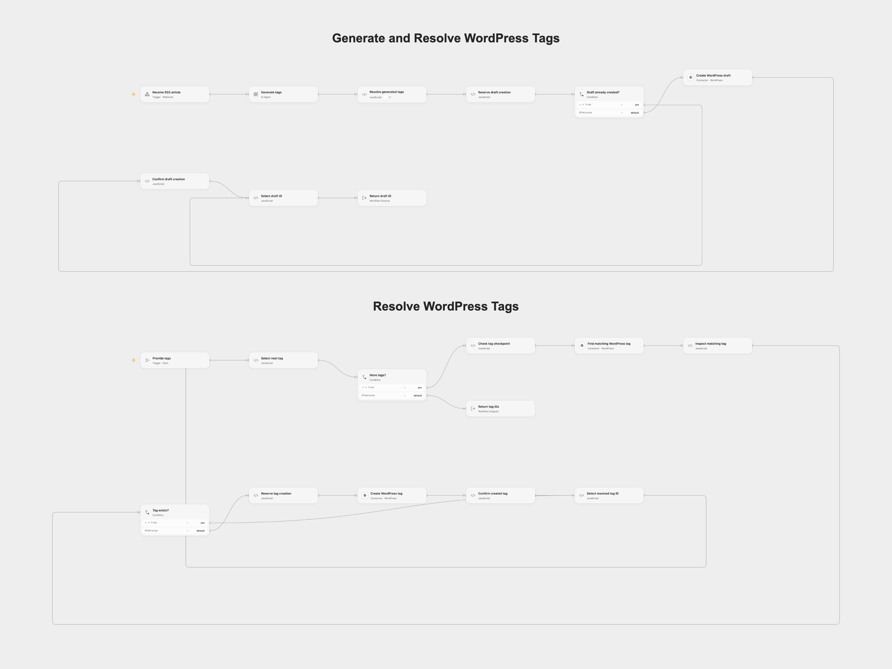

# Generate and Resolve WordPress Tags

Resolve article tags in WordPress and create a tagged draft from RSS content.

<picture>
  <source media="(prefers-color-scheme: dark)" srcset="preview-dark.png">
  
</picture>

[Open Flow JSON](templates/generate-and-resolve-wordpress-tags.openflow.json) · [n8n JSON](templates/generate-and-resolve-wordpress-tags.n8n.json)

## Setup

Import both Open Flow workflows, connect WordPress to both actions in Resolve WordPress Tags and the draft action, publish the worker, and refresh the Resolve generated tags capability in the main workflow. Set the feed URL in the n8n RSS frontend and its Open Flow webhook URL. Configure a model and persistent State. In n8n set the same workflow ID in Auto-Tag Posts in WordPress, configure the WordPress site URL and credentials, and create a Data Table with item_key and status text fields for both tag and post checkpoints. Choose one RSS trigger and set its feed URL. The Open Flow webhook accepts id, title and content; restrict it to trusted senders.

## Behavior

The callable worker accepts one or more tag names, finds matching WordPress slugs, creates missing tags and returns their IDs. The RSS demo uses each entry’s GUID or link as its stable ID, generates tags from its title and content, and creates a tagged draft. A pending tag or post checkpoint blocks a retry after an uncertain write. Inspect WordPress before clearing a checkpoint. Do not overlap runs.

Inspiration &amp; credits

## Changes to the source

- Resolve each requested slug individually, preserve the RSS and callable paths, and add persistent checkpoints around uncertain writes.
- Replace the original external subworkflow ID and example WordPress site with user configuration.

Adapted from [Auto-Tag Blog Posts in WordPress with AI](https://github.com/enescingoz/awesome-n8n-templates/blob/827110332c21cbe000ab13f6d292d5adb1f1f8db/WordPress/Auto-Tag%20Blog%20Posts%20in%20WordPress%20with%20AI.json) in [enescingoz/awesome-n8n-templates](https://github.com/enescingoz/awesome-n8n-templates).

Source collection notice: © 2024–2026 Enes Cingoz, [CC BY 4.0](https://github.com/enescingoz/awesome-n8n-templates/blob/827110332c21cbe000ab13f6d292d5adb1f1f8db/LICENSE). Original workflow by Ludwig Gerdes; the source does not state a separate license. See [repository licensing](../../README.md#licensing) for the scope of OOMOL contributions and third-party material.

