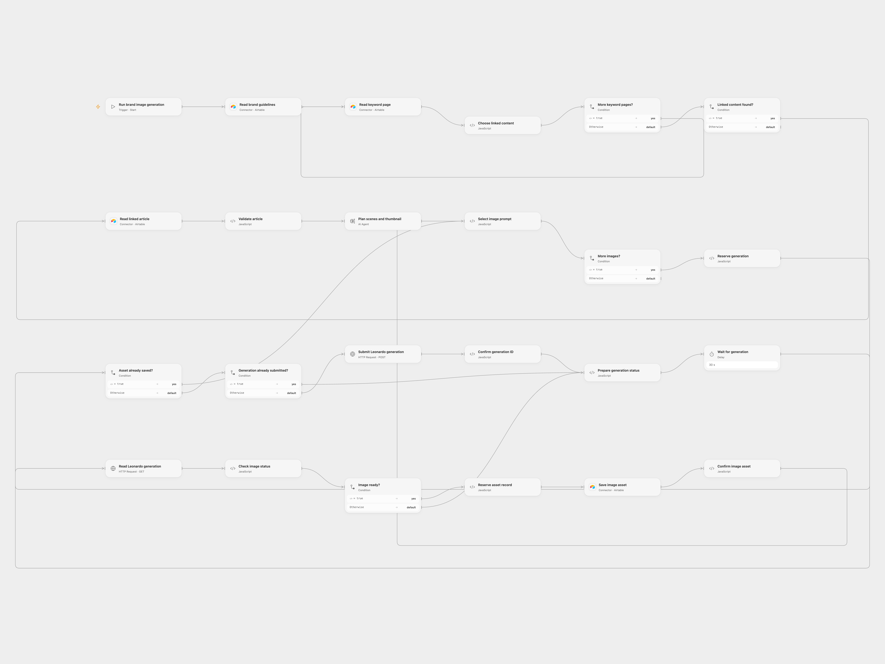

# Generate Brand Scene and Thumbnail Images

Turn a linked blog post and brand guidelines into four scene images and a thumbnail.

<!-- template-actions:start -->
[](https://openflow.run/templates/generate-brand-scene-and-thumbnail-images/) [](templates/generate-brand-scene-and-thumbnail-images.n8n.json)
<!-- template-actions:end -->

<picture>
  <source media="(prefers-color-scheme: dark)" srcset="preview-dark.png">
  
</picture>

## Setup

Connect Airtable, configure brand, keyword, content and asset tables and an AI model. The keyword table needs Keyword and RelatedContent linked record IDs; the content table needs Title and Content. The asset table needs Asset URL, Asset Name and Asset Type. The first brand record provides the guidelines. Set the keyword filter and a Leonardo API key. Leonardo API requires a separate account with credits. Open Flow uses a secret variable LEONARDO_API_KEY and persistent State. In n8n configure a Header Auth credential with Authorization: Bearer followed by your Leonardo key on both HTTP nodes and a Data Table with item_key and status columns.

## Behavior

The manual run selects the first linked article for a matching keyword, drafts four short scenes and a thumbnail, and generates five 720×1280 images. It saves each image URL in Airtable, with scene scripts in the asset names. Review generated content before use. Prevent overlapping runs. If a submission or asset write has an uncertain outcome, inspect Leonardo or Airtable before clearing its pending checkpoint. Open Flow polls every 30 seconds up to 20 times; rerun to continue a submitted generation. n8n checks once after 30 seconds and leaves its checkpoint pending if the image is not ready; inspect the execution and Leonardo before recovery.

<details>
<summary>Inspiration &amp; credits</summary>

Adapted from [Generate 9_16 Images from Content and Brand Guidelines](https://github.com/enescingoz/awesome-n8n-templates/blob/827110332c21cbe000ab13f6d292d5adb1f1f8db/OpenAI_and_LLMs/Generate%209_16%20Images%20from%20Content%20and%20Brand%20Guidelines.json) in [enescingoz/awesome-n8n-templates](https://github.com/enescingoz/awesome-n8n-templates).

Source collection notice: © 2024–2026 Enes Cingoz, [CC BY 4.0](https://github.com/enescingoz/awesome-n8n-templates/blob/827110332c21cbe000ab13f6d292d5adb1f1f8db/LICENSE). The source export credits [Alex Kim (AlexK1919)](https://n8n.io/creators/alexk1919); it does not identify a separate template license. See [repository licensing](../../README.md#licensing) for the scope of OOMOL contributions and third-party material.


Changes from source: Use linked content from a configurable content table, apply the retrieved brand guidelines, use structured scene prompts, generate exact 9:16 images, poll for completion and checkpoint generation and asset writes.

Collection license notice:

```text
Creative Commons Attribution 4.0 International License

Copyright (c) 2024-2026 Enes Cingoz

You are free to:

  Share - copy and redistribute the material in any medium or format
  Adapt - remix, transform, and build upon the material for any purpose,
  even commercially.

Under the following terms:

  Attribution - You must give appropriate credit, provide a link to the
  license, and indicate if changes were made. You may do so in any
  reasonable manner, but not in any way that suggests the licensor
  endorses you or your use.

  No additional restrictions - You may not apply legal terms or
  technological measures that legally restrict others from doing
  anything the license permits.

Notices:

  You do not have to comply with the license for elements of the
  material in the public domain or where your use is permitted by an
  applicable exception or limitation.

  No warranties are given. The license may not give you all of the
  permissions necessary for your intended use. For example, other rights
  such as publicity, privacy, or moral rights may limit how you use the
  material.

For the full license text, see:
https://creativecommons.org/licenses/by/4.0/legalcode

```

</details>
