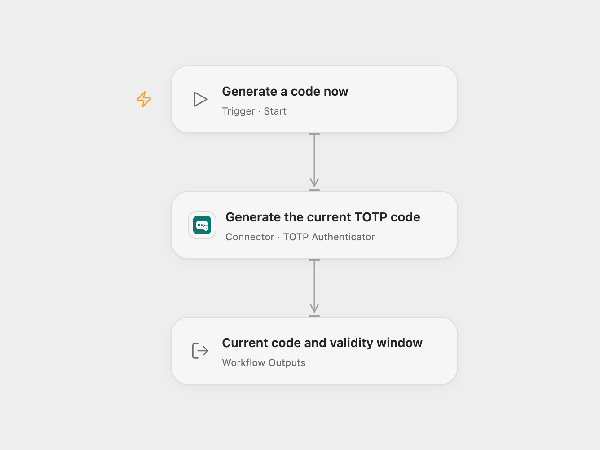

# Generate a Current TOTP Code

Run the workflow manually to generate the current six-digit time-based one-time password for an existing account.

<picture>
  <source media="(prefers-color-scheme: dark)" srcset="preview-dark.png">
  
</picture>

[Open Flow JSON](templates/generate-current-totp-code.openflow.json) · [n8n JSON](templates/generate-current-totp-code.n8n.json)

## Setup

In Open Flow, connect **Generate the current TOTP code** to a **TOTP Authenticator** Connection. Set its website URL, username and existing Base32 TOTP secret. The website and username identify the configured account; generation does not contact that website. The secret is stored in the Connection and is not included in the template or returned outputs.

In n8n, select **TOTP API** credentials and enter the same Base32 secret. Its optional Label uses `issuer:username`, for example `Example:alice`. Keep the native **Generate Secret** operation, **SHA1**, **6** digits and a **30**-second period. Despite that native operation label, this workflow generates a current code from your existing secret; it does not create, rotate or reveal a secret or provision a new account.

Both formats use the execution server’s clock. Keep that clock synchronized with the account’s authentication service. The account must use these same algorithm, digit and period settings.

## Use

Run **Generate a code now** in Open Flow or run the manual trigger in n8n. The workflow generates one code and returns immediately. Preserve the code as text so leading zeroes remain present. Runs within the same 30-second window normally return the same code. There is no timer, automatic refresh, login attempt or code-verification step.

Open Flow returns **Code**, its UTC **Expires At** timestamp, **Remaining Seconds**, **Website** and **Username**. Remaining Seconds rounds the lifetime up to a whole second. n8n returns `token` and `secondsRemaining`; its native lifetime is rounded down and can be `0` just before expiry. These values are snapshots at generation time and do not count down after the run. Use a fresh code if the remaining window is too short.

An output confirms generation, not acceptance by the account’s service. Do not publish or share run outputs containing a usable code. Restrict access to the workflow and its run history. Invalid credentials or generation failure stop the run; no replacement secret or guessed code is returned. No workflow retry is added.

## Changes to the source

- Restore the complete manual trigger → TOTP generation and remove private credential/instance identifiers.
- Make the source’s SHA-1, six-digit and 30-second defaults explicit in n8n.
- Use Open Flow’s formal TOTP Authenticator Action and retain its full current-code/validity/account output.

Source and license

Adapted from [Manual TOTP code generation](https://github.com/Zie619/n8n-workflows/blob/ae8cf6dc5b873cbb4f74587aa9180ed3a9f70682/workflows/Manual/0002_Manual_Totp_Automation_Triggered.json) in [Zie619/n8n-workflows](https://github.com/Zie619/n8n-workflows). The source export does not identify a separate template author or license.

The collection’s [MIT notice](https://github.com/Zie619/n8n-workflows/blob/94007c1445d9258a7da116646b79473e7c7c3282/LICENSE) is pinned at a later revision. This is the collection notice at that revision; it does not establish a separate original template author's license. Our changes are listed above; see [repository licensing](../../README.md#licensing).

> MIT License
>
> Copyright (c) 2025 Zie619
>
> Permission is hereby granted, free of charge, to any person obtaining a copy
> of this software and associated documentation files (the "Software"), to deal
> in the Software without restriction, including without limitation the rights
> to use, copy, modify, merge, publish, distribute, sublicense, and/or sell
> copies of the Software, and to permit persons to whom the Software is
> furnished to do so, subject to the following conditions:
>
> The above copyright notice and this permission notice shall be included in all
> copies or substantial portions of the Software.
>
> THE SOFTWARE IS PROVIDED "AS IS", WITHOUT WARRANTY OF ANY KIND, EXPRESS OR
> IMPLIED, INCLUDING BUT NOT LIMITED TO THE WARRANTIES OF MERCHANTABILITY,
> FITNESS FOR A PARTICULAR PURPOSE AND NONINFRINGEMENT. IN NO EVENT SHALL THE
> AUTHORS OR COPYRIGHT HOLDERS BE LIABLE FOR ANY CLAIM, DAMAGES OR OTHER
> LIABILITY, WHETHER IN AN ACTION OF CONTRACT, TORT OR OTHERWISE, ARISING FROM,
> OUT OF OR IN CONNECTION WITH THE SOFTWARE OR THE USE OR OTHER DEALINGS IN THE
> SOFTWARE.

