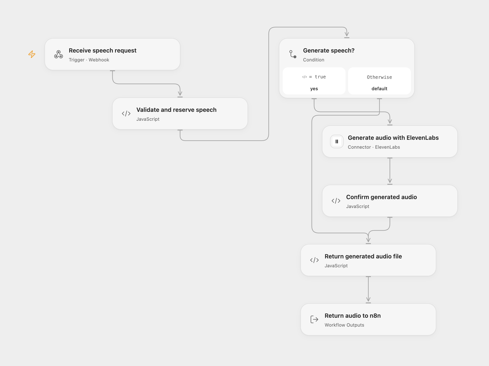

# Generate Speech with ElevenLabs

Generate speech from text and return the audio bytes.

<picture>
  <source media="(prefers-color-scheme: dark)" srcset="preview-dark.png">
  
</picture>

[Open Flow JSON](templates/generate-elevenlabs-speech-from-webhook.openflow.json) · [n8n JSON](templates/generate-elevenlabs-speech-from-webhook.n8n.json)

## Setup

Configure an ElevenLabs connection with access to eleven_multilingual_v2 and the selected voice. In n8n configure Header Auth with xi-api-key, choose n8n or Open Flow mode and set its webhook URL. Configure a Data Table with item_key and status columns and enable persistent State for Open Flow. Restrict webhook access; requests use your ElevenLabs account.

## Use

POST JSON with voice_id, text and a unique request_id. The n8n endpoint returns MP3 audio bytes. Open Flow synthesizes the audio and n8n downloads its transit file for the response. Open Flow transit URLs are public to anyone with the link; use only content suitable for that exposure. Text is sent to ElevenLabs. The model supports up to 10,000 characters per request.

A pending generation may have succeeded; inspect ElevenLabs and the pending State or Data Table row before retrying. Open Flow returns the same recorded transit file for the same ID and inputs after success while that URL remains valid. Prevent overlapping requests with the same ID.

Inspiration &amp; credits

Original workflow by The n8Ninja.

Adapted from [Generate Text-to-Speech Using Elevenlabs via API](https://github.com/enescingoz/awesome-n8n-templates/blob/827110332c21cbe000ab13f6d292d5adb1f1f8db/OpenAI_and_LLMs/Generate%20Text-to-Speech%20Using%20Elevenlabs%20via%20API.json) in [enescingoz/awesome-n8n-templates](https://github.com/enescingoz/awesome-n8n-templates).

Source collection notice: © 2024–2026 Enes Cingoz, [CC BY 4.0](https://github.com/enescingoz/awesome-n8n-templates/blob/827110332c21cbe000ab13f6d292d5adb1f1f8db/LICENSE). The source export does not identify a separate template author or license. See [repository licensing](../../README.md#licensing) for the scope of OOMOL contributions and third-party material.

