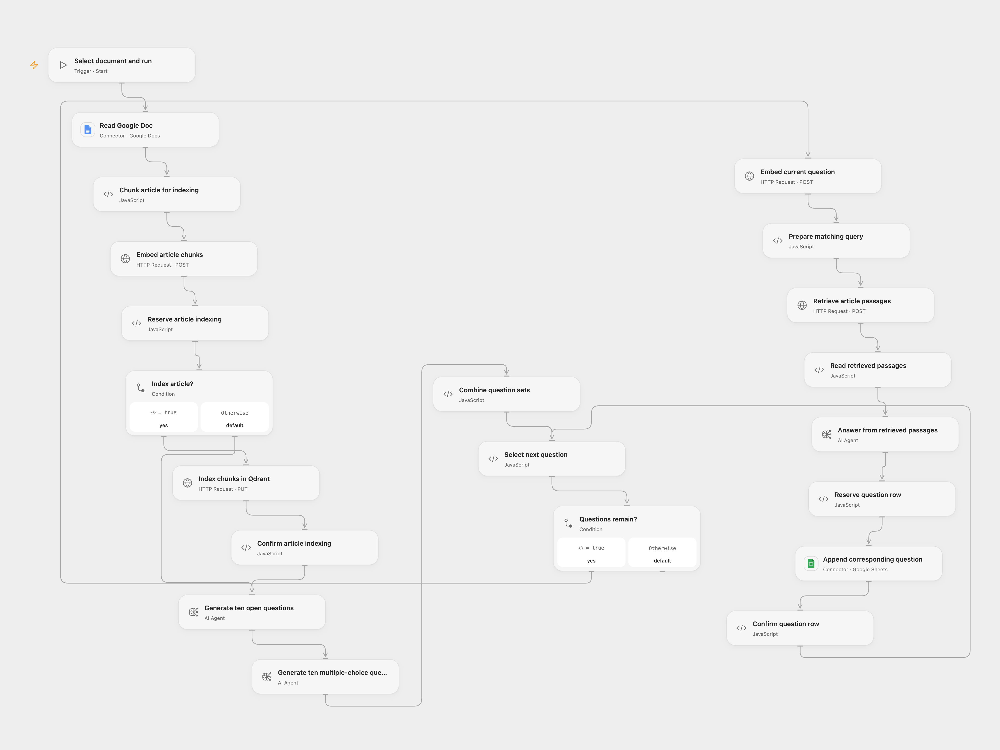

# Generate Exam Questions from Google Docs

Generate grounded open and multiple-choice exam questions from a Google Doc.

<picture>
  <source media="(prefers-color-scheme: dark)" srcset="preview-dark.png">
  
</picture>

[Open Flow JSON](templates/generate-exam-questions-from-google-docs.openflow.json) · [n8n JSON](templates/generate-exam-questions-from-google-docs.n8n.json)

## Setup

Configure Qdrant 1.10 or newer with a dedicated collection using 1536-dimensional cosine vectors, Google Docs and Sheets connections, OPENAI_API_KEY, QDRANT_API_KEY and persistent State. Enter the Qdrant URL and collection in both index and query preparation nodes, and the workbook and sheet ranges in **Select next question**. The workbook needs an Open questions sheet with QUESTION and ANSWER columns and a Closed questions sheet with QUESTION, ANSWER A–D and CORRECT columns. Run Open Flow with the document ID and a new unique UUID run ID. Prevent overlapping runs with the same ID. Open Flow uses HTTPS and bearer authentication for Qdrant. Code inputs and outputs must fit 1 MiB.

For n8n, configure the document ID, workbook, both sheet names, three Qdrant collection nodes, Qdrant Header Auth and refresh URL, OpenAI embeddings and Gemini credentials. Create a Data Table with text columns item_key, status and payload and select it on each checkpoint node. Set a new unique run ID in **Configure exam run**. Use a dedicated collection and prevent overlapping runs on it: n8n clears the collection before indexing. Finish or explicitly abandon a run before starting another; do not resume an older run after the collection has been refreshed for a newer run. If a checkpoint remains pending, inspect the matching Qdrant operation or sheet row; after confirming success set its Data Table status to done, or delete that pending row only after verifying the operation was absent. Retry the same run ID.

## Behavior

The document is split into overlapping character chunks, embedded, and indexed before either question set is generated. Twenty questions are processed one at a time, using matching passages from the current run to draft an answer. The two result types are appended to separate sheets. n8n stores each generated question set so resuming a run keeps the same questions. Review all questions, answers and distractors before use. The source token splitter uses 450-token chunks and 50-token overlap; this version uses 1600-character chunks and 200-character overlap. Open Flow reads plain document text and does not retain the source's Markdown styling. Open Flow uses text-embedding-3-small; n8n retains its configured OpenAI embedding model.

The source clears its configured collection before indexing. Open Flow isolates each run using a payload filter and does not clear other records; remove old runs as needed. If indexing or a row append has an unknown result, inspect Qdrant or the corresponding sheet. Set the displayed pending key and confirmed or absent in **Reserve article indexing** or **Select next question** before retrying. Clear those fields after recovery. Do not retry until the service result is known.

Inspiration &amp; credits

Adapted from [Auto-Generate Exam Questions from Google Docs with AI](https://github.com/Zie619/n8n-workflows/blob/ae8cf6dc5b873cbb4f74587aa9180ed3a9f70682/workflows/Googledocs/1134_Googledocs_Code_Create_Webhook.json) in [Zie619/n8n-workflows](https://github.com/Zie619/n8n-workflows). The source export does not identify a separate template author or license.

The collection’s [MIT notice](https://github.com/Zie619/n8n-workflows/blob/94007c1445d9258a7da116646b79473e7c7c3282/LICENSE) is pinned at a later revision. This is the collection notice at that revision; it does not establish a separate original template author's license. Our changes are listed above; see [repository licensing](../../README.md#licensing).

> MIT License
>
> Copyright (c) 2025 Zie619
>
> Permission is hereby granted, free of charge, to any person obtaining a copy
> of this software and associated documentation files (the "Software"), to deal
> in the Software without restriction, including without limitation the rights
> to use, copy, modify, merge, publish, distribute, sublicense, and/or sell
> copies of the Software, and to permit persons to whom the Software is
> furnished to do so, subject to the following conditions:
>
> The above copyright notice and this permission notice shall be included in all
> copies or substantial portions of the Software.
>
> THE SOFTWARE IS PROVIDED "AS IS", WITHOUT WARRANTY OF ANY KIND, EXPRESS OR
> IMPLIED, INCLUDING BUT NOT LIMITED TO THE WARRANTIES OF MERCHANTABILITY,
> FITNESS FOR A PARTICULAR PURPOSE AND NONINFRINGEMENT. IN NO EVENT SHALL THE
> AUTHORS OR COPYRIGHT HOLDERS BE LIABLE FOR ANY CLAIM, DAMAGES OR OTHER
> LIABILITY, WHETHER IN AN ACTION OF CONTRACT, TORT OR OTHERWISE, ARISING FROM,
> OUT OF OR IN CONNECTION WITH THE SOFTWARE OR THE USE OR OTHER DEALINGS IN THE
> SOFTWARE.

