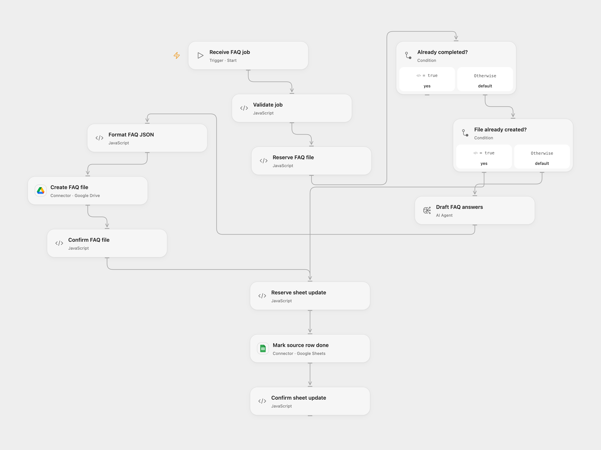

# Generate FAQ JSON for an Integration Row

Generate an integration FAQ JSON file and mark its source sheet row done.

<!-- template-actions:start -->
[](https://openflow.run/templates/generate-faq-json-for-integration-rows/) [](templates/generate-faq-json-for-integration-rows.n8n.json)
<!-- template-actions:end -->

<picture>
  <source media="(prefers-color-scheme: dark)" srcset="preview-dark.png">
  
</picture>

## Setup

Connect Google Drive and Sheets, configure an AI model and persistent State. Run with a name, kind, sheet name, row number, status column letter, spreadsheet ID and destination folder ID, and a reviewed pricing answer. Kind must be Single Integration Native, Single Integration Cred-only, Single Integration Non-native or Categories.

## Behavior

The callable component drafts four FAQ answers, includes the supplied pricing answer, saves a JSON file in the specified Drive folder and writes done to the specified row's status cell. Review generated answers against the integration documentation before publishing. The original spreadsheet-scanning parent is not included; call the component once per intended row. Prevent overlapping runs. After an uncertain Drive or Sheets write, inspect the destination before clearing the pending checkpoint.

<details>
<summary>In n8n</summary>

The corresponding n8n workflow uses an Execute Workflow trigger, a source sheet with a status header at the supplied column, and a Data Table with item_key and status columns.

</details>

<details>
<summary>Inspiration &amp; credits</summary>

Adapted from [Enrich FAQ sections on your website pages at scale with AI](https://github.com/enescingoz/awesome-n8n-templates/blob/827110332c21cbe000ab13f6d292d5adb1f1f8db/OpenAI_and_LLMs/Enrich%20FAQ%20sections%20on%20your%20website%20pages%20at%20scale%20with%20AI.json) in [enescingoz/awesome-n8n-templates](https://github.com/enescingoz/awesome-n8n-templates).

Source collection notice: © 2024–2026 Enes Cingoz, [CC BY 4.0](https://github.com/enescingoz/awesome-n8n-templates/blob/827110332c21cbe000ab13f6d292d5adb1f1f8db/LICENSE). The source export does not identify a separate template author or license. See [repository licensing](../../README.md#licensing) for the scope of OOMOL contributions and third-party material.

Changes from source: Publish the callable row-processing component, consolidate AI completions into a structured draft, replace the source's fixed pricing claims with a user-supplied pricing answer, and add write checkpoints.

Collection license notice:

```text
Creative Commons Attribution 4.0 International License

Copyright (c) 2024-2026 Enes Cingoz

You are free to:

  Share - copy and redistribute the material in any medium or format
  Adapt - remix, transform, and build upon the material for any purpose,
  even commercially.

Under the following terms:

  Attribution - You must give appropriate credit, provide a link to the
  license, and indicate if changes were made. You may do so in any
  reasonable manner, but not in any way that suggests the licensor
  endorses you or your use.

  No additional restrictions - You may not apply legal terms or
  technological measures that legally restrict others from doing
  anything the license permits.

Notices:

  You do not have to comply with the license for elements of the
  material in the public domain or where your use is permitted by an
  applicable exception or limitation.

  No warranties are given. The license may not give you all of the
  permissions necessary for your intended use. For example, other rights
  such as publicity, privacy, or moral rights may limit how you use the
  material.

For the full license text, see:
https://creativecommons.org/licenses/by/4.0/legalcode

```

</details>
