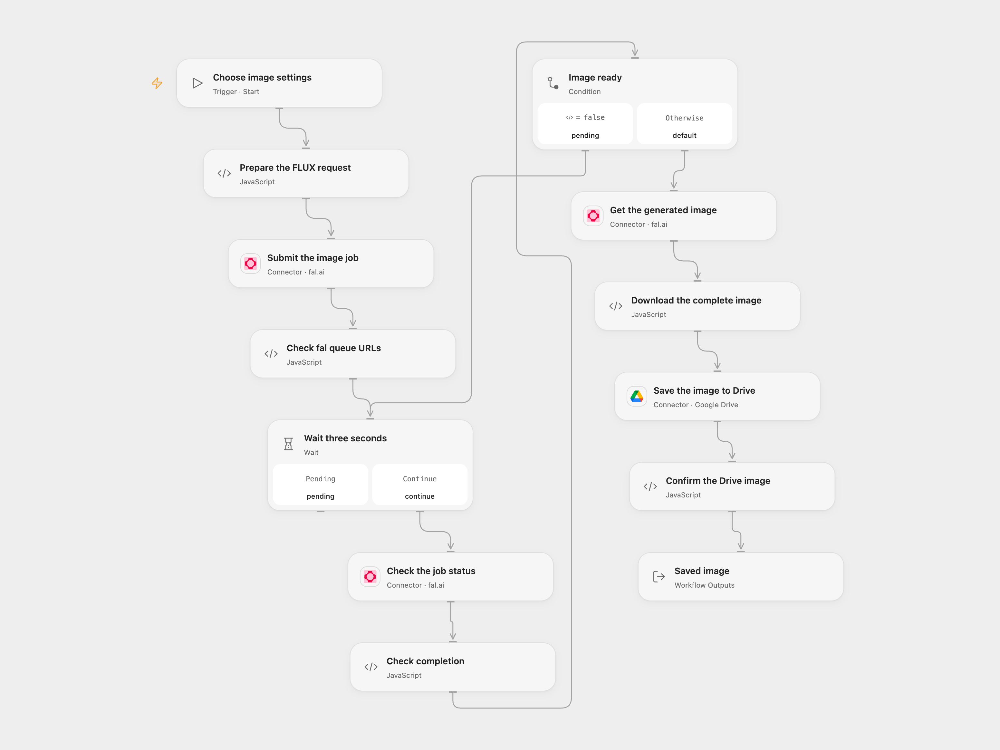

# Generate a FLUX Image to Google Drive

Generate one FLUX.1 dev image with fal and save it to Google Drive.

<picture>
  <source media="(prefers-color-scheme: dark)" srcset="preview-dark.png">
  
</picture>

[Open Flow JSON](templates/generate-flux-image-to-google-drive.openflow.json) · [n8n JSON](templates/generate-flux-image-to-google-drive.n8n.json)

## Setup

Connect fal and Google Drive. Set the destination folder ID in **Save the image to Drive** and run with a prompt, width, height, inference steps and guidance. For the source settings use 1024 × 768, 30 steps and guidance 3.5. The request asks for one image and enables fal's safety checker. Set the allowed HTTP host in **Download the complete image** to the hostname returned in fal's image URL if it differs from v3.fal.media.

In n8n configure the fal Authorization header credential and Google Drive credentials, choose a destination folder and set image parameters in **Edit Fields**. Use one format per run to avoid duplicate jobs.

## Behavior

The job is submitted once. The workflow waits three seconds and checks status until completion, then downloads the complete image and uploads it to Drive. Open Flow derives the output filename from the image URL; n8n uses its downloaded binary filename, which can depend on the response headers. Open Flow stops on an unexpected status, rejects incomplete image bytes when a size is supplied and checks the Drive receipt. The source n8n loop continues while status is not COMPLETED, including terminal statuses. A failed or uncertain submission or upload may already have succeeded; inspect fal and Drive before repeating. No automatic cancellation or exactly-once guarantee is added. The file must fit Open Flow's HTTP and Code budgets.

Inspiration &amp; credits

Adapted from [Flux Dev Image Generation (Fal.ai) to Google Drive](https://github.com/enescingoz/awesome-n8n-templates/blob/827110332c21cbe000ab13f6d292d5adb1f1f8db/Google_Drive_and_Google_Sheets/Flux%20Dev%20Image%20Generation%20(Fal.ai)%20to%20Google%20Drive.json) in [enescingoz/awesome-n8n-templates](https://github.com/enescingoz/awesome-n8n-templates).

Source collection notice: © 2024–2026 Enes Cingoz, [CC BY 4.0](https://github.com/enescingoz/awesome-n8n-templates/blob/827110332c21cbe000ab13f6d292d5adb1f1f8db/LICENSE). The source export does not identify a separate template author or license. See [repository licensing](../../README.md#licensing) for the scope of OOMOL contributions and third-party material.

