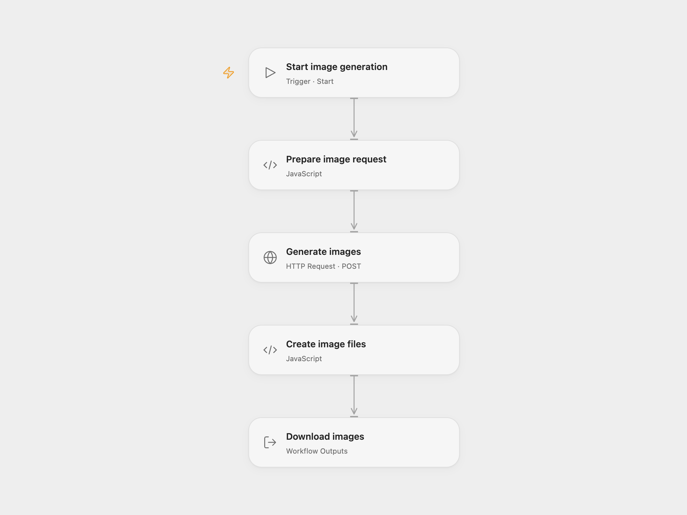

# Generate an Image from a Form

Generate an image from a prompt and selected size.

<picture>
  <source media="(prefers-color-scheme: dark)" srcset="preview-dark.png">
  
</picture>

[Open Flow JSON](templates/generate-image-from-a-form.openflow.json) · [n8n JSON](templates/generate-image-from-a-form.n8n.json)

## Setup and use

Bind the secret Variable OPENAI_API_KEY to **Generate images**. Run with a prompt and size (1024x1024, 1024x1536, or 1536x1024). In n8n connect the OpenAI credential and use the included form. Download the resulting image files. Use one format.

## Behavior

The workflow requests one image from GPT Image and converts the returned base64 image to a PNG file. The n8n form returns the file for download; Open Flow returns it as an artifact. Generation consumes API credits and can take time. A failed or interrupted request may have incurred charges; inspect the provider before retrying.

Inspiration &amp; credits

## Changes to the source

- Use artifact outputs for downloaded images in Open Flow and a secret Variable for authentication.

Adapted from [OpenAI image generation form](https://github.com/Zie619/n8n-workflows/blob/ae8cf6dc5b873cbb4f74587aa9180ed3a9f70682/workflows/Form/1316_Form_Stickynote_Automation_Webhook.json) in [Zie619/n8n-workflows](https://github.com/Zie619/n8n-workflows). The source note credits [Friedemann Schuetz](https://www.linkedin.com/in/friedemann-schuetz). The source export does not identify a separate template license.

The collection’s [MIT notice](https://github.com/Zie619/n8n-workflows/blob/94007c1445d9258a7da116646b79473e7c7c3282/LICENSE) is pinned at a later revision. This is the collection notice at that revision; it does not establish a separate original template author's license. Our changes are listed above; see [repository licensing](../../README.md#licensing).

> MIT License
>
> Copyright (c) 2025 Zie619
>
> Permission is hereby granted, free of charge, to any person obtaining a copy
> of this software and associated documentation files (the "Software"), to deal
> in the Software without restriction, including without limitation the rights
> to use, copy, modify, merge, publish, distribute, sublicense, and/or sell
> copies of the Software, and to permit persons to whom the Software is
> furnished to do so, subject to the following conditions:
>
> The above copyright notice and this permission notice shall be included in all
> copies or substantial portions of the Software.
>
> THE SOFTWARE IS PROVIDED "AS IS", WITHOUT WARRANTY OF ANY KIND, EXPRESS OR
> IMPLIED, INCLUDING BUT NOT LIMITED TO THE WARRANTIES OF MERCHANTABILITY,
> FITNESS FOR A PARTICULAR PURPOSE AND NONINFRINGEMENT. IN NO EVENT SHALL THE
> AUTHORS OR COPYRIGHT HOLDERS BE LIABLE FOR ANY CLAIM, DAMAGES OR OTHER
> LIABILITY, WHETHER IN AN ACTION OF CONTRACT, TORT OR OTHERWISE, ARISING FROM,
> OUT OF OR IN CONNECTION WITH THE SOFTWARE OR THE USE OR OTHER DEALINGS IN THE
> SOFTWARE.

