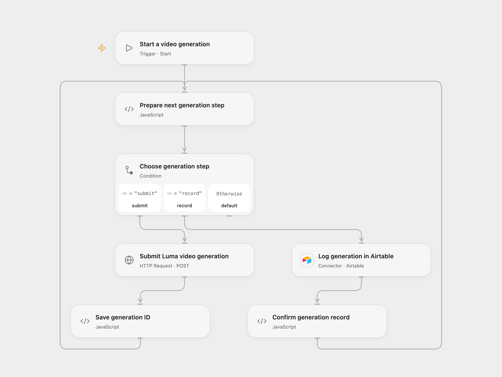

# Generate a Luma Video and Log It in Airtable

Submit a text-to-video request with a random camera motion and log the generation in Airtable.

<picture>
  <source media="(prefers-color-scheme: dark)" srcset="preview-dark.png">
  
</picture>

[Open Flow JSON](templates/generate-luma-video-and-log-airtable.openflow.json) · [n8n JSON](templates/generate-luma-video-and-log-airtable.n8n.json)

## Setup

Bind LUMA_API_KEY as a secret, connect Airtable, and configure the base and table in **Log generation in Airtable**. The table needs Generation ID, Prompt, Aspect, Length, Model, Resolution and Cluster ID fields, plus a Status field accepting In progress. Configure the prompt, aspect, duration and optional public callback URL in **Prepare next generation step**. Enable persistent State.

For n8n, configure **Video settings**, an HTTP Header Auth credential with Authorization set to Bearer followed by your Luma key, an Airtable credential, and a Data Table with text columns item_key, status, spec and generation_id. Use a fresh request ID for each generation.

For a pending generation, inspect Luma: if confirmed, set the checkpoint status to generated and generation_id to the confirmed ID; if absent, delete the checkpoint. For a pending Airtable record, inspect the matching Generation ID and Cluster ID: set status to done if confirmed, or generated if absent. Never change checkpoints while a run is active.

## Behavior

Start with a new, unique request ID. The workflow selects a random camera motion, submits Ray 2 text-to-video, and logs the returned generation ID as In progress. Generation continues asynchronously; the optional callback URL is an external endpoint that receives Luma updates. This template does not process those updates or mark the record complete.

If submission or Airtable creation has an unknown result, inspect Luma or Airtable before retrying the same request ID. Set the pending key and confirmed or absent in **Prepare next generation step**. For confirmed generation supply its ID; for a confirmed Airtable record verify that it belongs to that generation. Clear recovery fields after reconciliation. Avoid overlapping runs for the same request ID.

See [Luma's video API](https://docs.lumalabs.ai/reference/creategeneration).

Inspiration &amp; credits

Record asynchronous submissions as in progress and stop on uncertain generation or Airtable writes.

Adapted from [Luma AI Dream Machine](https://github.com/Zie619/n8n-workflows/blob/ae8cf6dc5b873cbb4f74587aa9180ed3a9f70682/workflows/Code/0753_Code_Executiondata_Automation_Webhook.json) in [Zie619/n8n-workflows](https://github.com/Zie619/n8n-workflows). Attribution: Zie619 / n8n-workflows.

The collection’s [MIT notice](https://github.com/Zie619/n8n-workflows/blob/94007c1445d9258a7da116646b79473e7c7c3282/LICENSE) is pinned at a later revision. This is the collection notice at that revision; it does not establish a separate original template author's license. Our changes are listed above; see [repository licensing](../../README.md#licensing).

> MIT License
>
> Copyright (c) 2025 Zie619
>
> Permission is hereby granted, free of charge, to any person obtaining a copy
> of this software and associated documentation files (the "Software"), to deal
> in the Software without restriction, including without limitation the rights
> to use, copy, modify, merge, publish, distribute, sublicense, and/or sell
> copies of the Software, and to permit persons to whom the Software is
> furnished to do so, subject to the following conditions:
>
> The above copyright notice and this permission notice shall be included in all
> copies or substantial portions of the Software.
>
> THE SOFTWARE IS PROVIDED "AS IS", WITHOUT WARRANTY OF ANY KIND, EXPRESS OR
> IMPLIED, INCLUDING BUT NOT LIMITED TO THE WARRANTIES OF MERCHANTABILITY,
> FITNESS FOR A PARTICULAR PURPOSE AND NONINFRINGEMENT. IN NO EVENT SHALL THE
> AUTHORS OR COPYRIGHT HOLDERS BE LIABLE FOR ANY CLAIM, DAMAGES OR OTHER
> LIABILITY, WHETHER IN AN ACTION OF CONTRACT, TORT OR OTHERWISE, ARISING FROM,
> OUT OF OR IN CONNECTION WITH THE SOFTWARE OR THE USE OR OTHER DEALINGS IN THE
> SOFTWARE.

