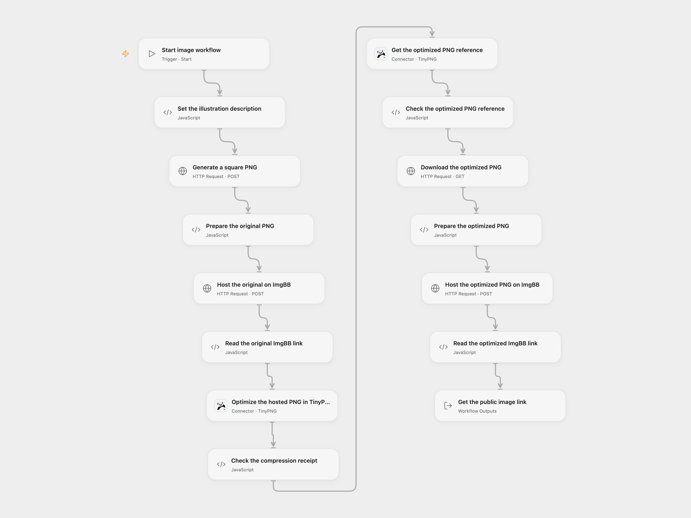

# Generate, Optimize, and Host an Image

Generate an illustration from a description, reduce its file size, and get a public ImgBB link.

<!-- template-actions:start -->
 
<!-- template-actions:end -->

<picture>
  <source media="(prefers-color-scheme: dark)" srcset="preview-dark.png">
  
</picture>

## Setup

1. Create an OpenAI API key with GPT Image 2.5 Flare access. Store the key in the secret variable `OPENAI_API_KEY` and bind it in **Generate a square PNG**.
2. Store your ImgBB API key in the secret variable `IMGBB_API_KEY`. Bind the same variable in both ImgBB upload steps. Select the same TinyPNG connection in **Optimize the hosted PNG in TinyPNG** and **Get the optimized PNG reference**.
3. In **Set the illustration description**, enter a subject and run the workflow manually. Copy `optimizedUrl` from **Get the public image link**.

## Behavior

OpenAI generates one square 1024 × 1024 PNG. ImgBB hosts that first version, and TinyPNG compresses the image at its direct URL. The workflow downloads TinyPNG’s output and uploads those PNG bytes to ImgBB. The output includes both ImgBB URLs and both file sizes. Already optimized images may show no reduction.

Both ImgBB uploads are public to anyone with the link. An original upload may remain if a later step fails. The workflow stops on an unconfirmed upload and does not automatically retry it. Check ImgBB before restarting a run with an unknown upload outcome.

The hosted runtime allows a 10 MiB artifact, including the JSON and Base64 in the generation response. The generated PNG may be up to 7,500,000 bytes.

In n8n

Select your OpenAI credential for **Generate a square PNG**. Select the same Query Auth credential in both ImgBB upload steps, with name `key` and your ImgBB API key as its value. In **Optimize the hosted PNG in TinyPNG** and **Download the optimized PNG**, select the same Basic Auth credential, using `api` as the username and your TinyPNG API key as the password. Enter a description and run manually. The final node returns `optimizedUrl` and both file sizes.

Inspiration &amp; credits

Adapted from [Convert image files to URLs and reduce file size](https://github.com/Zie619/n8n-workflows/blob/ae8cf6dc5b873cbb4f74587aa9180ed3a9f70682/workflows/Http/0622_HTTP_Stickynote_Create_Webhook.json) in [Zie619/n8n-workflows](https://github.com/Zie619/n8n-workflows). Attribution: Simon of Automake.io (simonscrapes, original workflow) / Zie619 (collection). See the [original n8n gallery template](https://n8n.io/workflows/2513-convert-image-files-jpg-png-to-urls-and-reduce-file-size-for-free/).

## Changes to the source

TinyPNG replaces reSmush.it so the optimized file can be retrieved over HTTPS. The manual entry uses GPT Image 2.5 Flare for the source illustration. The original suggested swapping in a user-owned file source. This template ships the wired generation path. [Tinify API](https://tinypng.com/developers/reference) [OpenAI image generation guide](https://developers.openai.com/api/docs/guides/image-generation)

The collection’s [MIT notice](https://github.com/Zie619/n8n-workflows/blob/94007c1445d9258a7da116646b79473e7c7c3282/LICENSE) is pinned at a later revision. This is the collection notice at that revision; it does not establish a separate original template author's license. Our changes are listed above; see [repository licensing](../../README.md#licensing).

> MIT License
>
> Copyright (c) 2025 Zie619
>
> Permission is hereby granted, free of charge, to any person obtaining a copy
> of this software and associated documentation files (the "Software"), to deal
> in the Software without restriction, including without limitation the rights
> to use, copy, modify, merge, publish, distribute, sublicense, and/or sell
> copies of the Software, and to permit persons to whom the Software is
> furnished to do so, subject to the following conditions:
>
> The above copyright notice and this permission notice shall be included in all
> copies or substantial portions of the Software.
>
> THE SOFTWARE IS PROVIDED "AS IS", WITHOUT WARRANTY OF ANY KIND, EXPRESS OR
> IMPLIED, INCLUDING BUT NOT LIMITED TO THE WARRANTIES OF MERCHANTABILITY,
> FITNESS FOR A PARTICULAR PURPOSE AND NONINFRINGEMENT. IN NO EVENT SHALL THE
> AUTHORS OR COPYRIGHT HOLDERS BE LIABLE FOR ANY CLAIM, DAMAGES OR OTHER
> LIABILITY, WHETHER IN AN ACTION OF CONTRACT, TORT OR OTHERWISE, ARISING FROM,
> OUT OF OR IN CONNECTION WITH THE SOFTWARE OR THE USE OR OTHER DEALINGS IN THE
> SOFTWARE.

