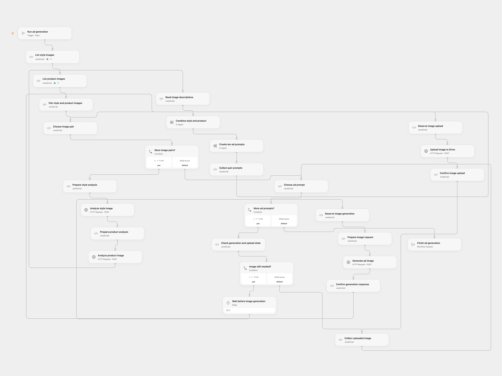

# Generate Product Ads from Drive Images

Analyze product images and ad examples, then generate and save image ads.

<!-- template-actions:start -->
 
<!-- template-actions:end -->

<picture>
  <source media="(prefers-color-scheme: dark)" srcset="preview-dark.png">
  
</picture>

## Setup

Configure the style-example, product-image and output folder IDs. Bind OPENAI_API_KEY and N8N_RELAY_TOKEN as secrets and connect Google Drive. Import the n8n workflow, configure its Drive and OpenAI credentials, and enable **Image relay** with a Header Auth credential matching the relay token. Set its URL in all relay nodes, configure the destination folder in **Upload relay image**, and enable persistent State. The two input folders should contain images.

For direct n8n operation, configure the three folder IDs, a unique value in **Set unique run ID**, and a Data Table with item_key and status text columns in the four checkpoint nodes. Use either n8n direct mode or Open Flow with the relay for a run. Restrict access to the authenticated relay and prevent concurrent runs with the same ID.

## Behavior

The workflow analyzes every style example with every product image, creates ten square ad prompts per pair and saves generated PNGs in Drive. It passes image data and descriptions to OpenAI. The original wait defaults to **15 hours before each image**; adjust the delay in the format you use if a different interval is intended. Generated ads may not accurately reproduce a product and need human review.

Use a unique run ID for each batch. Generation and Drive uploads are reserved separately. If a request fails or its response is lost, inspect OpenAI usage or the destination folder and the pending State or Data Table record before resolving the item manually. The n8n direct workflow stops when it finds a previous reservation; the Open Flow workflow skips confirmed uploads. A generated image is kept only for the current execution; after an interruption inspect the pending state before deciding how to finish the item. A timeout can occur after a provider has completed an action.

Inspiration &amp; credits

Adapted from [AI product Images](https://github.com/enescingoz/awesome-n8n-templates/blob/827110332c21cbe000ab13f6d292d5adb1f1f8db/AI%20product%20imagines.json) in [enescingoz/awesome-n8n-templates](https://github.com/enescingoz/awesome-n8n-templates).

Source collection notice: © 2024–2026 Enes Cingoz, [CC BY 4.0](https://github.com/enescingoz/awesome-n8n-templates/blob/827110332c21cbe000ab13f6d292d5adb1f1f8db/LICENSE). The source export does not identify a separate template author or license. See [repository licensing](../../README.md#licensing) for the scope of OOMOL contributions and third-party material.

