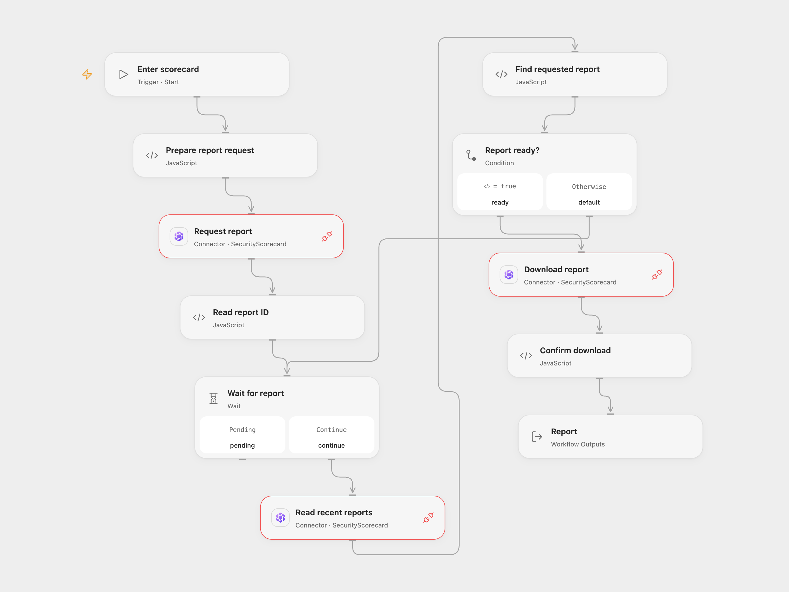

# Generate a SecurityScorecard Report

Request a full SecurityScorecard report and retrieve the matching completed report.

<picture>
  <source media="(prefers-color-scheme: dark)" srcset="preview-dark.png">
  
</picture>

[Open Flow JSON](templates/generate-securityscorecard-report.openflow.json) · [n8n JSON](templates/generate-securityscorecard-report.n8n.json)

## Setup

Connect SecurityScorecard with report generation and download access to each **Request report**, **Read recent reports** and **Download report** node, and allow Provider API access. Run Open Flow with a scorecard domain or ID. In n8n, configure the identifier in **Set scorecard**, select HTTP Header Auth with name `Authorization` and value `Token YOUR_API_TOKEN` for both HTTP nodes, and select a SecurityScorecard API credential with the same token in **Download report**. Do not put the token in the workflow JSON.

## Behavior

The workflow requests a full scorecard JSON report, then checks recent reports once per minute for up to 60 checks. It selects only the report with the ID returned by the request and downloads its `download_url` when available. The response URL must be on the SecurityScorecard report-files endpoint. The Open Flow output contains the response body, response headers and a base64 encoding indicator when applicable; n8n returns the downloaded file as binary data. The service can redirect the download to its file host. Open Flow accepts downloads up to 4 MiB; its recent-reports response must also fit the Code node’s 1 MiB input budget. Oversized responses stop the run.

A request can succeed even if its response is lost or report generation later fails. Check the service before repeating an uncertain request. No automatic creation retry is configured. A report that does not appear within an hour stops the run. The API may accept a request before a score is ready and later fail to generate it.

## Changes to the source

- Replace the example domain with configuration and use the current API's top-level `scorecard_identifier` request field.
- Match the generated report ID and wait for a download URL, instead of immediately selecting the first recent report.

Source and license

Adapted from [Generate and download a SecurityScorecard report](https://github.com/Zie619/n8n-workflows/blob/ae8cf6dc5b873cbb4f74587aa9180ed3a9f70682/workflows/Manual/1196_Manual_Securityscorecard_Automate_Triggered.json) in [Zie619/n8n-workflows](https://github.com/Zie619/n8n-workflows). The matching [n8n community listing](https://n8n.io/workflows/920-generate-retrieve-and-download-a-report-using-the-securityscorecard/) credits Harshil Agrawal. The original template does not state a separate license.

The collection’s [MIT notice](https://github.com/Zie619/n8n-workflows/blob/94007c1445d9258a7da116646b79473e7c7c3282/LICENSE) is pinned at a later revision. This is the collection notice at that revision; it does not establish a separate original template author's license. Our changes are listed above; see [repository licensing](../../README.md#licensing).

> MIT License
>
> Copyright (c) 2025 Zie619
>
> Permission is hereby granted, free of charge, to any person obtaining a copy
> of this software and associated documentation files (the "Software"), to deal
> in the Software without restriction, including without limitation the rights
> to use, copy, modify, merge, publish, distribute, sublicense, and/or sell
> copies of the Software, and to permit persons to whom the Software is
> furnished to do so, subject to the following conditions:
>
> The above copyright notice and this permission notice shall be included in all
> copies or substantial portions of the Software.
>
> THE SOFTWARE IS PROVIDED "AS IS", WITHOUT WARRANTY OF ANY KIND, EXPRESS OR
> IMPLIED, INCLUDING BUT NOT LIMITED TO THE WARRANTIES OF MERCHANTABILITY,
> FITNESS FOR A PARTICULAR PURPOSE AND NONINFRINGEMENT. IN NO EVENT SHALL THE
> AUTHORS OR COPYRIGHT HOLDERS BE LIABLE FOR ANY CLAIM, DAMAGES OR OTHER
> LIABILITY, WHETHER IN AN ACTION OF CONTRACT, TORT OR OTHERWISE, ARISING FROM,
> OUT OF OR IN CONNECTION WITH THE SOFTWARE OR THE USE OR OTHER DEALINGS IN THE
> SOFTWARE.

