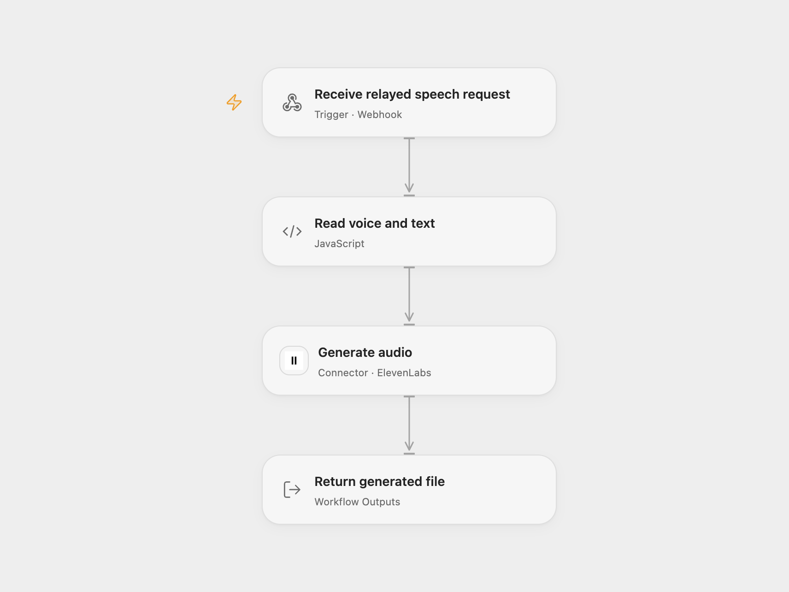

# Generate Speech with ElevenLabs

Generate an audio response from text and an ElevenLabs voice ID.

<picture>
  <source media="(prefers-color-scheme: dark)" srcset="preview-dark.png">
  
</picture>

[Open Flow JSON](templates/generate-speech-with-elevenlabs.openflow.json) · [n8n JSON](templates/generate-speech-with-elevenlabs.n8n.json)

## Setup and use

Import the supplied n8n workflow. Set **Choose execution mode** to n8n for its native path or openflow to send the complete request to Open Flow. Configure ElevenLabs HTTP Header Auth in n8n with header name xi-api-key and your API key as its value. For Open Flow connect ElevenLabs and set its webhook URL in **Forward to Open Flow**. Activate n8n and POST JSON containing voice_id and text to its webhook. Use one mode.

## Behavior

The selected path synthesizes speech and returns the audio bytes to the caller. Open Flow returns the generated transit file URL to n8n, which downloads the bytes and returns them. The Open Flow webhook waits up to 60 seconds; long requests may exceed that window and still complete. Both webhooks do not authenticate callers; restrict access because calls use ElevenLabs. The text and transit URL can appear in execution history. If a response is lost, generation may already have occurred; inspect ElevenLabs before retrying.

Inspiration &amp; credits

## Changes to the source

- Fix input checks and request serialization, explicitly request binary audio in n8n, and add a full-request Open Flow relay with a binary response bridge.

Adapted from [Generate Text-to-Speech Using Elevenlabs via API](https://github.com/Zie619/n8n-workflows/blob/ae8cf6dc5b873cbb4f74587aa9180ed3a9f70682/workflows/Http/0492_HTTP_Respondtowebhook_Create_Webhook.json) in [Zie619/n8n-workflows](https://github.com/Zie619/n8n-workflows). The source credits The n8Ninja. No separate original template license was found.

The collection’s [MIT notice](https://github.com/Zie619/n8n-workflows/blob/94007c1445d9258a7da116646b79473e7c7c3282/LICENSE) is pinned at a later revision. This is the collection notice at that revision; it does not establish a separate original template author's license. Our changes are listed above; see [repository licensing](../../README.md#licensing).

> MIT License
>
> Copyright (c) 2025 Zie619
>
> Permission is hereby granted, free of charge, to any person obtaining a copy
> of this software and associated documentation files (the "Software"), to deal
> in the Software without restriction, including without limitation the rights
> to use, copy, modify, merge, publish, distribute, sublicense, and/or sell
> copies of the Software, and to permit persons to whom the Software is
> furnished to do so, subject to the following conditions:
>
> The above copyright notice and this permission notice shall be included in all
> copies or substantial portions of the Software.
>
> THE SOFTWARE IS PROVIDED "AS IS", WITHOUT WARRANTY OF ANY KIND, EXPRESS OR
> IMPLIED, INCLUDING BUT NOT LIMITED TO THE WARRANTIES OF MERCHANTABILITY,
> FITNESS FOR A PARTICULAR PURPOSE AND NONINFRINGEMENT. IN NO EVENT SHALL THE
> AUTHORS OR COPYRIGHT HOLDERS BE LIABLE FOR ANY CLAIM, DAMAGES OR OTHER
> LIABILITY, WHETHER IN AN ACTION OF CONTRACT, TORT OR OTHERWISE, ARISING FROM,
> OUT OF OR IN CONNECTION WITH THE SOFTWARE OR THE USE OR OTHER DEALINGS IN THE
> SOFTWARE.

