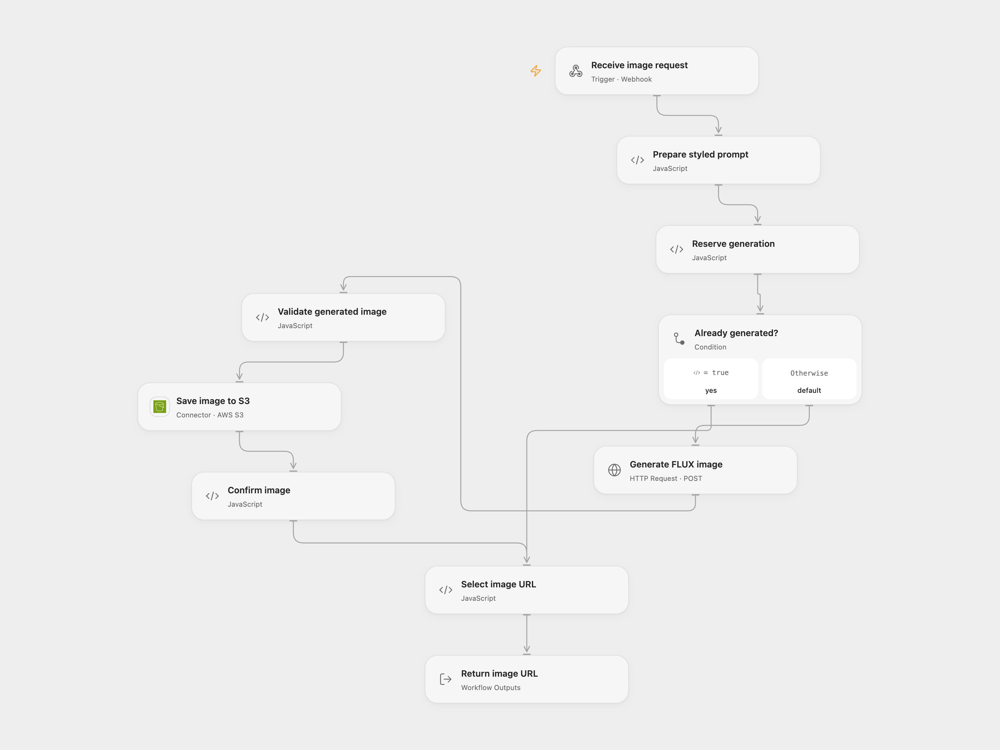

# Generate Styled FLUX Images to S3

Generate a styled FLUX image and save it to an S3 bucket.

<!-- template-actions:start -->
[](https://openflow.run/templates/generate-styled-flux-images-to-s3/) [](templates/generate-styled-flux-images-to-s3.n8n.json)
<!-- template-actions:end -->

<picture>
  <source media="(prefers-color-scheme: dark)" srcset="preview-dark.png">
  
</picture>

## Setup and use

Configure fal authentication, an S3 bucket and connection, and persistent State. Use an S3 bucket where intended recipients can read the generated object. In n8n configure Header Auth with Authorization: Key YOUR_FAL_KEY, an S3 connection, a Data Table with item_key, status and url text columns, and YOUR_PUBLIC_BUCKET_HOST in the response page. Inspect fal and S3 before clearing pending checkpoints; Use a unique Request ID for each image and reuse that same ID when retrying the same request; both the checkpoints and S3 object key use it. In Open Flow bind FAL_AUTH_HEADER to the complete Authorization value Key YOUR_FAL_KEY. Restrict the webhook with an authenticated gateway or private network.

The n8n form asks for a prompt and style. Open Flow accepts JSON fields submissionId, prompt and style, and returns an S3 URL. Use a unique stable submissionId for each image. Inspect fal and S3 before clearing a pending checkpoint after an uncertain operation. The source's previous-image gallery is omitted; it guessed previous execution IDs and could expose unrelated images.

<details>
<summary>Inspiration &amp; credits</summary>

Adapted from [Flux AI Image Generator](https://github.com/enescingoz/awesome-n8n-templates/blob/827110332c21cbe000ab13f6d292d5adb1f1f8db/OpenAI_and_LLMs/Flux%20AI%20Image%20Generator.json) in [enescingoz/awesome-n8n-templates](https://github.com/enescingoz/awesome-n8n-templates).

Source collection notice: © 2024–2026 Enes Cingoz, [CC BY 4.0](https://github.com/enescingoz/awesome-n8n-templates/blob/827110332c21cbe000ab13f6d292d5adb1f1f8db/LICENSE). The source export does not identify a separate template author or license. See [repository licensing](../../README.md#licensing) for the scope of OOMOL contributions and third-party material.


Created by [Max Tkacz](https://x.com/maxtkacz) for the [30 Day AI Sprint](https://30dayaisprint.notion.site/). Changes: use fal's current FLUX.1 schnell endpoint, make storage configurable, replace the guessed gallery with the generated image URL, and add an Open Flow webhook and checkpoint.

Collection license notice:

```text
Creative Commons Attribution 4.0 International License

Copyright (c) 2024-2026 Enes Cingoz

You are free to:

  Share - copy and redistribute the material in any medium or format
  Adapt - remix, transform, and build upon the material for any purpose,
  even commercially.

Under the following terms:

  Attribution - You must give appropriate credit, provide a link to the
  license, and indicate if changes were made. You may do so in any
  reasonable manner, but not in any way that suggests the licensor
  endorses you or your use.

  No additional restrictions - You may not apply legal terms or
  technological measures that legally restrict others from doing
  anything the license permits.

Notices:

  You do not have to comply with the license for elements of the
  material in the public domain or where your use is permitted by an
  applicable exception or limitation.

  No warranties are given. The license may not give you all of the
  permissions necessary for your intended use. For example, other rights
  such as publicity, privacy, or moral rights may limit how you use the
  material.

For the full license text, see:
https://creativecommons.org/licenses/by/4.0/legalcode
```

</details>
