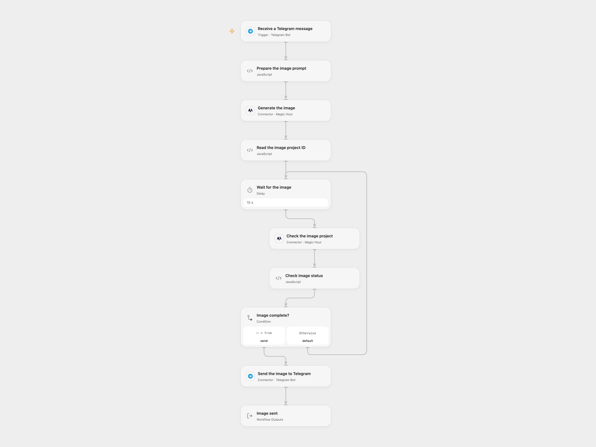

# Generate a Telegram Image from a Prompt

Generate an image from a Telegram message and send it back to the same chat.

<picture>
  <source media="(prefers-color-scheme: dark)" srcset="preview-dark.png">
  
</picture>

[Open Flow JSON](templates/generate-telegram-image-from-prompt.openflow.json) · [n8n JSON](templates/generate-telegram-image-from-prompt.n8n.json)

## Setup

Connect the same Telegram bot to the trigger and send node, and connect Magic Hour to both image nodes. In n8n install the Magic Hour community node and connect its credential and the same Telegram bot. Activate one format; Telegram allows one active webhook per bot.

## Behavior

Send a text description to the bot. The workflow requests one 640px square image using Magic Hour flux-2-klein and replies in the same chat. Magic Hour provides a temporary image URL that Telegram must be able to fetch. Prompts and images are shared with Magic Hour and Telegram. Non-text updates do not generate an image.

Open Flow checks at 10-second intervals at most 60 times; n8n polls for roughly ten minutes. A failed or uncertain generation may have created a project; inspect Magic Hour before retrying. An uncertain Telegram send may have succeeded; inspect the chat before retrying.

Inspiration &amp; credits

## Changes to the source

- Use Magic Hour because the original DALL·E models were retired. Use the originating chat ID instead of the source's positional aggregate.

Adapted from [Generate an image from a Telegram text message](https://github.com/Zie619/n8n-workflows/blob/ae8cf6dc5b873cbb4f74587aa9180ed3a9f70682/workflows/Aggregate/1506_Aggregate_Telegram_Automation_Triggered.json) in [Zie619/n8n-workflows](https://github.com/Zie619/n8n-workflows). The source export does not identify a separate template author or license.

The collection’s [MIT notice](https://github.com/Zie619/n8n-workflows/blob/94007c1445d9258a7da116646b79473e7c7c3282/LICENSE) is pinned at a later revision. This is the collection notice at that revision; it does not establish a separate original template author's license. Our changes are listed above; see [repository licensing](../../README.md#licensing).

> MIT License
>
> Copyright (c) 2025 Zie619
>
> Permission is hereby granted, free of charge, to any person obtaining a copy
> of this software and associated documentation files (the "Software"), to deal
> in the Software without restriction, including without limitation the rights
> to use, copy, modify, merge, publish, distribute, sublicense, and/or sell
> copies of the Software, and to permit persons to whom the Software is
> furnished to do so, subject to the following conditions:
>
> The above copyright notice and this permission notice shall be included in all
> copies or substantial portions of the Software.
>
> THE SOFTWARE IS PROVIDED "AS IS", WITHOUT WARRANTY OF ANY KIND, EXPRESS OR
> IMPLIED, INCLUDING BUT NOT LIMITED TO THE WARRANTIES OF MERCHANTABILITY,
> FITNESS FOR A PARTICULAR PURPOSE AND NONINFRINGEMENT. IN NO EVENT SHALL THE
> AUTHORS OR COPYRIGHT HOLDERS BE LIABLE FOR ANY CLAIM, DAMAGES OR OTHER
> LIABILITY, WHETHER IN AN ACTION OF CONTRACT, TORT OR OTHERWISE, ARISING FROM,
> OUT OF OR IN CONNECTION WITH THE SOFTWARE OR THE USE OR OTHER DEALINGS IN THE
> SOFTWARE.

