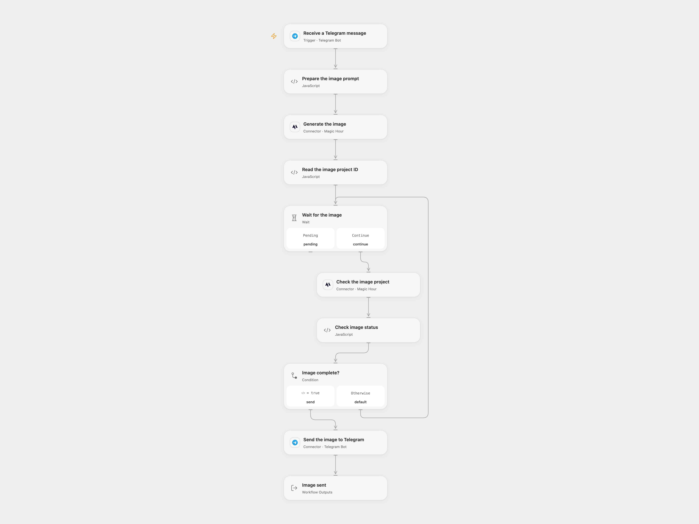

# Generate Telegram Images with Magic Hour

Generate an image from a Telegram text message and send it back to the same chat.

<picture>
  <source media="(prefers-color-scheme: dark)" srcset="preview-dark.png">
  
</picture>

[Open Flow JSON](templates/generate-telegram-images-with-magic-hour.openflow.json) · [n8n JSON](templates/generate-telegram-images-with-magic-hour.n8n.json)

## Setup

Connect the same Telegram bot to the trigger and **Send the image to Telegram**, and connect Magic Hour to both image nodes. In n8n install the Magic Hour community node, connect its API credential and connect the same Telegram bot to its trigger and send node. Activate one format; Telegram allows one active webhook per bot.

## Behavior

Send the bot a text description. The workflow sends that prompt to Magic Hour, requests one 640px square image using flux-2-klein and replies with the completed image in the same chat. Magic Hour provides a temporary image URL, which Telegram must be able to fetch. Prompts and generated images are shared with Magic Hour and Telegram.

Open Flow waits 10 seconds between at most 60 checks; request time can extend the run beyond ten minutes. n8n's community node polls for roughly ten minutes. A failed, uncertain or timed-out generation may already have created a project; inspect Magic Hour before retrying. An uncertain Telegram send may already have succeeded; inspect the chat before retrying. Non-text updates do not generate an image.

Inspiration &amp; credits

## Changes to the source

- Use Magic Hour image generation because the original DALL·E models were retired. Replace the positional aggregate with the original message's chat ID so replies go to the originating chat, including groups.

Adapted from [Image Creation with OpenAI and Telegram](https://github.com/enescingoz/awesome-n8n-templates/blob/827110332c21cbe000ab13f6d292d5adb1f1f8db/Telegram/Image%20Creation%20with%20OpenAI%20and%20Telegram.json) in [enescingoz/awesome-n8n-templates](https://github.com/enescingoz/awesome-n8n-templates).

Source collection notice: © 2024–2026 Enes Cingoz, [CC BY 4.0](https://github.com/enescingoz/awesome-n8n-templates/blob/827110332c21cbe000ab13f6d292d5adb1f1f8db/LICENSE). The source export does not identify a separate template author or license. See [repository licensing](../../README.md#licensing) for the scope of OOMOL contributions and third-party material.

