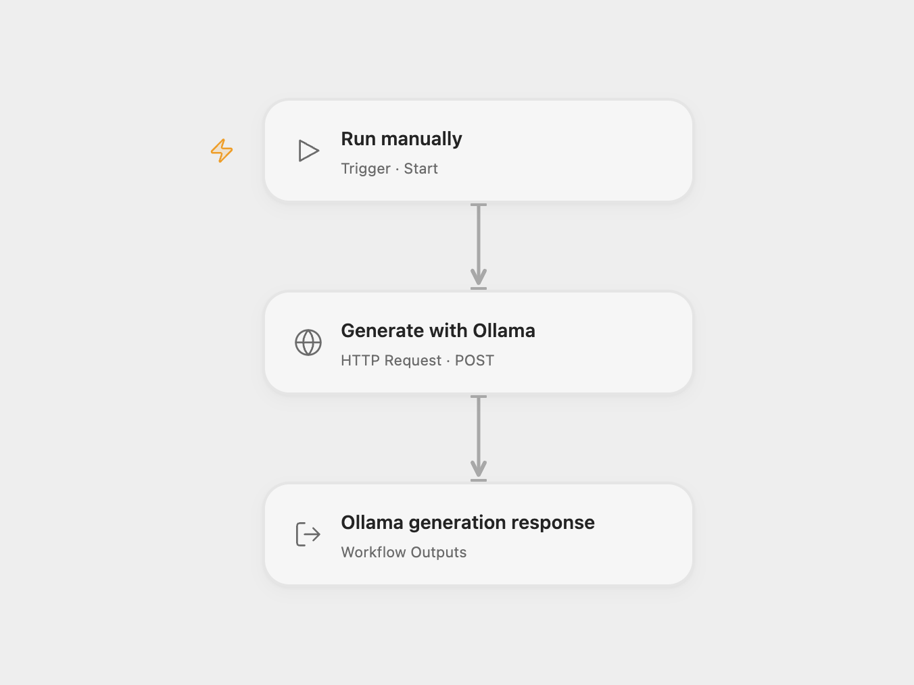

# Generate Text with Local Ollama

Run a prompt on your local Ollama model and see its full generation response.

<!-- template-actions:start -->
 
<!-- template-actions:end -->

<picture>
  <source media="(prefers-color-scheme: dark)" srcset="preview-dark.png">
  
</picture>

## Setup

1. Use a self-hosted deployment on a machine or private container network that can reach your Ollama server. Install the `phi3` model in Ollama or select another local model. [Ollama API](https://docs.ollama.com/api/introduction)
2. Set the URL in **Generate with Ollama** to the server's private `/api/generate` endpoint. Keep the default `http://localhost:11434/api/generate` when the workflow runner and Ollama share the same network namespace. When they run in separate containers, use Ollama's service name on their shared private network. [Self-hosting guide](https://openflow.run/docs/guides/self-host-docker/)
3. Set the body’s `model` and `prompt` in **Generate with Ollama**, then run the workflow. Use an installed model that can complete the prompt in 30 seconds. A cold model can take longer to load.

## Behavior

The workflow sends one POST request with `stream: false`. The run output includes the original JSON response, with the generated text in `generation.response` and the returned model in `generation.model`. An unavailable server, rejected request, or request beyond the 30-second HTTP limit fails the run. A hosted runner's localhost points to its own environment.

In n8n

Use a self-hosted n8n instance or worker that can reach Ollama. In **Generate with Ollama**, set the private endpoint and edit the JSON body's `model` and `prompt`. Run the workflow manually. The JSON output includes Ollama's `response` and `model` fields. This request has the source's 60-second timeout.

Inspiration &amp; credits

Adapted from [Ollama Basic Workflow](https://github.com/enescingoz/awesome-n8n-templates/blob/827110332c21cbe000ab13f6d292d5adb1f1f8db/OpenAI_and_LLMs/Ollama_Basic_Workflow.json) in [enescingoz/awesome-n8n-templates](https://github.com/enescingoz/awesome-n8n-templates).

Source collection notice: © 2024–2026 Enes Cingoz, [CC BY 4.0](https://github.com/enescingoz/awesome-n8n-templates/blob/827110332c21cbe000ab13f6d292d5adb1f1f8db/LICENSE). The source export does not identify a separate template author or license. See [repository licensing](../../README.md#licensing) for the scope of OOMOL contributions and third-party material.

