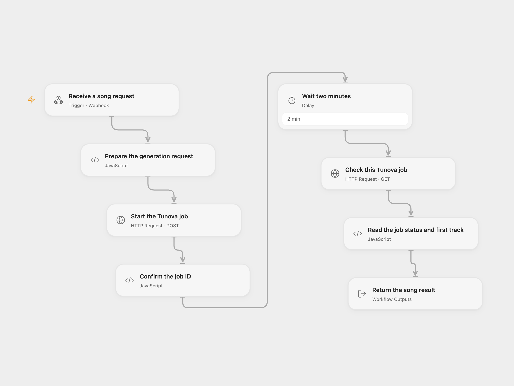

# Generate a Song with Tunova

Submit a song prompt and check its Tunova job after two minutes to get the first finished track.

<!-- template-actions:start -->
 
<!-- template-actions:end -->

<picture>
  <source media="(prefers-color-scheme: dark)" srcset="preview-dark.png">
  
</picture>

## Setup

1. Set the `TUNOVA_API_KEY` secret variable used by **Start the Tunova job** and **Check this Tunova job** to your Tunova API key. Confirm your account has generation credits. [Tunova quickstart](https://tunova.ai/quickstart)
2. Publish and open the hosted form in **Receive a song request**. Keep the form and its submission URL behind a private deployment or authenticated gateway. Submitting the form can spend credits.
3. Enter a song description and choose whether it should be instrumental. Leave the submission reference blank for a new song. To safely recover the same request if its creation outcome is uncertain, supply and keep a random UUID v4 before submitting.

## Behavior

The form acknowledges receipt immediately. Open the run output after two minutes to see the Tunova job ID and its status. A completed job includes the first track's audio link and title when available. A queued, processing, submitted or failed job has no final audio link. If it is still pending, check that job ID in your Tunova account or call the job status endpoint with the same ID.

The workflow submits each generation once and queries it once. If creation has an uncertain outcome, reuse the original reference and the same prompt and instrumental choice to recover the existing job during Tunova's retention period (normally about seven days). Without a saved reference, check Tunova before submitting again. Use a new reference for a new song. [Tunova idempotency](https://tunova.ai/security)

In n8n

Attach the same **Header Auth** credential in **Start the Tunova job** and **Check this Tunova job**, with header name `X-API-Key` and your Tunova key as the value. Activate the workflow and use its production form URL. Review **Read the job status and first track** in the saved execution. Restrict execution access because operators can see prompts and generation results.

Inspiration &amp; credits

Adapted from [Tunova - Generate a song from a form](https://github.com/enescingoz/awesome-n8n-templates/blob/827110332c21cbe000ab13f6d292d5adb1f1f8db/Forms_and_Surveys/Tunova%20-%20Generate%20a%20song%20from%20a%20form.json) in [enescingoz/awesome-n8n-templates](https://github.com/enescingoz/awesome-n8n-templates).

Source collection notice: © 2024–2026 Enes Cingoz, [CC BY 4.0](https://github.com/enescingoz/awesome-n8n-templates/blob/827110332c21cbe000ab13f6d292d5adb1f1f8db/LICENSE). The source export does not identify a separate template author or license. See [repository licensing](../../README.md#licensing) for the scope of OOMOL contributions and third-party material.

## Changes to the source

The request uses Tunova’s documented instrumental field and Suno v6, the current replacement for the v5.5 name. An optional reference supports recovery of an uncertain request. The workflow verifies the job ID before returning a finished clip. [Tunova versioning](https://tunova.ai/versioning)

