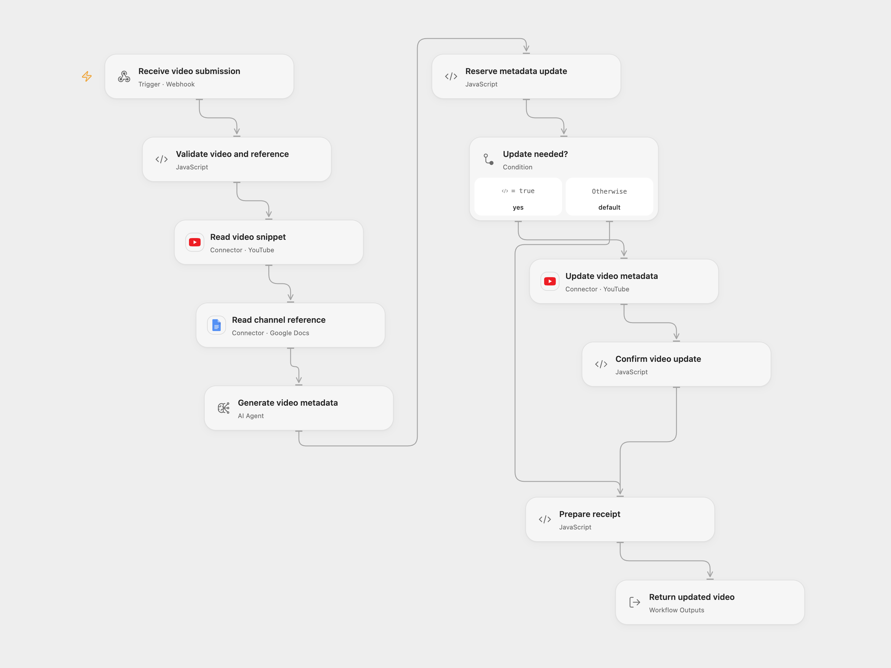

# Generate YouTube Metadata from Transcript and Document

Generate a video title, description and tags using a transcript and channel reference document.

<picture>
  <source media="(prefers-color-scheme: dark)" srcset="preview-dark.png">
  
</picture>

[Open Flow JSON](templates/generate-youtube-metadata-from-transcript-and-doc.openflow.json) · [n8n JSON](templates/generate-youtube-metadata-from-transcript-and-doc.n8n.json)

## Setup

Connect YouTube with permission to edit the selected video, Google Docs with read access to your channel reference, and an AI model. Put your approved promotional links in that document. In n8n set the document ID in **Prepare submission** and the Google Docs tool, connect the same accounts, and select a Data Table with item_key and status text columns. Prevent concurrent updates to a video.

For Open Flow set **Prepare submission** to relay, configure its webhook URL, connect YouTube and Google Docs and enable persistent State. Restrict webhook access. Direct mode runs in n8n; use one mode.

## Behavior

Submit a YouTube video URL or ID, transcript and optional focus keywords. The workflow reads the reference document and generates a title, description, tags, hashtags and call to action, then updates the same video while retaining its category and language settings. Model output may be inaccurate; review the metadata and promotional links in YouTube Studio. Transcript and reference content are sent to the model and may appear in execution history. Code ports must each fit within 1 MiB.

If an update is uncertain, inspect the video first. In Open Flow set **Reserve metadata update** resolution to applied if the changes exist or absent if they do not, replay once, then clear the field. In n8n reconcile the pending Data Table row against YouTube before marking it done or deleting it. Remove a completed checkpoint before a deliberate new update.

Inspiration &amp; credits

Replace personal links with your own document and retain the video category.

Adapted from [YouTube Meta Generator](https://github.com/Zie619/n8n-workflows/blob/ae8cf6dc5b873cbb4f74587aa9180ed3a9f70682/workflows/Form/0732_Form_Youtube_Update_Triggered.json) in [Zie619/n8n-workflows](https://github.com/Zie619/n8n-workflows). The source export does not identify a separate template author or license.

The collection’s [MIT notice](https://github.com/Zie619/n8n-workflows/blob/94007c1445d9258a7da116646b79473e7c7c3282/LICENSE) is pinned at a later revision. This is the collection notice at that revision; it does not establish a separate original template author's license. Our changes are listed above; see [repository licensing](../../README.md#licensing).

> MIT License
>
> Copyright (c) 2025 Zie619
>
> Permission is hereby granted, free of charge, to any person obtaining a copy
> of this software and associated documentation files (the "Software"), to deal
> in the Software without restriction, including without limitation the rights
> to use, copy, modify, merge, publish, distribute, sublicense, and/or sell
> copies of the Software, and to permit persons to whom the Software is
> furnished to do so, subject to the following conditions:
>
> The above copyright notice and this permission notice shall be included in all
> copies or substantial portions of the Software.
>
> THE SOFTWARE IS PROVIDED "AS IS", WITHOUT WARRANTY OF ANY KIND, EXPRESS OR
> IMPLIED, INCLUDING BUT NOT LIMITED TO THE WARRANTIES OF MERCHANTABILITY,
> FITNESS FOR A PARTICULAR PURPOSE AND NONINFRINGEMENT. IN NO EVENT SHALL THE
> AUTHORS OR COPYRIGHT HOLDERS BE LIABLE FOR ANY CLAIM, DAMAGES OR OTHER
> LIABILITY, WHETHER IN AN ACTION OF CONTRACT, TORT OR OTHERWISE, ARISING FROM,
> OUT OF OR IN CONNECTION WITH THE SOFTWARE OR THE USE OR OTHER DEALINGS IN THE
> SOFTWARE.

