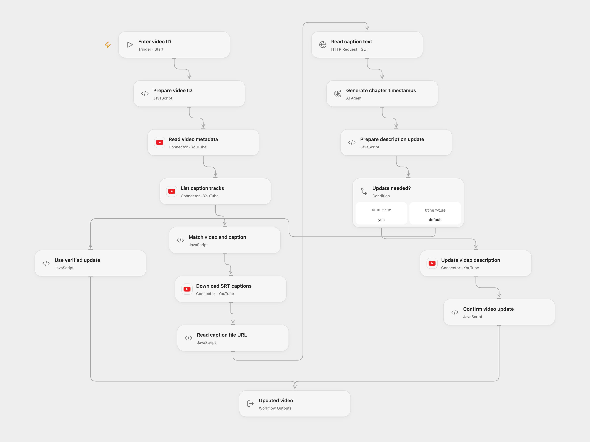

# Generate YouTube Video Chapters

Generate chapter timestamps from a video caption track and append them to its description.

<!-- template-actions:start -->
 
<!-- template-actions:end -->

<picture>
  <source media="(prefers-color-scheme: dark)" srcset="preview-dark.png">
  
</picture>

## Setup

Connect YouTube with permission to edit the video and download captions, and configure an AI model. Open Flow requires connector file transit and Persistent State. Run with the video ID. The first available caption track is selected.

## Behavior

The workflow downloads SRT captions, generates timestamps and appends them to the existing description. It keeps the video's title, category and other editable snippet fields. Review generated chapters in YouTube Studio; model output can be inaccurate. Captions are sent to the model. Long captions must fit workflow and model limits. The account must have permission to edit the video.

If an update has an unknown outcome, inspect the video before another run. In Open Flow if the update did not apply set **Prepare description update** resolution to absent, rerun, then clear it. If it applied, set resolution to applied and rerun once to mark it confirmed without another update. Clear the resolution afterward. Avoid concurrent runs for the same video. Inspect YouTube before retrying an uncertain update; remove its checkpoint only after reconciliation. Remove a completed checkpoint before a deliberate new update.

In n8n

In n8n set the video ID in **Set Video ID** and connect YouTube OAuth and the OpenAI model. In n8n configure a Data Table with item_key and status text columns.

Inspiration &amp; credits

Use the requested video ID throughout, preserve existing description and video metadata, and remove the source’s duplicate chapter text.

Adapted from [youtube chapter generator](https://github.com/Zie619/n8n-workflows/blob/ae8cf6dc5b873cbb4f74587aa9180ed3a9f70682/workflows/Extractfromfile/1641_Extractfromfile_Manual_Automation_Webhook.json) in [Zie619/n8n-workflows](https://github.com/Zie619/n8n-workflows). The source export does not identify a separate template author or license.

The collection’s [MIT notice](https://github.com/Zie619/n8n-workflows/blob/94007c1445d9258a7da116646b79473e7c7c3282/LICENSE) is pinned at a later revision. This is the collection notice at that revision; it does not establish a separate original template author's license. Our changes are listed above; see [repository licensing](../../README.md#licensing).

> MIT License
>
> Copyright (c) 2025 Zie619
>
> Permission is hereby granted, free of charge, to any person obtaining a copy
> of this software and associated documentation files (the "Software"), to deal
> in the Software without restriction, including without limitation the rights
> to use, copy, modify, merge, publish, distribute, sublicense, and/or sell
> copies of the Software, and to permit persons to whom the Software is
> furnished to do so, subject to the following conditions:
>
> The above copyright notice and this permission notice shall be included in all
> copies or substantial portions of the Software.
>
> THE SOFTWARE IS PROVIDED "AS IS", WITHOUT WARRANTY OF ANY KIND, EXPRESS OR
> IMPLIED, INCLUDING BUT NOT LIMITED TO THE WARRANTIES OF MERCHANTABILITY,
> FITNESS FOR A PARTICULAR PURPOSE AND NONINFRINGEMENT. IN NO EVENT SHALL THE
> AUTHORS OR COPYRIGHT HOLDERS BE LIABLE FOR ANY CLAIM, DAMAGES OR OTHER
> LIABILITY, WHETHER IN AN ACTION OF CONTRACT, TORT OR OTHERWISE, ARISING FROM,
> OUT OF OR IN CONNECTION WITH THE SOFTWARE OR THE USE OR OTHER DEALINGS IN THE
> SOFTWARE.

