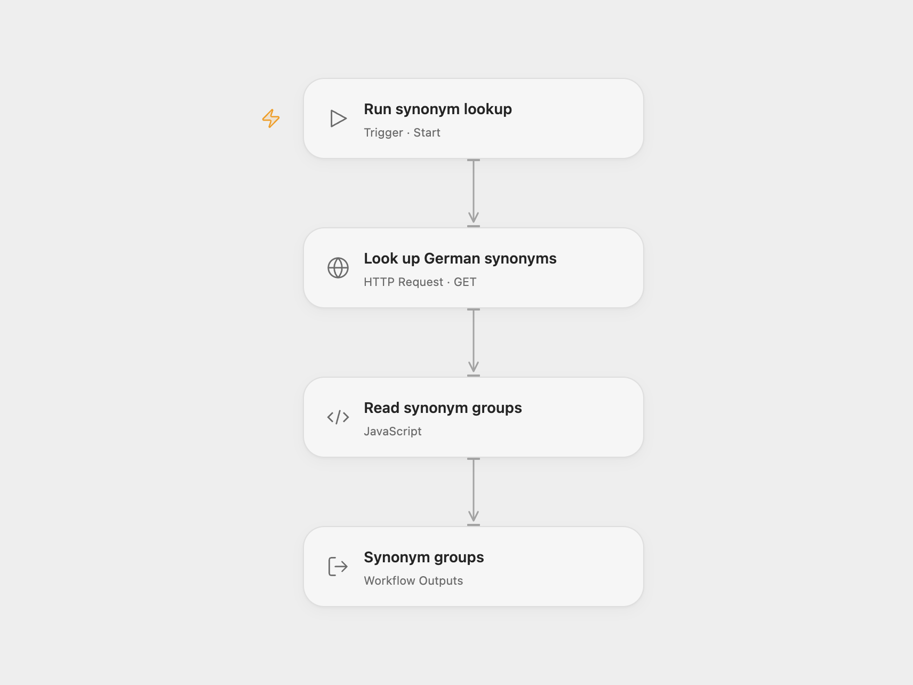

# German Synonym Lookup

Look up German synonym groups in [OpenThesaurus](https://www.openthesaurus.de/). The source example searches for `Hallo`.

<picture>
  <source media="(prefers-color-scheme: dark)" srcset="preview-dark.png">
  
</picture>

[Open Flow JSON](templates/german-synonym-lookup.openflow.json) · [n8n JSON](templates/german-synonym-lookup.n8n.json)

## Setup

In Open Flow, edit **Query q** in **Look up German synonyms**. Keep the JSON format and API URL. Set the **User-Agent** header to include your project’s homepage or contact email; the default is the Open Flow homepage. In n8n, set the word in **OpenThesaurus**. Its bundled client supplies n8n’s homepage as its User-Agent. Run manually.

Each run makes one search request and keeps the synonym groups in their returned order, including term labels and categories. It does not enable similar-spelling or substring options. Open Flow returns the group array and its count; n8n returns one item per group. No match produces an empty array in Open Flow and no result items in n8n.

Keep a visible [OpenThesaurus](https://www.openthesaurus.de/) link wherever you publish its results. Follow the service’s [API usage conditions](https://www.openthesaurus.de/about/api), including its contact header, rate limit and requirement to contact the maintainer before permanent use.

A service error or malformed response stops the run. There is no cache, history or automatic retry.

## Changes to the source

- Use an explicit JSON HTTP request in Open Flow, with the required contact header.
- Expose the unchanged synonym groups and count in Open Flow.

Source and license

Adapted from [OpenThesaurus synonym workflow](https://github.com/Zie619/n8n-workflows/blob/ae8cf6dc5b873cbb4f74587aa9180ed3a9f70682/workflows/Manual/0192_Manual_Openthesaurus_Import_Triggered.json) in [Zie619/n8n-workflows](https://github.com/Zie619/n8n-workflows). The source export does not identify a separate template author or license.

The collection’s [MIT notice](https://github.com/Zie619/n8n-workflows/blob/94007c1445d9258a7da116646b79473e7c7c3282/LICENSE) is pinned at a later revision. This is the collection notice at that revision; it does not establish a separate original template author's license. Our changes are listed above; see [repository licensing](../../README.md#licensing).

> MIT License
>
> Copyright (c) 2025 Zie619
>
> Permission is hereby granted, free of charge, to any person obtaining a copy
> of this software and associated documentation files (the "Software"), to deal
> in the Software without restriction, including without limitation the rights
> to use, copy, modify, merge, publish, distribute, sublicense, and/or sell
> copies of the Software, and to permit persons to whom the Software is
> furnished to do so, subject to the following conditions:
>
> The above copyright notice and this permission notice shall be included in all
> copies or substantial portions of the Software.
>
> THE SOFTWARE IS PROVIDED "AS IS", WITHOUT WARRANTY OF ANY KIND, EXPRESS OR
> IMPLIED, INCLUDING BUT NOT LIMITED TO THE WARRANTIES OF MERCHANTABILITY,
> FITNESS FOR A PARTICULAR PURPOSE AND NONINFRINGEMENT. IN NO EVENT SHALL THE
> AUTHORS OR COPYRIGHT HOLDERS BE LIABLE FOR ANY CLAIM, DAMAGES OR OTHER
> LIABILITY, WHETHER IN AN ACTION OF CONTRACT, TORT OR OTHERWISE, ARISING FROM,
> OUT OF OR IN CONNECTION WITH THE SOFTWARE OR THE USE OR OTHER DEALINGS IN THE
> SOFTWARE.

