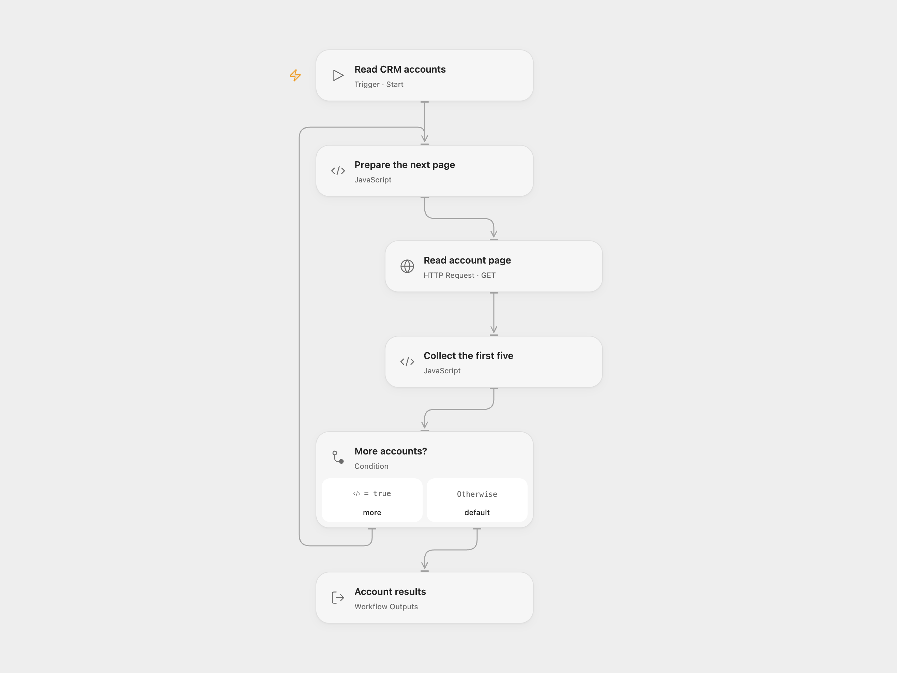

# Get Five Zoho CRM Accounts

Read Zoho CRM accounts and return up to five records.

<picture>
  <source media="(prefers-color-scheme: dark)" srcset="preview-dark.png">
  
</picture>

[Open Flow JSON](templates/get-five-zoho-crm-accounts.openflow.json) · [n8n JSON](templates/get-five-zoho-crm-accounts.n8n.json)

## Setup and use

Use an OAuth access token with account read permission. In Open Flow, bind a secret Variable containing the complete header value `Zoho-oauthtoken YOUR_ACCESS_TOKEN` in **Read account page** and run with your Zoho API domain, such as `https://www.zohoapis.com`. Refresh or replace the token when it expires. In n8n, connect Zoho OAuth credentials for the same data center.

## Behavior

The source defaults to accounts, a limit of five, and no filters. Both formats request pages of up to 200 until Zoho reports no more records, then return the first five. The output order follows Zoho; the workflow does not request a specific sort order. It may read more than five records before returning and is not a full account export.

Open Flow returns a state object with the records and number of pages read; n8n emits records as separate items. Records can change while pages are being read.

Inspiration &amp; credits

## Changes to the source

- Open Flow uses the Zoho CRM v2 API with a configured data-center domain and OAuth token, and exposes the returned records in a state object.

Adapted from [Get Zoho CRM accounts](https://github.com/Zie619/n8n-workflows/blob/ae8cf6dc5b873cbb4f74587aa9180ed3a9f70682/workflows/Manual/1021_Manual_Zohocrm_Automate_Triggered.json) in [Zie619/n8n-workflows](https://github.com/Zie619/n8n-workflows). The source export does not identify a separate template author or license.

The collection’s [MIT notice](https://github.com/Zie619/n8n-workflows/blob/94007c1445d9258a7da116646b79473e7c7c3282/LICENSE) is pinned at a later revision. This is the collection notice at that revision; it does not establish a separate original template author's license. Our changes are listed above; see [repository licensing](../../README.md#licensing).

> MIT License
>
> Copyright (c) 2025 Zie619
>
> Permission is hereby granted, free of charge, to any person obtaining a copy
> of this software and associated documentation files (the "Software"), to deal
> in the Software without restriction, including without limitation the rights
> to use, copy, modify, merge, publish, distribute, sublicense, and/or sell
> copies of the Software, and to permit persons to whom the Software is
> furnished to do so, subject to the following conditions:
>
> The above copyright notice and this permission notice shall be included in all
> copies or substantial portions of the Software.
>
> THE SOFTWARE IS PROVIDED "AS IS", WITHOUT WARRANTY OF ANY KIND, EXPRESS OR
> IMPLIED, INCLUDING BUT NOT LIMITED TO THE WARRANTIES OF MERCHANTABILITY,
> FITNESS FOR A PARTICULAR PURPOSE AND NONINFRINGEMENT. IN NO EVENT SHALL THE
> AUTHORS OR COPYRIGHT HOLDERS BE LIABLE FOR ANY CLAIM, DAMAGES OR OTHER
> LIABILITY, WHETHER IN AN ACTION OF CONTRACT, TORT OR OTHERWISE, ARISING FROM,
> OUT OF OR IN CONNECTION WITH THE SOFTWARE OR THE USE OR OTHER DEALINGS IN THE
> SOFTWARE.

