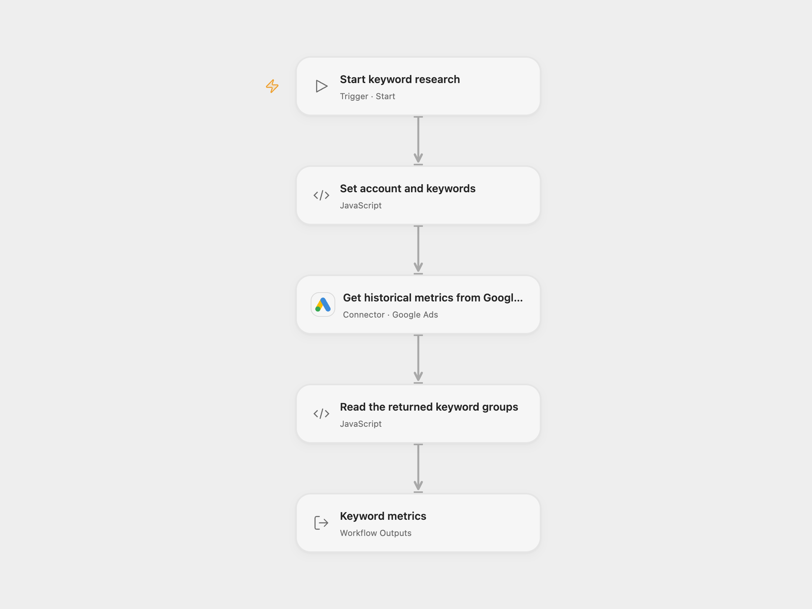

# Get Google Ads Keyword History

Look up historical Google Search metrics for an existing keyword list and keep Google Ads’ grouped variants and raw values.

<!-- template-actions:start -->
 
<!-- template-actions:end -->

<picture>
  <source media="(prefers-color-scheme: dark)" srcset="preview-dark.png">
  
</picture>

## Setup

1. Select a Google Ads connection in **Get historical metrics from Google Ads**. It needs Keyword Planner access for your Google Ads account. For production accounts, the OAuth client's Google Cloud project needs the access level Google requires for Keyword Planning. [Google Ads API access levels](https://developers.google.com/google-ads/api/docs/api-policy/access-levels)
2. In **Set account and keywords**, enter the 10-digit client account ID without dashes and a list of one to twenty keywords. Enter the 10-digit manager account ID only if you access the client through a manager.
3. Run manually and open **Keyword metrics**.

## Behavior

The workflow requests historical metrics for Google Search. It returns Google's result groups with the representative keyword, any close variants, and the original metrics. For example, Google can combine `desk lamp` and `desk lamps` into one result, so there may be fewer groups than keywords. [Google Ads historical metrics](https://developers.google.com/google-ads/api/docs/keyword-planning/generate-historical-metrics)

The results keep Google's reported search volumes, competition and bid values in their original units. Missing metrics remain missing. The workflow does not change campaigns or write the results to a database.

In n8n

Enter the same account IDs and keywords in **Set account and keywords**. Bind a generic **OAuth2 API** credential in **Get historical metrics from Google Ads**. Use a Google Cloud OAuth client with approved Google Ads access and register the redirect URL shown in the credential. Select **Authorization Code**, use `https://accounts.google.com/o/oauth2/v2/auth` and `https://oauth2.googleapis.com/token`, set scope `https://www.googleapis.com/auth/adwords`, and set authorization query parameters `access_type=offline&prompt=consent`. Use body client authentication. [Google Ads OAuth setup](https://developers.google.com/google-ads/api/docs/oauth/user-authentication)

Run manually. **Read the returned keyword groups** outputs one item per result group. Google now assigns API access to the OAuth client's Cloud project, so the request needs no developer token. [Developer token sunset](https://developers.google.com/google-ads/api/docs/api-policy/developer-token)

Inspiration &amp; credits

Adapted from [Generate SEO Keyword Search Volume Data using Google API](https://github.com/Zie619/n8n-workflows/blob/ae8cf6dc5b873cbb4f74587aa9180ed3a9f70682/workflows/Splitout/0614_Splitout_Manual_Import_Webhook.json) in [Zie619/n8n-workflows](https://github.com/Zie619/n8n-workflows). Attribution: Simon (Automake, original workflow) / Zie619 (collection).

The collection’s [MIT notice](https://github.com/Zie619/n8n-workflows/blob/94007c1445d9258a7da116646b79473e7c7c3282/LICENSE) is pinned at a later revision. This is the collection notice at that revision; it does not establish a separate original template author's license. Our changes are listed above; see [repository licensing](../../README.md#licensing).

> MIT License
>
> Copyright (c) 2025 Zie619
>
> Permission is hereby granted, free of charge, to any person obtaining a copy
> of this software and associated documentation files (the "Software"), to deal
> in the Software without restriction, including without limitation the rights
> to use, copy, modify, merge, publish, distribute, sublicense, and/or sell
> copies of the Software, and to permit persons to whom the Software is
> furnished to do so, subject to the following conditions:
>
> The above copyright notice and this permission notice shall be included in all
> copies or substantial portions of the Software.
>
> THE SOFTWARE IS PROVIDED "AS IS", WITHOUT WARRANTY OF ANY KIND, EXPRESS OR
> IMPLIED, INCLUDING BUT NOT LIMITED TO THE WARRANTIES OF MERCHANTABILITY,
> FITNESS FOR A PARTICULAR PURPOSE AND NONINFRINGEMENT. IN NO EVENT SHALL THE
> AUTHORS OR COPYRIGHT HOLDERS BE LIABLE FOR ANY CLAIM, DAMAGES OR OTHER
> LIABILITY, WHETHER IN AN ACTION OF CONTRACT, TORT OR OTHERWISE, ARISING FROM,
> OUT OF OR IN CONNECTION WITH THE SOFTWARE OR THE USE OR OTHER DEALINGS IN THE
> SOFTWARE.

