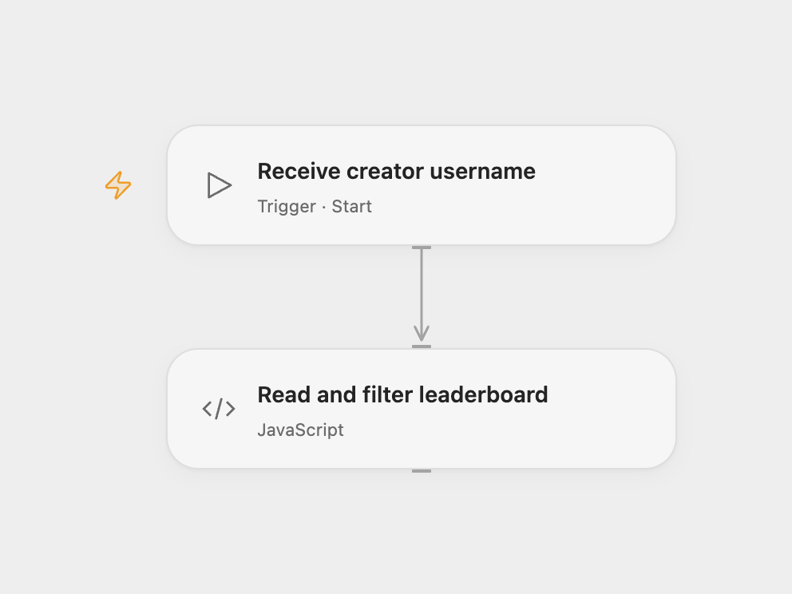

# Get n8n Creator Leaderboard Statistics

Look up a creator and their popular workflows in the community leaderboard.

<!-- template-actions:start -->
[](https://openflow.run/templates/get-n8n-creator-leaderboard-statistics/) [](templates/get-n8n-creator-leaderboard-statistics.n8n.json)
<!-- template-actions:end -->

<picture>
  <source media="(prefers-color-scheme: dark)" srcset="preview-dark.png">
  
</picture>

## Use

Run with an exact creator username. The workflow reads the public leaderboard, sorts creators by weekly insertions and retains the top 25, sorts workflows by weekly insertions and retains the top 300, then returns matching creator and workflow statistics. A creator outside the top 25 returns no match. The data changes as the upstream project updates it.

This callable component returns data for a downstream report. It does not implement the source chat interface or optional local file output. Open Flow downloads the large public files in bounded ranges and checks that the snapshot stays consistent.

<details>
<summary>Inspiration &amp; credits</summary>

Adapted from [AI Agent for n8n Creators Leaderboard - Find Popular Workflows](https://github.com/enescingoz/awesome-n8n-templates/blob/827110332c21cbe000ab13f6d292d5adb1f1f8db/OpenAI_and_LLMs/%F0%9F%94%A5%F0%9F%93%88%F0%9F%A4%96%20AI%20Agent%20for%20n8n%20Creators%20Leaderboard%20-%20Find%20Popular%20Workflows.json) in [enescingoz/awesome-n8n-templates](https://github.com/enescingoz/awesome-n8n-templates).

Source collection notice: © 2024–2026 Enes Cingoz, [CC BY 4.0](https://github.com/enescingoz/awesome-n8n-templates/blob/827110332c21cbe000ab13f6d292d5adb1f1f8db/LICENSE). The source export does not identify a separate template author or license. See [repository licensing](../../README.md#licensing) for the scope of OOMOL contributions and third-party material.

Changes from source: Publish the callable statistics component, omit the chat interface and optional local file output, and read the current array-shaped leaderboard data in bounded ranges. The returned statistics preserve the source's top-25 and top-300 filters.

Collection license notice:

```text
Creative Commons Attribution 4.0 International License

Copyright (c) 2024-2026 Enes Cingoz

You are free to:

  Share - copy and redistribute the material in any medium or format
  Adapt - remix, transform, and build upon the material for any purpose,
  even commercially.

Under the following terms:

  Attribution - You must give appropriate credit, provide a link to the
  license, and indicate if changes were made. You may do so in any
  reasonable manner, but not in any way that suggests the licensor
  endorses you or your use.

  No additional restrictions - You may not apply legal terms or
  technological measures that legally restrict others from doing
  anything the license permits.

Notices:

  You do not have to comply with the license for elements of the
  material in the public domain or where your use is permitted by an
  applicable exception or limitation.

  No warranties are given. The license may not give you all of the
  permissions necessary for your intended use. For example, other rights
  such as publicity, privacy, or moral rights may limit how you use the
  material.

For the full license text, see:
https://creativecommons.org/licenses/by/4.0/legalcode

```

</details>
