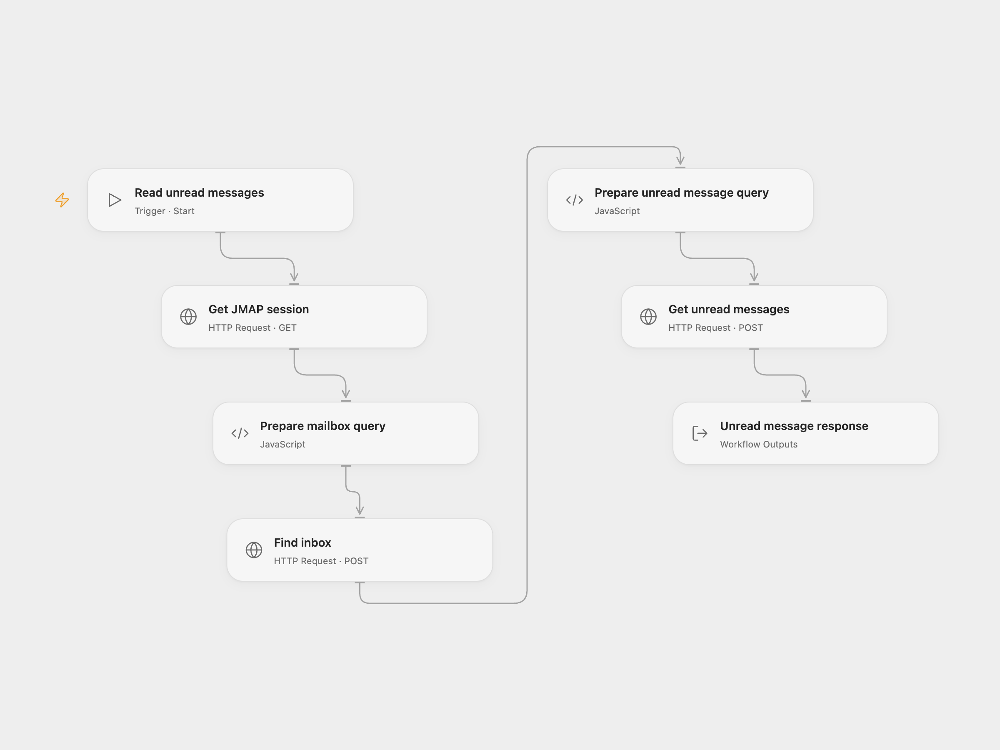

# Get the Latest Unread Fastmail Messages

Read the three most recent unread messages in the Fastmail inbox.

<picture>
  <source media="(prefers-color-scheme: dark)" srcset="preview-dark.png">
  
</picture>

[Open Flow JSON](templates/get-the-latest-unread-fastmail-messages.openflow.json) · [n8n JSON](templates/get-the-latest-unread-fastmail-messages.n8n.json)

## Setup and use

Create a Fastmail API token with mail read access and bind it as secret Variable FASTMAIL_API_TOKEN in all three Open Flow HTTP nodes. In n8n configure HTTP Header Auth with Authorization as the header name and Bearer followed by your API token as the value. Run manually and use one format.

## Behavior

The workflow finds the primary mail account and inbox, queries its three most recent unread messages and returns the JMAP response with IDs, received times, senders, subjects and keywords. Email metadata may appear in execution history.

Inspiration &amp; credits

## Changes to the source

- Open Flow uses native HTTP requests and returns the original JMAP response.

Adapted from [Fetch unread Fastmail inbox messages](https://github.com/Zie619/n8n-workflows/blob/ae8cf6dc5b873cbb4f74587aa9180ed3a9f70682/workflows/Manual/0374_Manual_Stickynote_Send_Webhook.json) in [Zie619/n8n-workflows](https://github.com/Zie619/n8n-workflows). The source export does not identify a separate template author or license.

The collection’s [MIT notice](https://github.com/Zie619/n8n-workflows/blob/94007c1445d9258a7da116646b79473e7c7c3282/LICENSE) is pinned at a later revision. This is the collection notice at that revision; it does not establish a separate original template author's license. Our changes are listed above; see [repository licensing](../../README.md#licensing).

> MIT License
>
> Copyright (c) 2025 Zie619
>
> Permission is hereby granted, free of charge, to any person obtaining a copy
> of this software and associated documentation files (the "Software"), to deal
> in the Software without restriction, including without limitation the rights
> to use, copy, modify, merge, publish, distribute, sublicense, and/or sell
> copies of the Software, and to permit persons to whom the Software is
> furnished to do so, subject to the following conditions:
>
> The above copyright notice and this permission notice shall be included in all
> copies or substantial portions of the Software.
>
> THE SOFTWARE IS PROVIDED "AS IS", WITHOUT WARRANTY OF ANY KIND, EXPRESS OR
> IMPLIED, INCLUDING BUT NOT LIMITED TO THE WARRANTIES OF MERCHANTABILITY,
> FITNESS FOR A PARTICULAR PURPOSE AND NONINFRINGEMENT. IN NO EVENT SHALL THE
> AUTHORS OR COPYRIGHT HOLDERS BE LIABLE FOR ANY CLAIM, DAMAGES OR OTHER
> LIABILITY, WHETHER IN AN ACTION OF CONTRACT, TORT OR OTHERWISE, ARISING FROM,
> OUT OF OR IN CONNECTION WITH THE SOFTWARE OR THE USE OR OTHER DEALINGS IN THE
> SOFTWARE.

