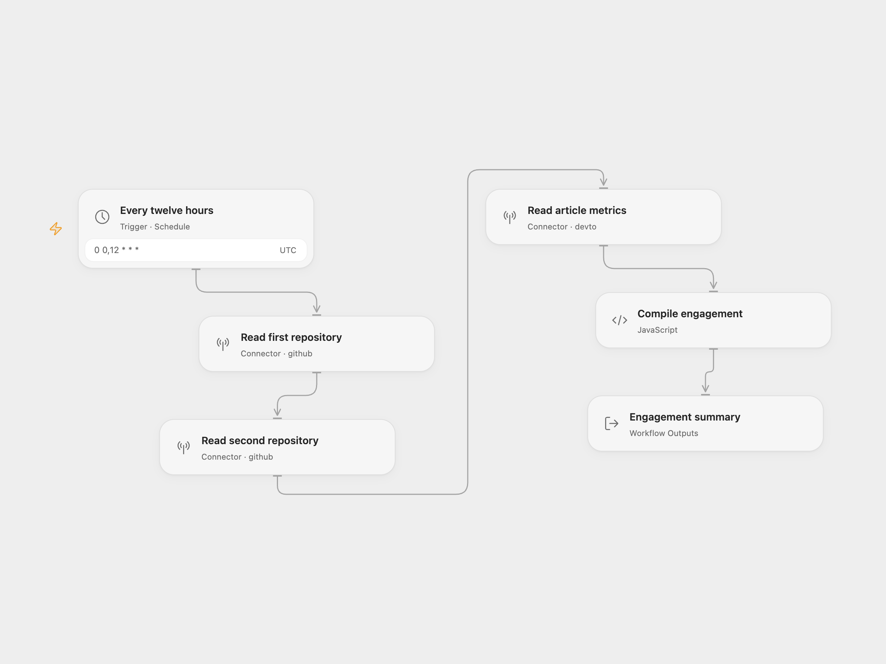

# GitHub & Dev.to Engagement

Collect stars, forks, and open issue counts for two GitHub repositories, plus reactions and comments for one Dev.to article. The workflow produces one summary at 00:00 and 12:00 UTC.

<picture>
  <source media="(prefers-color-scheme: dark)" srcset="preview-dark.png">
  
</picture>

[Open Flow JSON](templates/github-devto-engagement-monitor.openflow.json) · [n8n JSON](templates/github-devto-engagement-monitor.n8n.json)

## Setup

Import the JSON for your platform.

### Open Flow

Select a GitHub connection on both repository nodes and a Dev.to connection on the article node. Set up the Dev.to connection with your Dev.to API key, then replace the resource placeholders:

| Node | Configuration |
| --- | --- |
| Read first repository | `owner` and `repo` for the first repository |
| Read second repository | `owner` and `repo` for the second repository |
| Read article metrics | Article author's `username` and article `slug` |

The GitHub connection must have access to both repositories. Use a published Dev.to article. The connectors manage authentication and API requests; API rate limits still apply.

### n8n

Replace the three API URL placeholders:

| Node | URL format |
| --- | --- |
| GitHub Repo 1 | `https://api.github.com/repos/OWNER/REPOSITORY` |
| GitHub Repo 2 | `https://api.github.com/repos/OWNER/REPOSITORY` |
| dev.to Article 1 | `https://dev.to/api/articles/USERNAME/ARTICLE-SLUG` |

The n8n template uses HTTP Request nodes for public repositories and a published article. These public endpoints require no account connection and are subject to API rate limits.

Both formats use the schedule `0 0,12 * * *` in `UTC`. Confirm the timezone before enabling the workflow and run a manual test after configuration.

## Output

```json
{
  "checked_at": "2026-11-05T12:00:00.000Z",
  "repo1": { "stars": 123, "forks": 8, "open_issues": 2 },
  "repo2": { "stars": 0, "forks": 0, "open_issues": 0 },
  "article1": { "reactions": 11, "comments": 3 }
}
```

Open Flow exposes these fields as workflow outputs. In n8n, they are the result of `Compile Summary`. GitHub's `open_issues_count` includes open pull requests.

The three requests run in order. A failed request stops the run. This template produces a snapshot; it does not store historical results or send notifications.

## Improvements to the source

- Validate every metric and name missing or invalid fields in the error. Zero remains a valid count.
- Make the twice-daily schedule and UTC timezone explicit.
- Use the GitHub and Dev.to connectors in Open Flow. The n8n HTTP requests include an explicit User-Agent.
- Use explicit response references in both formats so all three results reach the summary.

## Source and license

Adapted from [GitHub Stars and Dev.to Engagement Monitor](https://github.com/enescingoz/awesome-n8n-templates/blob/827110332c21cbe000ab13f6d292d5adb1f1f8db/devops/GitHub%20Stars%20and%20Dev.to%20Engagement%20Monitor.json) in [enescingoz/awesome-n8n-templates](https://github.com/enescingoz/awesome-n8n-templates).

Source collection notice: © 2024–2026 Enes Cingoz, [CC BY 4.0](https://github.com/enescingoz/awesome-n8n-templates/blob/827110332c21cbe000ab13f6d292d5adb1f1f8db/LICENSE). The source export does not identify a separate template author or license. This adaptation includes the changes listed above; see [repository licensing](../../README.md#licensing) for the scope of OOMOL contributions and third-party material.
