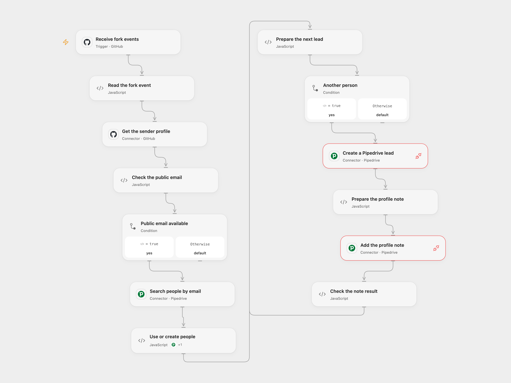

# Create Pipedrive Leads for GitHub Forks

Create a Pipedrive lead and GitHub profile note when a repository is forked.

<picture>
  <source media="(prefers-color-scheme: dark)" srcset="preview-dark.png">
  
</picture>

[Open Flow JSON](templates/github-fork-to-pipedrive-lead.openflow.json) · [n8n JSON](templates/github-fork-to-pipedrive-lead.n8n.json)

## Setup

Use a GitHub.com repository. Connect GitHub in **Receive fork events**, set its owner and name, and connect GitHub in **Get the sender profile**. Connect Pipedrive in **Search people by email** and the Action in **Use or create people**. Grant Pipedrive Provider API access in **Create a Pipedrive lead** and **Add the profile note**, using the same account. In n8n configure the GitHub and Pipedrive credentials and repository. Enable only one format.

## Behavior

For each fork event, the workflow reads the sender's public GitHub email and searches Pipedrive by exact, case-insensitive email. It processes up to 100 matches sequentially, completing each lead and note before starting the next. For each matching person it creates a lead and attaches a note with the sender's GitHub profile URL. If no person matches, it creates one named after the fork owner with the public email, then creates the lead and note. If no public email is available, it makes no Pipedrive changes.

Each event can create new leads; there is no deduplication. Concurrent runs can both create a person for the same email. A failure stops later writes, but earlier people, leads or notes remain. An uncertain write is not retried automatically; check Pipedrive before rerunning.

Inspiration &amp; credits

## Changes to the source

- Replace the source repository and credentials with user configuration. Use exact email matching to avoid linking a different address and skip missing public email.
- Fix the source's empty-search branch so a new person can be created, and correct the email reference. Reject matching people with missing names before writing. Upgrade the n8n HTTP node so GitHub credentials apply to the profile lookup.
- Process matching people one at a time in both formats, stopping on a failed lead or note. Escape the profile URL as HTML. Use the GitHub user and Pipedrive person Actions and Provider API for lead and note creation.

Adapted from [Add a new lead to Pipedrive once GitHub repo is forked](https://github.com/Zie619/n8n-workflows/blob/ae8cf6dc5b873cbb4f74587aa9180ed3a9f70682/workflows/Http/0252_HTTP_GitHub_Create_Webhook.json) in [Zie619/n8n-workflows](https://github.com/Zie619/n8n-workflows). The matching [n8n listing](https://n8n.io/workflows/1788-add-a-new-lead-to-pipedrive-once-github-repo-is-forked/) credits n8n Team. No separate original template license was found.

The collection’s [MIT notice](https://github.com/Zie619/n8n-workflows/blob/94007c1445d9258a7da116646b79473e7c7c3282/LICENSE) is pinned at a later revision. This is the collection notice at that revision; it does not establish a separate original template author's license. Our changes are listed above; see [repository licensing](../../README.md#licensing).

> MIT License
>
> Copyright (c) 2025 Zie619
>
> Permission is hereby granted, free of charge, to any person obtaining a copy
> of this software and associated documentation files (the "Software"), to deal
> in the Software without restriction, including without limitation the rights
> to use, copy, modify, merge, publish, distribute, sublicense, and/or sell
> copies of the Software, and to permit persons to whom the Software is
> furnished to do so, subject to the following conditions:
>
> The above copyright notice and this permission notice shall be included in all
> copies or substantial portions of the Software.
>
> THE SOFTWARE IS PROVIDED "AS IS", WITHOUT WARRANTY OF ANY KIND, EXPRESS OR
> IMPLIED, INCLUDING BUT NOT LIMITED TO THE WARRANTIES OF MERCHANTABILITY,
> FITNESS FOR A PARTICULAR PURPOSE AND NONINFRINGEMENT. IN NO EVENT SHALL THE
> AUTHORS OR COPYRIGHT HOLDERS BE LIABLE FOR ANY CLAIM, DAMAGES OR OTHER
> LIABILITY, WHETHER IN AN ACTION OF CONTRACT, TORT OR OTHERWISE, ARISING FROM,
> OUT OF OR IN CONNECTION WITH THE SOFTWARE OR THE USE OR OTHER DEALINGS IN THE
> SOFTWARE.

