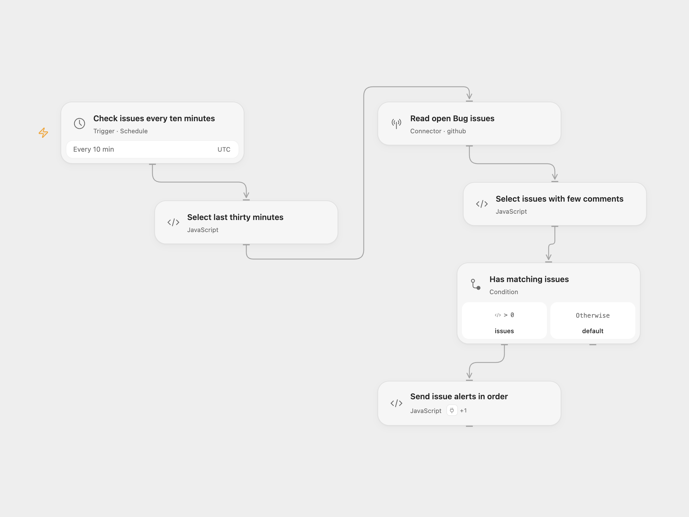

# GitHub Issues to Telegram

Check a repository every ten minutes. Send one Telegram alert for each matching open Bug issue with fewer than five comments.

<picture>
  <source media="(prefers-color-scheme: dark)" srcset="preview-dark.png">
  
</picture>

[Open Flow JSON](templates/github-low-comment-issues-telegram.openflow.json) · [n8n JSON](templates/github-low-comment-issues-telegram.n8n.json)

## Setup

In Open Flow, connect GitHub in **Read open Bug issues**, replace the owner and repository placeholders, and edit Labels if your repository uses a different label. The source filter is the case-sensitive name `Bug`. Connect your Telegram bot through **Actions** in **Send issue alerts in order** and set the destination channel username or numeric chat ID.

In n8n, configure the repository and GitHub account in **Get Github Issues**. Set the Telegram account and chat ID in **Send Message to @user**. Both formats use an explicit UTC schedule every ten minutes.

Each run queries the first 50 raw results for open, matching-label issues updated in the preceding 30 minutes. Pull requests are excluded. The workflow then selects issues with 0–4 comments and sends their title and link in GitHub’s returned order. It does not fetch another page. With no matches, it sends nothing.

“Updated” includes changes to older issues; these alerts are not limited to newly created issues. The 30-minute query window overlaps the ten-minute schedule, and the workflow keeps no notification history. An issue can generate repeated alerts across runs. A read failure prevents notifications; a send failure stops later alerts without replaying earlier ones.

Inspiration &amp; credits

## Changes to the source

- Add repository and chat placeholders and make the source’s 50-result limit explicit.
- Exclude pull requests from the n8n issue results.
- Escape issue titles and links for Telegram HTML and disable the automatic n8n footer.
- Preserve the 30-minute update window, comment threshold, and send order.

Adapted from [FetchGithubIssues](https://github.com/Zie619/n8n-workflows/blob/ae8cf6dc5b873cbb4f74587aa9180ed3a9f70682/workflows/Telegram/1945_Telegram_Schedule_Import_Scheduled.json) in [Zie619/n8n-workflows](https://github.com/Zie619/n8n-workflows). The source export does not identify a separate template author or license.

The collection’s [MIT notice](https://github.com/Zie619/n8n-workflows/blob/94007c1445d9258a7da116646b79473e7c7c3282/LICENSE) is pinned at a later revision. This is the collection notice at that revision; it does not establish a separate original template author's license. Our changes are listed above; see [repository licensing](../../README.md#licensing).

> MIT License
>
> Copyright (c) 2025 Zie619
>
> Permission is hereby granted, free of charge, to any person obtaining a copy
> of this software and associated documentation files (the "Software"), to deal
> in the Software without restriction, including without limitation the rights
> to use, copy, modify, merge, publish, distribute, sublicense, and/or sell
> copies of the Software, and to permit persons to whom the Software is
> furnished to do so, subject to the following conditions:
>
> The above copyright notice and this permission notice shall be included in all
> copies or substantial portions of the Software.
>
> THE SOFTWARE IS PROVIDED "AS IS", WITHOUT WARRANTY OF ANY KIND, EXPRESS OR
> IMPLIED, INCLUDING BUT NOT LIMITED TO THE WARRANTIES OF MERCHANTABILITY,
> FITNESS FOR A PARTICULAR PURPOSE AND NONINFRINGEMENT. IN NO EVENT SHALL THE
> AUTHORS OR COPYRIGHT HOLDERS BE LIABLE FOR ANY CLAIM, DAMAGES OR OTHER
> LIABILITY, WHETHER IN AN ACTION OF CONTRACT, TORT OR OTHERWISE, ARISING FROM,
> OUT OF OR IN CONNECTION WITH THE SOFTWARE OR THE USE OR OTHER DEALINGS IN THE
> SOFTWARE.

