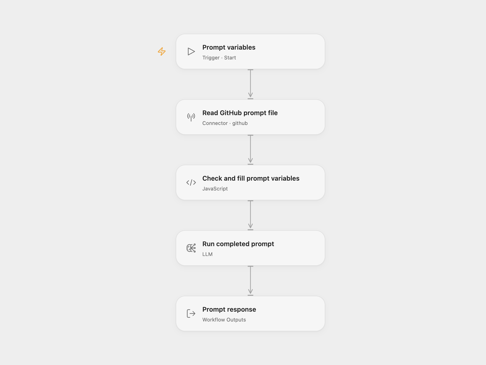

# GitHub Prompt Runner

Read a prompt file from GitHub, check its placeholders, fill them with supplied values, and return one model response.

<picture>
  <source media="(prefers-color-scheme: dark)" srcset="preview-dark.png">
  
</picture>

[Open Flow JSON](templates/github-prompt-runner.openflow.json) · [n8n JSON](templates/github-prompt-runner.n8n.json)

## Setup and use

In Open Flow, connect GitHub and edit the owner, repository and complete file path in **Read GitHub prompt file**. Select a configured `llama3.2` model in **Run completed prompt**. The GitHub account needs read access to the repository contents, including any private repository you select. The file is read from the repository's default branch.

Use Run and supply a `variables` object. For a prompt containing `Write about {{ product }} for {{ profile.company }}.`, supply:

```json
{
  "variables": {
    "company": "Example Company",
    "product": "Workflow templates"
  }
}
```

For n8n, edit **Set Prompt Settings**, connect the **GitHub** node, and configure the **Ollama Chat Model** credential for an Ollama service reachable from n8n. Confirm that the service provides [`llama3.2`](https://ollama.com/library/llama3.2), or choose another available text model in both formats. Execute the manual workflow and read `promptResponse` from **Prompt Output**.

## Behavior

The selected file must be a regular UTF-8 text file, at most 1 MiB. [GitHub's Contents API](https://docs.github.com/en/rest/repos/contents#get-repository-content) serves these small files with their encoded content. Files with empty or undecodable text, and directory paths, stop before the model.

Placeholders use `{{ key }}` or a dotted form such as `{{ profile.company }}`. Matching is case-sensitive and uses the final dotted key, so the latter reads `variables.company`. All values must be strings; extra variables are allowed. Substitution is one pass over single-line placeholders, uses only explicitly supplied keys, and treats inserted values as text. It does not evaluate n8n or JavaScript expressions. Missing keys stop before generation and are listed in the error.

Each successful run reads one file and has one model generation step. The model receives the completed prompt as its user message, keeps the source's default assistant system message, and returns `promptResponse`. The workflow does not write to GitHub or publish the response. No workflow-level retries are configured; the model adapter and provider can retry transient requests internally. Output quality depends on the prompt and selected model.

## Changes to the source

- Remove personal repository and company settings, and make the complete file path explicit.
- Use the same supplied variable object for the presence check and substitution, removing hard-coded replacement values.
- Read GitHub content through the platform connector and keep file decoding in memory.
- Replace the tool-less Agent with a Basic LLM Chain and map its actual `text` output to `promptResponse`.

## Source and license

Adapted from [Fetch Dynamic Prompts from GitHub and Auto-Populate n8n Expressions in Prompt](https://github.com/enescingoz/awesome-n8n-templates/blob/827110332c21cbe000ab13f6d292d5adb1f1f8db/OpenAI_and_LLMs/Fetch%20Dynamic%20Prompts%20from%20GitHub%20and%20Auto-Populate%20n8n%20Expressions%20in%20Prompt.json) in [enescingoz/awesome-n8n-templates](https://github.com/enescingoz/awesome-n8n-templates).

Source collection notice: © 2024–2026 Enes Cingoz, [CC BY 4.0](https://github.com/enescingoz/awesome-n8n-templates/blob/827110332c21cbe000ab13f6d292d5adb1f1f8db/LICENSE). The source export does not identify a separate template author or license. This adaptation includes the changes above; see [repository licensing](../../README.md#licensing) for OOMOL contributions and third-party material.
