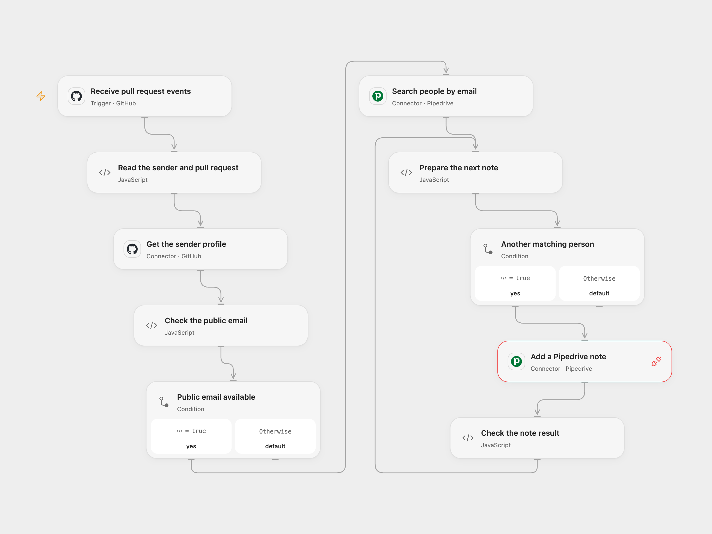

# Add GitHub Pull Requests to Pipedrive Contacts

Add a GitHub pull request link to Pipedrive people whose email matches the event sender.

<picture>
  <source media="(prefers-color-scheme: dark)" srcset="preview-dark.png">
  
</picture>

[Open Flow JSON](templates/github-pull-request-pipedrive-note.openflow.json) · [n8n JSON](templates/github-pull-request-pipedrive-note.n8n.json)

## Setup

Use a GitHub.com repository. Connect GitHub in **Receive pull request events**, set the repository owner and name, and connect GitHub in **Get the sender profile**. Connect Pipedrive in **Search people by email** and grant Provider API access in **Add a Pipedrive note** to the same account. The account needs permission to search people and create notes. In n8n configure the GitHub and Pipedrive credentials and repository. Enable only one format.

## Behavior

For each subscribed pull request event, the workflow reads the sender's public GitHub profile email and searches Pipedrive people by exact email, case insensitive. It adds a note containing the pull request URL to each returned person with a nonempty name, one at a time. People with empty names are skipped. Search returns at most 100 people per event; further matching people are not processed. If the sender has no public email or no person matches, it adds no notes. The sender is the actor who triggered the event, which can differ from the pull request author. GitHub may deliver several events for the same pull request; each matching event can add another note.

If a read fails, no later write occurs. If a note fails, earlier notes remain and later notes are not attempted. A write with an unknown outcome is not retried automatically; check Pipedrive before rerunning.

Inspiration &amp; credits

## Changes to the source

- Replace the source repository and credentials with user configuration. Use exact email matching rather than partial matching to avoid adding notes to people with different email addresses. Skip missing public email.
- Escape the URL as HTML in note content and use the GitHub user Action and Pipedrive Provider API for note creation.

Adapted from [Add a note to Pipedrive's contact once PR is added on GitHub](https://github.com/Zie619/n8n-workflows/blob/ae8cf6dc5b873cbb4f74587aa9180ed3a9f70682/workflows/Http/0253_HTTP_GitHub_Send_Webhook.json) in [Zie619/n8n-workflows](https://github.com/Zie619/n8n-workflows). The matching [n8n listing](https://n8n.io/workflows/1789-add-a-note-to-pipedrives-contact-once-pr-is-added-on-github/) credits n8n Team. No separate original template license was found.

The collection’s [MIT notice](https://github.com/Zie619/n8n-workflows/blob/94007c1445d9258a7da116646b79473e7c7c3282/LICENSE) is pinned at a later revision. This is the collection notice at that revision; it does not establish a separate original template author's license. Our changes are listed above; see [repository licensing](../../README.md#licensing).

> MIT License
>
> Copyright (c) 2025 Zie619
>
> Permission is hereby granted, free of charge, to any person obtaining a copy
> of this software and associated documentation files (the "Software"), to deal
> in the Software without restriction, including without limitation the rights
> to use, copy, modify, merge, publish, distribute, sublicense, and/or sell
> copies of the Software, and to permit persons to whom the Software is
> furnished to do so, subject to the following conditions:
>
> The above copyright notice and this permission notice shall be included in all
> copies or substantial portions of the Software.
>
> THE SOFTWARE IS PROVIDED "AS IS", WITHOUT WARRANTY OF ANY KIND, EXPRESS OR
> IMPLIED, INCLUDING BUT NOT LIMITED TO THE WARRANTIES OF MERCHANTABILITY,
> FITNESS FOR A PARTICULAR PURPOSE AND NONINFRINGEMENT. IN NO EVENT SHALL THE
> AUTHORS OR COPYRIGHT HOLDERS BE LIABLE FOR ANY CLAIM, DAMAGES OR OTHER
> LIABILITY, WHETHER IN AN ACTION OF CONTRACT, TORT OR OTHERWISE, ARISING FROM,
> OUT OF OR IN CONNECTION WITH THE SOFTWARE OR THE USE OR OTHER DEALINGS IN THE
> SOFTWARE.

