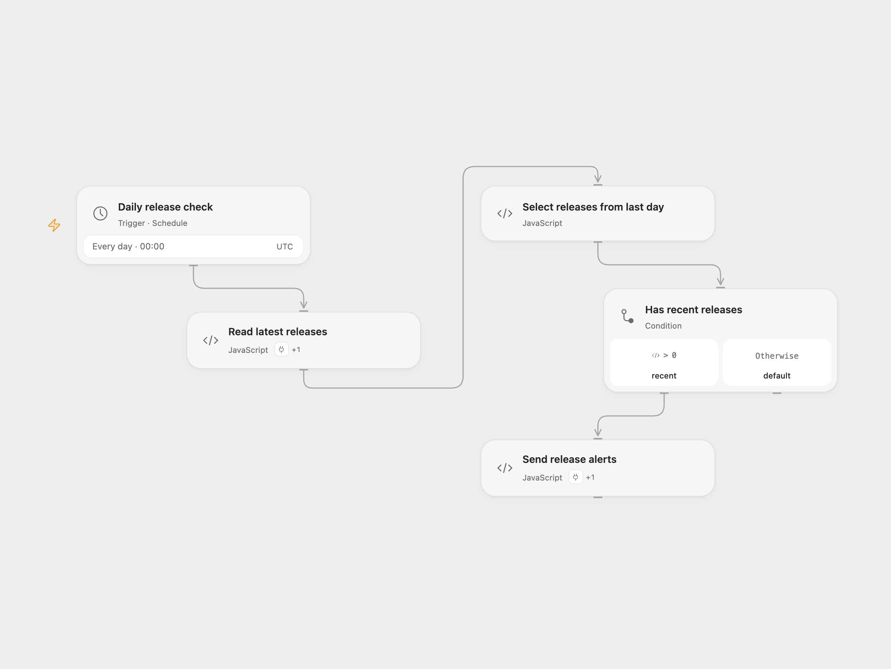

# GitHub Release Slack Alerts

Check the latest release of each configured GitHub repository every day. Send one Slack message per release published within the preceding 24 hours.

<picture>
  <source media="(prefers-color-scheme: dark)" srcset="preview-dark.png">
  
</picture>

[Open Flow JSON](templates/github-release-slack-alerts.openflow.json) · [n8n JSON](templates/github-release-slack-alerts.n8n.json)

## Setup

For Open Flow, import the JSON and configure:

| Node | Configuration |
| --- | --- |
| Daily release check | Set the schedule and timezone. The default is midnight UTC. |
| Read latest releases | Edit the repositories array and connect GitHub in the node’s Actions settings. |
| Send release alerts | Replace `YOUR_SLACK_CHANNEL_ID`, connect Slack in Actions, and invite the bot to the channel. |

The example repositories are `n8n-io/n8n` and `home-assistant/core`. For n8n, edit the list in **RepoConfig**, connect Slack in **Send Message**, and replace its channel ID. GitHub reads use the public latest-release API; add a GitHub credential on the HTTP node if your repository requires authentication.

Enable the workflow after setup. It reads one latest release per repository, in list order, before sending any notifications. An empty list or no recent releases sends no messages. A read failure stops all notifications; a Slack failure stops later messages. Rerunning can send duplicate alerts, and an earlier Slack message may already have been delivered. GitHub’s latest-release endpoint omits drafts and prereleases; a repository with no published release fails that read.

## Changes to the source

- Use a correct 24-hour date comparison and an explicit UTC schedule.
- Handle a missing release body as empty text, use the tag when a release name is absent, and link to the public release page.
- Escape Slack mention/link markup in repository names and release text.
- Keep repository identity with each release and preserve the order of reads and notifications.

## Source and license

Adapted from [GitHub release notifications to Slack](https://github.com/Zie619/n8n-workflows/blob/ae8cf6dc5b873cbb4f74587aa9180ed3a9f70682/workflows/Code/0546_Code_Schedule_Create_Scheduled.json) in [Zie619/n8n-workflows](https://github.com/Zie619/n8n-workflows). The source export does not identify a separate template author or license.

The collection’s [MIT notice](https://github.com/Zie619/n8n-workflows/blob/94007c1445d9258a7da116646b79473e7c7c3282/LICENSE) is pinned at a later revision. This is the collection notice at that revision; it does not establish a separate original template author's license. Our changes are listed above; see [repository licensing](../../README.md#licensing).

> MIT License
>
> Copyright (c) 2025 Zie619
>
> Permission is hereby granted, free of charge, to any person obtaining a copy
> of this software and associated documentation files (the "Software"), to deal
> in the Software without restriction, including without limitation the rights
> to use, copy, modify, merge, publish, distribute, sublicense, and/or sell
> copies of the Software, and to permit persons to whom the Software is
> furnished to do so, subject to the following conditions:
>
> The above copyright notice and this permission notice shall be included in all
> copies or substantial portions of the Software.
>
> THE SOFTWARE IS PROVIDED "AS IS", WITHOUT WARRANTY OF ANY KIND, EXPRESS OR
> IMPLIED, INCLUDING BUT NOT LIMITED TO THE WARRANTIES OF MERCHANTABILITY,
> FITNESS FOR A PARTICULAR PURPOSE AND NONINFRINGEMENT. IN NO EVENT SHALL THE
> AUTHORS OR COPYRIGHT HOLDERS BE LIABLE FOR ANY CLAIM, DAMAGES OR OTHER
> LIABILITY, WHETHER IN AN ACTION OF CONTRACT, TORT OR OTHERWISE, ARISING FROM,
> OUT OF OR IN CONNECTION WITH THE SOFTWARE OR THE USE OR OTHER DEALINGS IN THE
> SOFTWARE.
