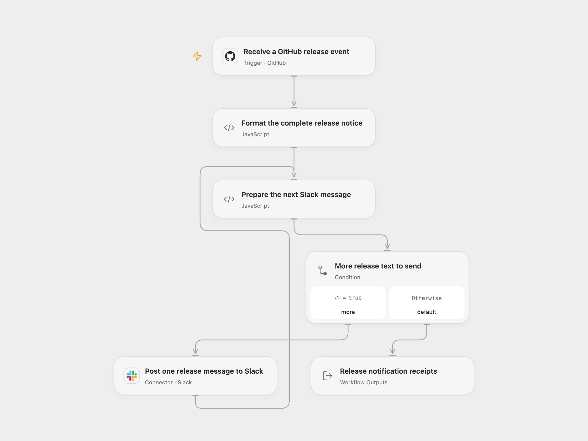

# GitHub Release Slack Notifications

Notify a Slack channel when GitHub sends a release event. Each notice includes the repository, tag, complete release notes and the release’s original URL.

<picture>
  <source media="(prefers-color-scheme: dark)" srcset="preview-dark.png">
  
</picture>

[Open Flow JSON](templates/github-release-slack-notifications.openflow.json) · [n8n JSON](templates/github-release-slack-notifications.n8n.json)

## Setup

In Open Flow, connect GitHub in **Receive a GitHub release event** and replace its owner and repository values. The Connection must be allowed to manage repository webhooks. Connect Slack in **Post one release message to Slack**, then set the destination channel ID in **Prepare the next Slack message**. The Slack app needs `chat:write` and access to that conversation; invite it to a private channel before activating the workflow.

In n8n, select **GitHub API** access-token credentials on the trigger, set its owner/repository, and select **Slack API** credentials and the channel ID on its send node. Both formats require a publicly reachable HTTPS webhook endpoint and permission to create repository webhooks. Activate only the format you intend to use.

## Use

Create, publish, edit or otherwise change a release in the repository. The workflow handles every `release` event delivered by GitHub. It does not limit notifications to published releases, so an edited or deleted release can use the source’s “New release is available” wording too. GitHub controls which draft and pre-release activities generate webhook deliveries.

A null release body is rendered as empty text. Notes are passed as Slack message text, preserving the source’s default Slack formatting and link handling. Slack may render markup, links and mentions in repository content. The workflow does not fetch release files or attachments.

Long notices are divided at Unicode codepoint boundaries into numbered messages of at most 4000 characters and posted in order. Join the content after each part label to reconstruct the original notice. No release text is truncated. Posting stops if Slack rejects a request, returns an invalid receipt or leaves the outcome uncertain. Earlier parts may already exist; check the channel before replaying. No workflow retry is added.

Open Flow returns all normalized Slack receipts (`ts` and `channelId`), the count and the release action. n8n retains complete Slack API response envelopes. A receipt confirms the post identifier and channel, rather than independently proving Slack’s rendering. The message identity comes from the selected Slack credentials. The source’s obsolete top-level `as_user` field is not read by the inspected current n8n Slack V1 implementation.

Open Flow identifies deliveries by GitHub’s delivery ID when supplied. n8n adds no workflow-level delivery history. Manual replay, redelivery or an uncertain post can produce duplicates. The complete event, parts and accumulated receipts must fit the inspected Open Flow host’s 1 MiB per-Code input/result budget; oversized data fails without truncation.

## Changes to the source

- Restore the original GitHub-to-Slack connection and replace private repository/channel values with configuration placeholders.
- Keep all delivered release actions and the complete repository/tag/notes/URL message.
- Use current secret-checked webhook registration and explicit native authentication.
- Split long notices sequentially and check each Slack receipt before posting the next part.

Source and license

Adapted from [GitHub release notifications to Slack](https://github.com/Zie619/n8n-workflows/blob/ae8cf6dc5b873cbb4f74587aa9180ed3a9f70682/workflows/Github/1068_GitHub_Slack_Automation_Triggered.json) in [Zie619/n8n-workflows](https://github.com/Zie619/n8n-workflows). The source export does not identify a separate template author or license.

The collection’s [MIT notice](https://github.com/Zie619/n8n-workflows/blob/94007c1445d9258a7da116646b79473e7c7c3282/LICENSE) is pinned at a later revision. This is the collection notice at that revision; it does not establish a separate original template author's license. Our changes are listed above; see [repository licensing](../../README.md#licensing).

> MIT License
>
> Copyright (c) 2025 Zie619
>
> Permission is hereby granted, free of charge, to any person obtaining a copy
> of this software and associated documentation files (the "Software"), to deal
> in the Software without restriction, including without limitation the rights
> to use, copy, modify, merge, publish, distribute, sublicense, and/or sell
> copies of the Software, and to permit persons to whom the Software is
> furnished to do so, subject to the following conditions:
>
> The above copyright notice and this permission notice shall be included in all
> copies or substantial portions of the Software.
>
> THE SOFTWARE IS PROVIDED "AS IS", WITHOUT WARRANTY OF ANY KIND, EXPRESS OR
> IMPLIED, INCLUDING BUT NOT LIMITED TO THE WARRANTIES OF MERCHANTABILITY,
> FITNESS FOR A PARTICULAR PURPOSE AND NONINFRINGEMENT. IN NO EVENT SHALL THE
> AUTHORS OR COPYRIGHT HOLDERS BE LIABLE FOR ANY CLAIM, DAMAGES OR OTHER
> LIABILITY, WHETHER IN AN ACTION OF CONTRACT, TORT OR OTHERWISE, ARISING FROM,
> OUT OF OR IN CONNECTION WITH THE SOFTWARE OR THE USE OR OTHER DEALINGS IN THE
> SOFTWARE.

