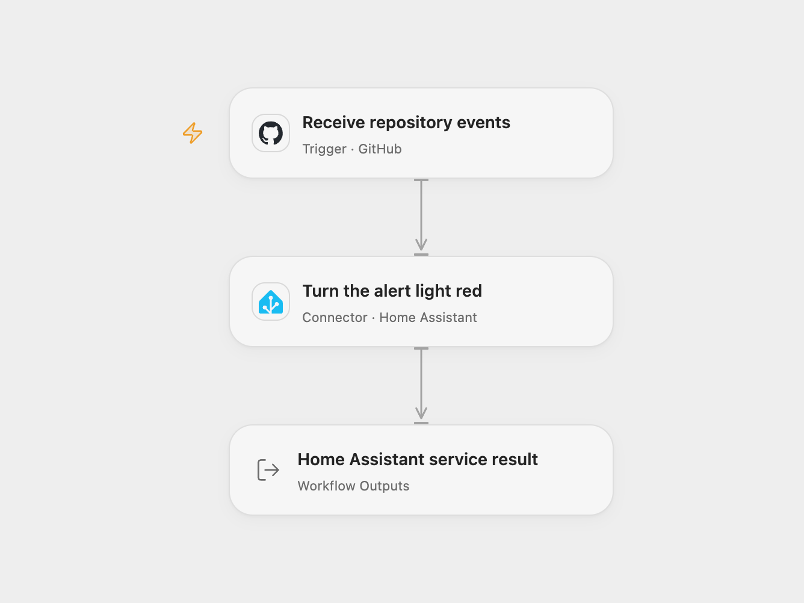

# GitHub Repository Alert Light

Turn an RGB light red when GitHub delivers an event from a selected repository. Use the light as a visible activity signal.

<picture>
  <source media="(prefers-color-scheme: dark)" srcset="preview-dark.png">
  
</picture>

[Open Flow JSON](templates/github-repository-alert-light.openflow.json) · [n8n JSON](templates/github-repository-alert-light.n8n.json)

## Setup

Connect GitHub in **Receive repository events** and replace its owner and repository values. The Connection needs permission to manage repository webhooks, and the workflow needs a publicly reachable HTTPS callback. The wildcard `*` subscribes to all repository event types offered by GitHub, including pushes, issues and pull requests.

Connect Home Assistant in **Turn the alert light red** using a long-lived access token and the public HTTPS root URL of your instance. The hosted Connector rejects private, local, loopback, metadata and IPv6 addresses. The instance must be reachable from that Connector and permit the selected account to call the service.

Replace `entity_id` in **Service Data** with an existing RGB-capable light, such as `light.office_lamp`. Keep **Domain** `light`, **Service** `turn_on`, and `rgb_color` `[255, 0, 0]` for red. You can change that RGB array to another supported color. Do not request service response data for this light service.

In n8n, select **GitHub API** access-token credentials on its trigger, set the owner/repository, then select **Home Assistant API** credentials on its light node. Configure the Home Assistant host, protocol, port and long-lived token for your n8n deployment. Replace the light entity under **Service Attributes**. Activate one format for the repository.

## Behavior

Each delivered repository event calls `light.turn_on` once with the configured entity and RGB color. It does not filter for failures or releases, flash the light, restore its previous state, turn it off, or apply a cooldown. The selected Home Assistant integration controls how the light implements the color request. GitHub determines which activities produce webhook deliveries.

Open Flow returns the Action’s complete normalized `changedStates` and `serviceResponse` outputs; n8n returns the service API’s changed-state rows and emits one empty object when the API returns an empty array. A successful call can return an empty list when no state changes while the service runs. Returned states can include other changes during that interval. The result records the service response and does not independently verify the physical light or guarantee that every state row is the configured entity.

Webhook signatures are checked using the registered secret. Open Flow uses a delivery ID for deduplication when GitHub supplies one; n8n adds no workflow-level delivery history. Redelivery or manual replay can call the light service again. An API error or uncertain outcome fails the run without a workflow retry; the light may already have changed.

## Changes to the source

- Restore the repository-event → light-service connection and replace private repository/entity values with setup placeholders.
- Keep the wildcard event subscription and one `light.turn_on` call with RGB red.
- Use current secret-checked GitHub registration and expose the Home Assistant Action result in Open Flow.

Source and license

Adapted from [Turn on a light to a specific color on any update in GitHub repository](https://github.com/Zie619/n8n-workflows/blob/ae8cf6dc5b873cbb4f74587aa9180ed3a9f70682/workflows/Github/0289_GitHub_Stickynote_Update_Triggered.json) in [Zie619/n8n-workflows](https://github.com/Zie619/n8n-workflows). The source export does not identify a separate template author or license.

The collection’s [MIT notice](https://github.com/Zie619/n8n-workflows/blob/94007c1445d9258a7da116646b79473e7c7c3282/LICENSE) is pinned at a later revision. This is the collection notice at that revision; it does not establish a separate original template author's license. Our changes are listed above; see [repository licensing](../../README.md#licensing).

> MIT License
>
> Copyright (c) 2025 Zie619
>
> Permission is hereby granted, free of charge, to any person obtaining a copy
> of this software and associated documentation files (the "Software"), to deal
> in the Software without restriction, including without limitation the rights
> to use, copy, modify, merge, publish, distribute, sublicense, and/or sell
> copies of the Software, and to permit persons to whom the Software is
> furnished to do so, subject to the following conditions:
>
> The above copyright notice and this permission notice shall be included in all
> copies or substantial portions of the Software.
>
> THE SOFTWARE IS PROVIDED "AS IS", WITHOUT WARRANTY OF ANY KIND, EXPRESS OR
> IMPLIED, INCLUDING BUT NOT LIMITED TO THE WARRANTIES OF MERCHANTABILITY,
> FITNESS FOR A PARTICULAR PURPOSE AND NONINFRINGEMENT. IN NO EVENT SHALL THE
> AUTHORS OR COPYRIGHT HOLDERS BE LIABLE FOR ANY CLAIM, DAMAGES OR OTHER
> LIABILITY, WHETHER IN AN ACTION OF CONTRACT, TORT OR OTHERWISE, ARISING FROM,
> OUT OF OR IN CONNECTION WITH THE SOFTWARE OR THE USE OR OTHER DEALINGS IN THE
> SOFTWARE.

