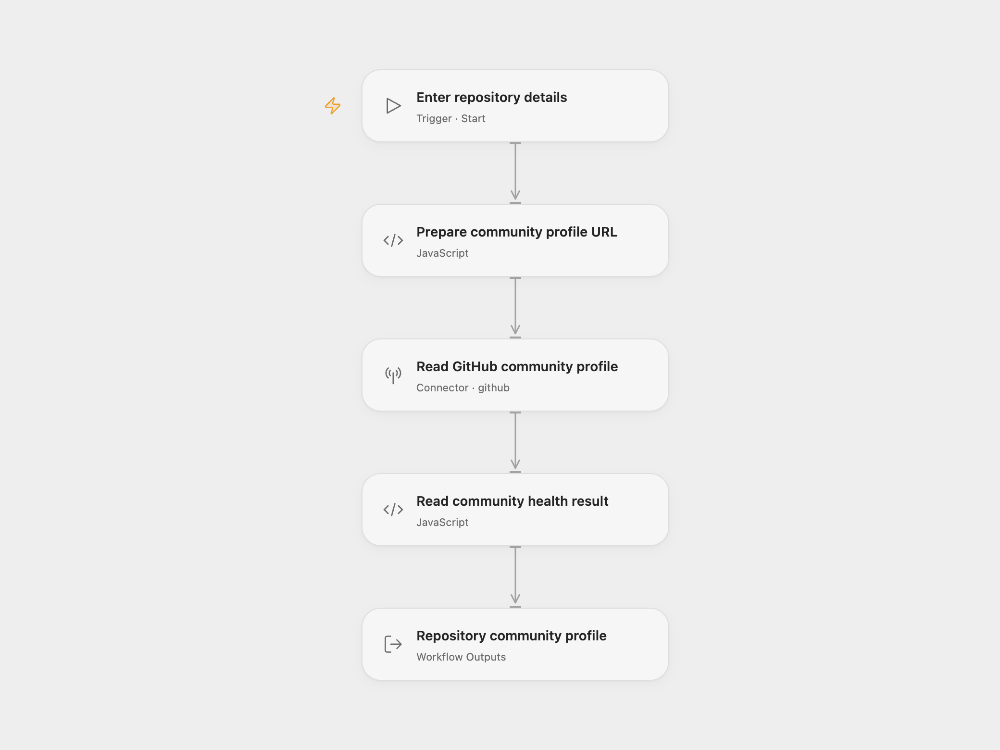

# GitHub Repository Profile

Read a GitHub repository’s community health score and the detected community files, including its README, license and contribution guides.

<picture>
  <source media="(prefers-color-scheme: dark)" srcset="preview-dark.png">
  
</picture>

[Open Flow JSON](templates/github-repository-profile.openflow.json) · [n8n JSON](templates/github-repository-profile.n8n.json)

## Setup

Select your GitHub account in **Read GitHub community profile** and allow **Provider API** access. This permission is separate from individual Action permissions. Run with the repository **Owner** and **Repo**. Use a GitHub.com repository that is not a fork. A fine-grained token needs **Contents: read** access to the repository. In n8n, edit the owner and repository in the HTTP URL and choose **GitHub API** credentials in **Read GitHub community profile**.

Each run makes one read request and returns the complete community profile. GitHub’s health percentage measures the presence of recommended community files. Missing files can be `null`; organization-owned repositories can include additional fields. The workflow preserves those values.

A missing or inaccessible repository can return HTTP 404. A failed request or unexpected response stops the run. No repository content is changed, and no workflow retry is configured.

Inspiration &amp; credits

## Changes to the source

- Require the repository owner and name as Open Flow run inputs.
- Use the GitHub Provider API in Open Flow and an explicit HTTP Request with GitHub credentials in n8n for the community profile endpoint.
- Expose the complete profile in Open Flow.

Adapted from [GitHub community profile workflow](https://github.com/Zie619/n8n-workflows/blob/ae8cf6dc5b873cbb4f74587aa9180ed3a9f70682/workflows/Manual/1066_Manual_GitHub_Create_Triggered.json) in [Zie619/n8n-workflows](https://github.com/Zie619/n8n-workflows). The source export does not identify a separate template author or license.

The collection’s [MIT notice](https://github.com/Zie619/n8n-workflows/blob/94007c1445d9258a7da116646b79473e7c7c3282/LICENSE) is pinned at a later revision. This is the collection notice at that revision; it does not establish a separate original template author's license. Our changes are listed above; see [repository licensing](../../README.md#licensing).

> MIT License
>
> Copyright (c) 2025 Zie619
>
> Permission is hereby granted, free of charge, to any person obtaining a copy
> of this software and associated documentation files (the "Software"), to deal
> in the Software without restriction, including without limitation the rights
> to use, copy, modify, merge, publish, distribute, sublicense, and/or sell
> copies of the Software, and to permit persons to whom the Software is
> furnished to do so, subject to the following conditions:
>
> The above copyright notice and this permission notice shall be included in all
> copies or substantial portions of the Software.
>
> THE SOFTWARE IS PROVIDED "AS IS", WITHOUT WARRANTY OF ANY KIND, EXPRESS OR
> IMPLIED, INCLUDING BUT NOT LIMITED TO THE WARRANTIES OF MERCHANTABILITY,
> FITNESS FOR A PARTICULAR PURPOSE AND NONINFRINGEMENT. IN NO EVENT SHALL THE
> AUTHORS OR COPYRIGHT HOLDERS BE LIABLE FOR ANY CLAIM, DAMAGES OR OTHER
> LIABILITY, WHETHER IN AN ACTION OF CONTRACT, TORT OR OTHERWISE, ARISING FROM,
> OUT OF OR IN CONNECTION WITH THE SOFTWARE OR THE USE OR OTHER DEALINGS IN THE
> SOFTWARE.

