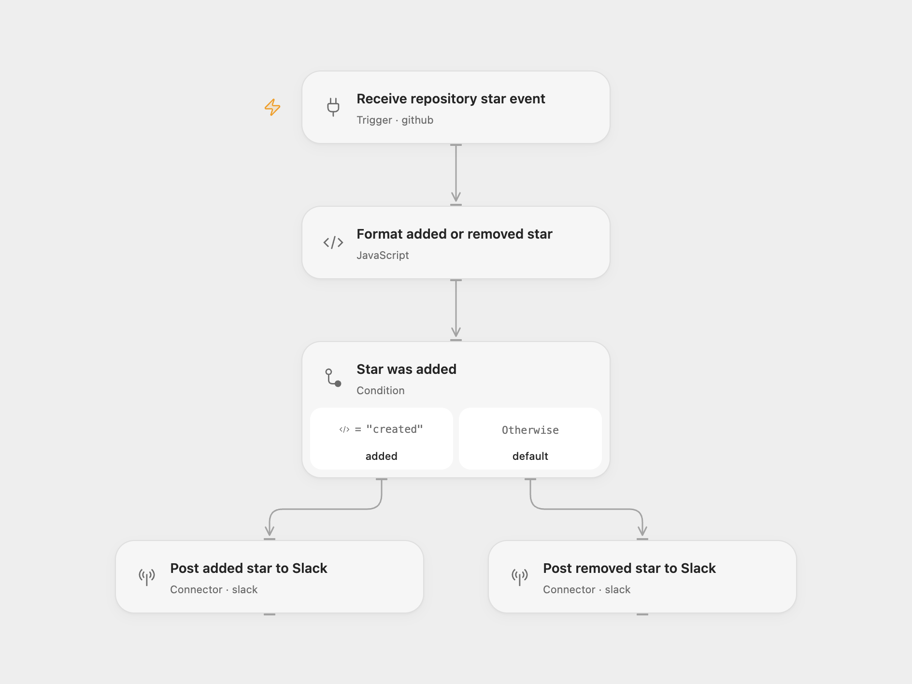

# GitHub Star Alerts in Slack

Send Slack a notification when someone adds or removes a star from your repository.

<picture>
  <source media="(prefers-color-scheme: dark)" srcset="preview-dark.png">
  
</picture>

[Open Flow JSON](templates/github-star-slack-alert.openflow.json) · [n8n JSON](templates/github-star-slack-alert.n8n.json)

## Setup

Connect GitHub in **Receive repository star event** and set the repository owner and name. The GitHub account must be able to manage that repository’s webhooks. Keep the subscribed event as `star`.

Connect Slack in both **Post added star to Slack** and **Post removed star to Slack**, and set their channel IDs. They can use the same channel or separate channels. The account must have permission to post there. In n8n, configure the equivalent **Github Trigger**, **Slack - Add**, and **Slack - Remove** nodes. Activate one format after setup.

Each `created` event sends one green attachment; each `deleted` event sends one red attachment. The message includes the sender’s GitHub login, profile link, avatar, and the repository star count from that event. The count is a snapshot from the webhook payload; the workflow does not query GitHub again or adjust the number itself.

The workflow keeps no notification history. Duplicate event deliveries or two active formats can produce repeated alerts. A malformed payload fails before Slack; a Slack error fails the run without an automatic retry.

## Changes to the source

- Replace the original repository and Slack channels with setup placeholders.
- Read the GitHub payload through the current node output instead of legacy `.data` expressions.
- Validate the two star actions and required sender/count fields.
- Add notification fallback text and escape dynamic Slack values while retaining the avatar, profile link, colors, and separate destinations.

## Source and license

Adapted from [GitHub star notifications](https://github.com/Zie619/n8n-workflows/blob/ae8cf6dc5b873cbb4f74587aa9180ed3a9f70682/workflows/Github/0973_GitHub_Slack_Create_Triggered.json) in [Zie619/n8n-workflows](https://github.com/Zie619/n8n-workflows). The source export does not identify a separate template author or license.

The collection’s [MIT notice](https://github.com/Zie619/n8n-workflows/blob/94007c1445d9258a7da116646b79473e7c7c3282/LICENSE) is pinned at a later revision. This is the collection notice at that revision; it does not establish a separate original template author's license. Our changes are listed above; see [repository licensing](../../README.md#licensing).

> MIT License
>
> Copyright (c) 2025 Zie619
>
> Permission is hereby granted, free of charge, to any person obtaining a copy
> of this software and associated documentation files (the "Software"), to deal
> in the Software without restriction, including without limitation the rights
> to use, copy, modify, merge, publish, distribute, sublicense, and/or sell
> copies of the Software, and to permit persons to whom the Software is
> furnished to do so, subject to the following conditions:
>
> The above copyright notice and this permission notice shall be included in all
> copies or substantial portions of the Software.
>
> THE SOFTWARE IS PROVIDED "AS IS", WITHOUT WARRANTY OF ANY KIND, EXPRESS OR
> IMPLIED, INCLUDING BUT NOT LIMITED TO THE WARRANTIES OF MERCHANTABILITY,
> FITNESS FOR A PARTICULAR PURPOSE AND NONINFRINGEMENT. IN NO EVENT SHALL THE
> AUTHORS OR COPYRIGHT HOLDERS BE LIABLE FOR ANY CLAIM, DAMAGES OR OTHER
> LIABILITY, WHETHER IN AN ACTION OF CONTRACT, TORT OR OTHERWISE, ARISING FROM,
> OUT OF OR IN CONNECTION WITH THE SOFTWARE OR THE USE OR OTHER DEALINGS IN THE
> SOFTWARE.
