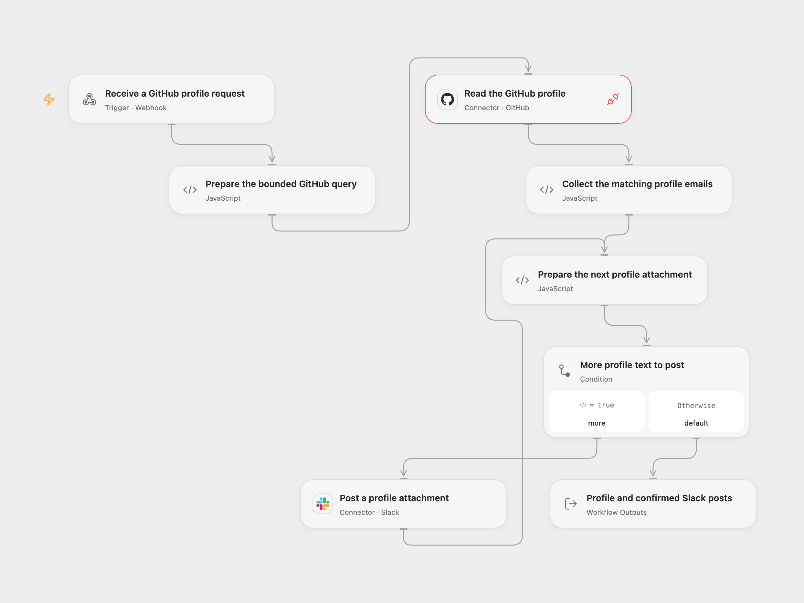

# GitHub User Profile to Slack

Post a GitHub user’s name, company, location, avatar and matching public or commit-author emails to a Slack conversation.

<picture>
  <source media="(prefers-color-scheme: dark)" srcset="preview-dark.png">
  
</picture>

[Open Flow JSON](templates/github-user-profile-to-slack.openflow.json) · [n8n JSON](templates/github-user-profile-to-slack.n8n.json)

## Setup

Connect GitHub in **Read the GitHub profile** and allow **Provider API** access. This is a separate permission from individual Actions. The Connection needs access to the queried GitHub data. Connect Slack in **Post a profile attachment** with `chat:write` and membership in the destination conversation.

In n8n, select **GitHub API** access-token credentials on the HTTP Request and **Slack API** access-token credentials on the send node. The workflow replaces the source’s inline token placeholder with managed credentials.

Enable the POST webhook behind access controls appropriate for your deployment. The endpoint itself has no shared-secret or Slack-signature check. Anyone with access can use your selected GitHub account and post to a submitted Slack conversation that your connection can reach.

## Use

Send a JSON object containing one GitHub username in `text` and one Slack conversation ID in `channel_id`:

```sh
curl -X POST -H 'Content-Type: application/json' \
  --data '{"text":"octocat","channel_id":"C0123456789"}' \
  'YOUR_WEBHOOK_URL'
```

This is a JSON webhook. It does not directly accept a Slack slash command’s form-encoded payload or verify Slack requests. Both formats acknowledge admission with HTTP 200 before the query or Slack post finishes. Check the workflow run for completion; the HTTP acknowledgment is not a delivery receipt.

The query reads the user’s public email and the last 25 pull requests returned by GitHub, with the last 25 commits in each. It makes no additional pagination requests. A commit email is included when its author name contains the nonempty profile name as literal, case-sensitive text, or exactly equals the submitted username. The public email comes first, duplicates are removed, and GitHub no-reply addresses are excluded. Commit-author names and emails can be self-reported; a name match does not verify that an email belongs to the user. This is a bounded lookup, not a complete email history.

A profile with no matching email still posts its other details. Missing name, company or location is shown as empty. A missing user, malformed response or GraphQL errors stop before Slack; partial GraphQL results are not posted. Profile text is escaped for Slack, with attachment Markdown disabled. The avatar is attached to the first message. Long results are posted sequentially as numbered attachments of at most 3800 characters, preserving all text.

Open Flow returns the complete queried profile, selected emails, scan counts and all normalized Slack `ts`/`channelId` receipts. n8n retains the profile summary and complete Slack API responses. A failed or uncertain Slack post stops later parts without a workflow retry. Earlier parts may already exist; check the conversation before repeating a request. Repeating a request can post again.

The complete request, GraphQL response, parts and accumulated receipts must fit the inspected Open Flow host’s 1 MiB per-Code input/result budget. Oversized data fails without truncation.

## Changes to the source

- Restore the complete webhook → GitHub → email collection → Slack sequence.
- Bind the username as a GraphQL variable and use managed credentials.
- Replace the stateful, unescaped name regular expression with literal matching; handle nullable profile and author fields.
- Remove GitHub no-reply addresses using an anchored domain check, escape Slack content and preserve long results with confirmed sequential posts.

<details>
<summary>Source and license</summary>

Adapted from [Slack-GitHub User Info](https://github.com/Zie619/n8n-workflows/blob/ae8cf6dc5b873cbb4f74587aa9180ed3a9f70682/workflows/Slack/1063_Slack_Graphql_Automation_Webhook.json) in [Zie619/n8n-workflows](https://github.com/Zie619/n8n-workflows). The source export does not identify a separate template author or license.

The collection’s [MIT notice](https://github.com/Zie619/n8n-workflows/blob/94007c1445d9258a7da116646b79473e7c7c3282/LICENSE) is pinned at a later revision. This is the collection notice at that revision; it does not establish a separate original template author's license. Our changes are listed above; see [repository licensing](../../README.md#licensing).

> MIT License
>
> Copyright (c) 2025 Zie619
>
> Permission is hereby granted, free of charge, to any person obtaining a copy
> of this software and associated documentation files (the "Software"), to deal
> in the Software without restriction, including without limitation the rights
> to use, copy, modify, merge, publish, distribute, sublicense, and/or sell
> copies of the Software, and to permit persons to whom the Software is
> furnished to do so, subject to the following conditions:
>
> The above copyright notice and this permission notice shall be included in all
> copies or substantial portions of the Software.
>
> THE SOFTWARE IS PROVIDED "AS IS", WITHOUT WARRANTY OF ANY KIND, EXPRESS OR
> IMPLIED, INCLUDING BUT NOT LIMITED TO THE WARRANTIES OF MERCHANTABILITY,
> FITNESS FOR A PARTICULAR PURPOSE AND NONINFRINGEMENT. IN NO EVENT SHALL THE
> AUTHORS OR COPYRIGHT HOLDERS BE LIABLE FOR ANY CLAIM, DAMAGES OR OTHER
> LIABILITY, WHETHER IN AN ACTION OF CONTRACT, TORT OR OTHERWISE, ARISING FROM,
> OUT OF OR IN CONNECTION WITH THE SOFTWARE OR THE USE OR OTHER DEALINGS IN THE
> SOFTWARE.

</details>
