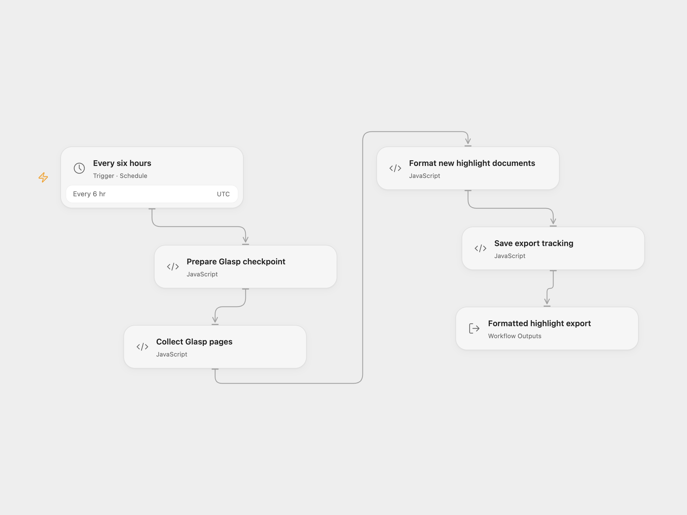

# Glasp Highlight Export

Collect highlight documents from your Glasp account every six hours and format them as plain text and Markdown. The workflow returns the formatted documents and tracks exported document IDs for 30 days.

<picture>
  <source media="(prefers-color-scheme: dark)" srcset="preview-dark.png">
  
</picture>

[Open Flow JSON](templates/glasp-highlight-export.openflow.json) · [n8n JSON](templates/glasp-highlight-export.n8n.json)

## Setup

Get your [Glasp access token](https://glasp.co/settings/access_token). In Open Flow, bind **Collect Glasp pages → accessToken** to a secret Variable containing that token. In n8n, create a Header Auth credential with name `Authorization` and value `Bearer <your token>`, then select it on **Glasp API**.

Review the schedule before enabling it. Both formats run at 00:00, 06:00, 12:00, and 18:00 UTC. Persistent tracking is saved by enabled production executions; n8n manual tests do not persist workflow static data.

## Export behavior

The first run queries changes since 24 hours and five minutes before it starts. Later runs query since the saved checkpoint minus five minutes. Pagination uses Glasp's opaque cursor without changing it, including when an empty page still supplies a cursor. See the [official Highlight Export API](https://glasp.co/docs/apis) for the current response and access-token contract.

Documents with no highlights are skipped. A tracked document ID is skipped for 30 days, even when it gains new highlights during that time. This is document-level export tracking. It is not a per-highlight synchronization service. Expired IDs are removed after filtering, so a document still present in the queried window may become eligible on a later run.

Each exported document includes its source URL, Glasp URL, tags, notes, highlight metadata, `highlightsText`, and `highlightsMarkdown`. Markdown uses UTC calendar dates and quotes every line of multiline highlights. Open Flow returns a `documents` array, `count`, and `message`; n8n returns one item per exported document. An empty export returns `No new highlights found.` with count zero.

The workflow reads at most 100 pages with a 30-second timeout per page. Open Flow bounds the collection task to 50 minutes and each HTTP response to the runtime's 1 MiB limit. Redirects are rejected in both formats. A failed request, malformed page, repeated cursor, unfinished pagination at the page limit, formatting error, or tracking-save failure fails the run. No workflow retry is configured. Successful output is returned after tracking is saved.

The checkpoint uses the time the run began preparing its query. Changes that occur during pagination remain eligible for the next poll. The five-minute overlap and document tracking reduce repeated exports, but overlapping runs can still export the same document. Keep runs from overlapping if that matters for your destination.

This template returns export data. It does not save to disk or write to Notion, Slack, or another destination. Before adding a destination, move tracking after its successful completion so a failed downstream write can be retried. Changing the Glasp account requires resetting its saved tracking state.

## Changes to the source

- Correct the n8n pagination option structure and enable the intended 100-page limit. Fail when the final page still has a cursor instead of advancing the checkpoint with missing pages.
- Encode cursors and timestamps as query parameters and keep authentication on the fixed Glasp host.
- Preserve a run-start checkpoint, validate pages before saving state, and check document IDs without inherited object properties.
- Use real line breaks and UTC highlight dates in formatted output.
- Give query preparation, page collection, formatting, and state saving separate visible steps in Open Flow.

Source and license

Adapted from [glasp-highlights-export-workflow](https://github.com/enescingoz/awesome-n8n-templates/blob/827110332c21cbe000ab13f6d292d5adb1f1f8db/Other_Integrations_and_Use_Cases/glasp-highlights-export-workflow.json) in [enescingoz/awesome-n8n-templates](https://github.com/enescingoz/awesome-n8n-templates). Related setup guidance is available in [Glasp's n8n tutorial](https://glasp.co/posts/how-to-autoexport-glasp-highlights-with-n8n).

Source collection notice: © 2024–2026 Enes Cingoz, [CC BY 4.0](https://github.com/enescingoz/awesome-n8n-templates/blob/827110332c21cbe000ab13f6d292d5adb1f1f8db/LICENSE). The source export does not identify a separate template author or license. This adaptation includes the changes listed above; see [repository licensing](../../README.md#licensing) for the scope of OOMOL contributions and third-party material.

