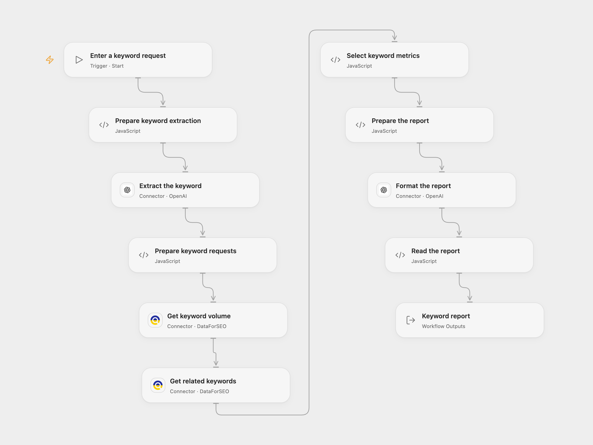

# Research Global Keyword Metrics

Research global search volume, competition and bid metrics for a keyword and related terms.

<picture>
  <source media="(prefers-color-scheme: dark)" srcset="preview-dark.png">
  
</picture>

[Open Flow JSON](templates/global-keyword-metrics-with-dataforseo.openflow.json) · [n8n JSON](templates/global-keyword-metrics-with-dataforseo.n8n.json)

## Setup

Connect OpenAI and a DataForSEO account with Provider API permission. Enter a keyword request and run the workflow. In n8n configure Google Gemini and HTTP Basic credentials for DataForSEO, then open the chat. Each run makes two billable DataForSEO requests and two model requests.

## Behavior

The workflow extracts one keyword, requests worldwide Google Ads search volume and relevant keyword suggestions, selects up to ten related terms, and formats their search volume, paid competition and low/high top-of-page bid estimates. Missing values remain null in the structured output. Generated prose may contain errors; check it against the structured values. Queries and results are shared with the connected providers.

Inspiration &amp; credits

## Changes to the source

- Replace the unavailable RapidAPI endpoint with DataForSEO Google Ads. The data source, ranking and numeric estimates may differ. Low and high values are Google Ads top-of-page bid estimates.
- Open Flow uses a manual input and OpenAI Responses; n8n retains the chat trigger and Gemini agents.

Adapted from [Research global keyword metrics](https://github.com/Zie619/n8n-workflows/blob/ae8cf6dc5b873cbb4f74587aa9180ed3a9f70682/workflows/Aggregate/1576_Aggregate_Stickynote_Automate_Webhook.json) in [Zie619/n8n-workflows](https://github.com/Zie619/n8n-workflows). The source export does not identify a separate template author or license.

The collection’s [MIT notice](https://github.com/Zie619/n8n-workflows/blob/94007c1445d9258a7da116646b79473e7c7c3282/LICENSE) is pinned at a later revision. This is the collection notice at that revision; it does not establish a separate original template author's license. Our changes are listed above; see [repository licensing](../../README.md#licensing).

> MIT License
>
> Copyright (c) 2025 Zie619
>
> Permission is hereby granted, free of charge, to any person obtaining a copy
> of this software and associated documentation files (the "Software"), to deal
> in the Software without restriction, including without limitation the rights
> to use, copy, modify, merge, publish, distribute, sublicense, and/or sell
> copies of the Software, and to permit persons to whom the Software is
> furnished to do so, subject to the following conditions:
>
> The above copyright notice and this permission notice shall be included in all
> copies or substantial portions of the Software.
>
> THE SOFTWARE IS PROVIDED "AS IS", WITHOUT WARRANTY OF ANY KIND, EXPRESS OR
> IMPLIED, INCLUDING BUT NOT LIMITED TO THE WARRANTIES OF MERCHANTABILITY,
> FITNESS FOR A PARTICULAR PURPOSE AND NONINFRINGEMENT. IN NO EVENT SHALL THE
> AUTHORS OR COPYRIGHT HOLDERS BE LIABLE FOR ANY CLAIM, DAMAGES OR OTHER
> LIABILITY, WHETHER IN AN ACTION OF CONTRACT, TORT OR OTHERWISE, ARISING FROM,
> OUT OF OR IN CONNECTION WITH THE SOFTWARE OR THE USE OR OTHER DEALINGS IN THE
> SOFTWARE.

