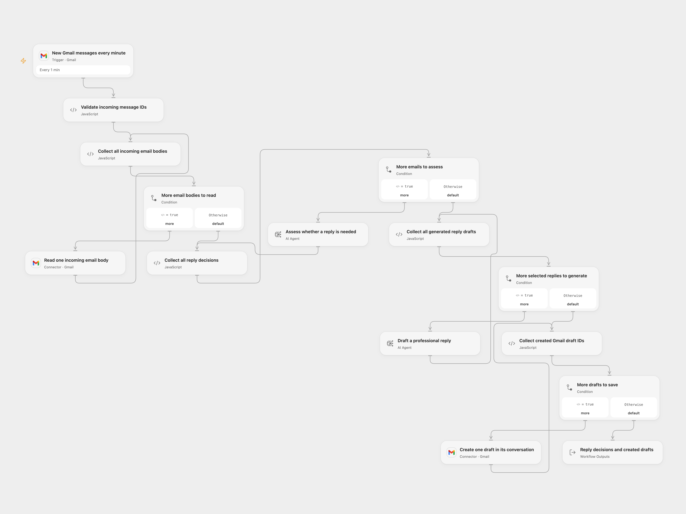

# Gmail AI Reply Draft

Assess incoming Gmail messages and prepare professional replies as drafts in their original conversations. Review and send them yourself.

<picture>
  <source media="(prefers-color-scheme: dark)" srcset="preview-dark.png">
  
</picture>

[Open Flow JSON](templates/gmail-ai-reply-draft.openflow.json) · [n8n JSON](templates/gmail-ai-reply-draft.n8n.json)

## Setup

Choose the same Gmail mailbox on **New Gmail messages every minute**, **Read one incoming email body** and **Create one draft in its conversation**. Allow message reading and draft creation. The shared template has no account connection. Configure available models on both AI Agent nodes before enabling the poll.

For n8n, select the same Gmail OAuth2 account on the Trigger and draft node, and configure both OpenAI model nodes. The assessment model must support temperature `0` and JSON object responses. The source used `gpt-4o` for assessment and `gpt-4-turbo` for writing; this template requires available model choices.

## Run

The mailbox is polled every minute with `-from:me`, excluding drafts, Spam and Trash. Open Flow starts from a new Gmail history checkpoint and drains history pages in batches of up to 25 candidate messages. n8n uses its own timestamp and pending-message queue. This is an incoming-email workflow, not a backfill of your existing inbox. Trigger checkpoint expiry, queue limits and failed executions need monitoring; messages are not automatically replayed after a workflow failure.

Every supplied body is read before assessment starts. The workflow assesses the whole batch, generates text only for messages marked `needsReply: true`, validates all generated replies, then saves drafts in order. Marketing emails are instructed to skip. A false decision creates no draft. A read, assessment or reply-generation failure prevents every draft in that batch. An error during saving stops later drafts and keeps earlier ones created.

The reply instructions preserve the source’s business-casual tone, same-language response, `Hello,` greeting and `Best,` ending. Yes/no questions request affirmative and negative alternatives separated by the source’s OR marker; unknown answers can remain as placeholders. Replies are model judgments and can be wrong. Email bodies are sent to your configured model services. Open Flow uses two native AI Agents, one model round each, without external tools. Their host adds output instructions and uses model-service generation settings; n8n retains assessment temperature `0` and JSON mode. Wording and decisions can differ. No deterministic result is promised.

Drafts address the incoming From field, add the source’s `Re: ` subject prefix, and use the conversation’s thread and reply headers. They do not add CC, attachments or an automatic send. Plain reply text is escaped before HTML line breaks are added. Gmail may read the thread’s current latest message when constructing reply headers.

No additional draft deduplication or workflow-level retry is added. A lost draft-write response may leave a draft created; inspect Drafts before repeating the run. n8n’s model adapter allows two additional transient retries; Open Flow Agent does not retry its model round. Complete message and draft collections must fit the platform’s execution and Code byte budgets, including 1 MiB per Code input/result in the inspected Open Flow host, and each model’s context. Oversized data fails instead of producing a truncated batch.

The Open Flow result lists each decision and created draft ID with its selected conversation. It is an acceptance record, not an independent read-back audit. n8n produces no further items if none need a reply.

## Changes to the source

- Correct the assessment input, structured decision field and current Gmail body/header references.
- Require available model choices and retain two separate assessment/writing steps.
- Preserve batch phase boundaries and validate every reply before writing.
- Escape plain-text replies before HTML formatting and check draft confirmations.

Source and license

Adapted from [Gmail AI Auto-Responder: Create Draft Replies to incoming emails](https://github.com/enescingoz/awesome-n8n-templates/blob/827110332c21cbe000ab13f6d292d5adb1f1f8db/Gmail_and_Email_Automation/Gmail%20AI%20Auto-Responder_%20Create%20Draft%20Replies%20to%20incoming%20emails.json) in [enescingoz/awesome-n8n-templates](https://github.com/enescingoz/awesome-n8n-templates).

Source collection notice: © 2024–2026 Enes Cingoz, [CC BY 4.0](https://github.com/enescingoz/awesome-n8n-templates/blob/827110332c21cbe000ab13f6d292d5adb1f1f8db/LICENSE). The source export does not identify a separate template author or license. See [repository licensing](../../README.md#licensing) for the scope of OOMOL contributions and third-party material.

