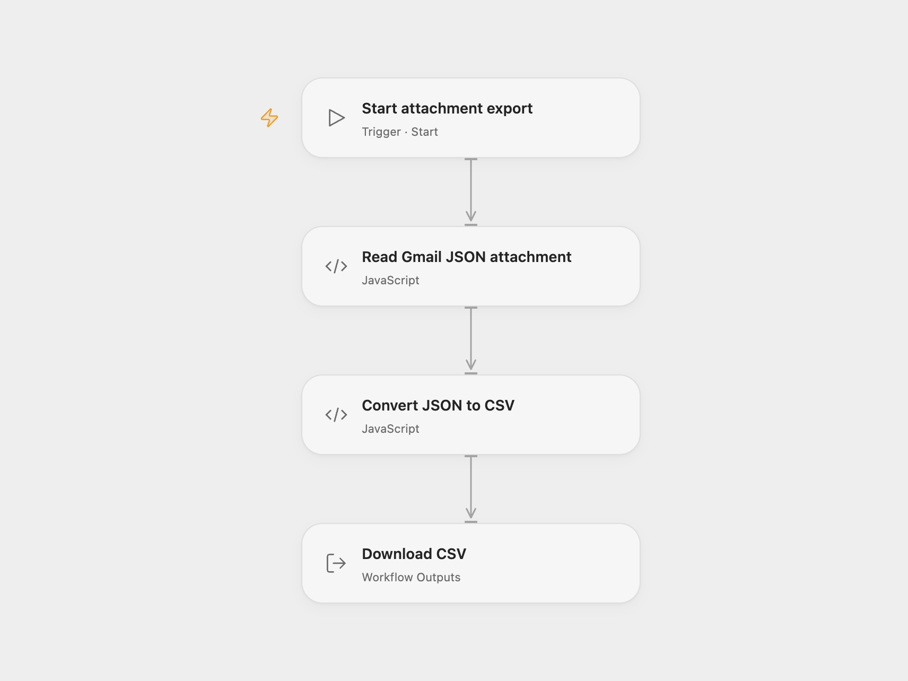

# Convert a Gmail JSON Attachment to CSV

Find a Gmail message, read a named JSON attachment and export it to CSV.

<picture>
  <source media="(prefers-color-scheme: dark)" srcset="preview-dark.png">
  
</picture>

[Open Flow JSON](templates/gmail-json-attachment-to-csv.openflow.json) · [n8n JSON](templates/gmail-json-attachment-to-csv.n8n.json)

## Setup

In **Read Gmail JSON attachment**, enter a Gmail search and the exact attachment filename, and bind a secret Variable containing a Gmail OAuth access token with read permission. Refresh the token when it expires. The first matching message must contain exactly one attachment with that filename. Run manually and download `users_spreadsheet.csv`.

In n8n, connect Gmail, set the same search in **Gmail**, and set the filename in **Select JSON attachment**. Run manually. The source did not specify a search or attachment name and did not download the binary data, so these settings are required.

## Behavior

The attachment must contain a JSON object or array. Its nested keys are flattened into dot-separated CSV columns, matching the source Spreadsheet File node; the JSON document becomes one CSV row. The workflow does not change the message. Gmail data and the file can contain sensitive information; restrict execution and artifact access. Attachment and request sizes are subject to runtime limits.

Inspiration &amp; credits

## Changes to the source

- Enable Gmail attachment download, select the intended JSON by filename, and add a manual trigger.

Adapted from [JSON file to spreadsheet](https://github.com/Zie619/n8n-workflows/blob/ae8cf6dc5b873cbb4f74587aa9180ed3a9f70682/workflows/Gmail/0221_Gmail_Movebinarydata_Send.json) in [Zie619/n8n-workflows](https://github.com/Zie619/n8n-workflows). The source export does not identify a separate template author or license.

The collection’s [MIT notice](https://github.com/Zie619/n8n-workflows/blob/94007c1445d9258a7da116646b79473e7c7c3282/LICENSE) is pinned at a later revision. This is the collection notice at that revision; it does not establish a separate original template author's license. Our changes are listed above; see [repository licensing](../../README.md#licensing).

> MIT License
>
> Copyright (c) 2025 Zie619
>
> Permission is hereby granted, free of charge, to any person obtaining a copy
> of this software and associated documentation files (the "Software"), to deal
> in the Software without restriction, including without limitation the rights
> to use, copy, modify, merge, publish, distribute, sublicense, and/or sell
> copies of the Software, and to permit persons to whom the Software is
> furnished to do so, subject to the following conditions:
>
> The above copyright notice and this permission notice shall be included in all
> copies or substantial portions of the Software.
>
> THE SOFTWARE IS PROVIDED "AS IS", WITHOUT WARRANTY OF ANY KIND, EXPRESS OR
> IMPLIED, INCLUDING BUT NOT LIMITED TO THE WARRANTIES OF MERCHANTABILITY,
> FITNESS FOR A PARTICULAR PURPOSE AND NONINFRINGEMENT. IN NO EVENT SHALL THE
> AUTHORS OR COPYRIGHT HOLDERS BE LIABLE FOR ANY CLAIM, DAMAGES OR OTHER
> LIABILITY, WHETHER IN AN ACTION OF CONTRACT, TORT OR OTHERWISE, ARISING FROM,
> OUT OF OR IN CONNECTION WITH THE SOFTWARE OR THE USE OR OTHER DEALINGS IN THE
> SOFTWARE.

SheetJS xlsx 0.20.2 is included under the [Apache License 2.0](https://www.apache.org/licenses/LICENSE-2.0); copyright 2013-present SheetJS. The full license is included in the workflow module.

