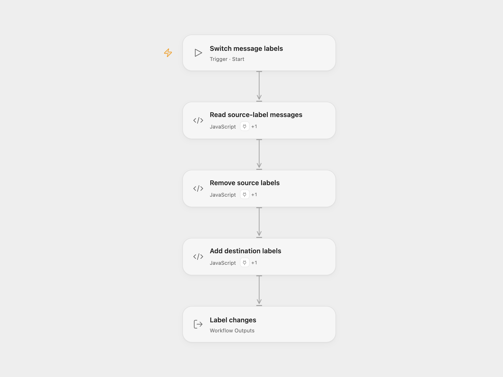

# Gmail Label Switcher

Select a batch of messages with one Gmail label, remove that label, and add a destination label.

<picture>
  <source media="(prefers-color-scheme: dark)" srcset="preview-dark.png">
  
</picture>

[Open Flow JSON](templates/gmail-label-switcher.openflow.json) · [n8n JSON](templates/gmail-label-switcher.n8n.json)

## Setup

In Open Flow, connect Gmail through the **Actions** settings of **Read source-label messages**, **Remove source labels**, and **Add destination labels**. Use the same mailbox for all three. Set Source Label ID in the reader and Destination Label ID in the final label step. The reader limit defaults to 10 messages.

In n8n, connect the same Gmail account in all three Gmail nodes. Set the source label in **Gmail** and the destination label in **Gmail2**. **Gmail1** reads its source label from **Gmail**. Return All is disabled and Limit is 10 by default; keep that setting to match Open Flow’s single-batch behavior.

Run manually. The workflow reads the selected batch before changing labels. It removes the source label from every selected message in order, then adds the destination label to every selected message in the same order. Other labels remain attached. With no matches, it changes nothing. Open Flow returns the modified message records and the number of removals and additions.

A service error stops the run without replaying earlier writes. A removal error prevents the addition phase. An addition error can leave earlier messages with the destination label and later messages with neither configured label. Check the mailbox before rerunning; messages whose source label was already removed will no longer match the reader.

## Changes to the source

- Replace mailbox-specific labels with setup placeholders and make the source’s 10-message default explicit.
- Keep the two label-changing phases separate and expose their modified messages and completed counts in Open Flow.

## Source and license

Adapted from [Get messages with a certain label, remove the label, and add a new one](https://github.com/Zie619/n8n-workflows/blob/ae8cf6dc5b873cbb4f74587aa9180ed3a9f70682/workflows/Manual/0240_Manual_Gmail_Create_Triggered.json) in [Zie619/n8n-workflows](https://github.com/Zie619/n8n-workflows). The source export does not identify a separate template author or license.

The collection’s [MIT notice](https://github.com/Zie619/n8n-workflows/blob/94007c1445d9258a7da116646b79473e7c7c3282/LICENSE) is pinned at a later revision. This is the collection notice at that revision; it does not establish a separate original template author's license. Our changes are listed above; see [repository licensing](../../README.md#licensing).

> MIT License
>
> Copyright (c) 2025 Zie619
>
> Permission is hereby granted, free of charge, to any person obtaining a copy
> of this software and associated documentation files (the "Software"), to deal
> in the Software without restriction, including without limitation the rights
> to use, copy, modify, merge, publish, distribute, sublicense, and/or sell
> copies of the Software, and to permit persons to whom the Software is
> furnished to do so, subject to the following conditions:
>
> The above copyright notice and this permission notice shall be included in all
> copies or substantial portions of the Software.
>
> THE SOFTWARE IS PROVIDED "AS IS", WITHOUT WARRANTY OF ANY KIND, EXPRESS OR
> IMPLIED, INCLUDING BUT NOT LIMITED TO THE WARRANTIES OF MERCHANTABILITY,
> FITNESS FOR A PARTICULAR PURPOSE AND NONINFRINGEMENT. IN NO EVENT SHALL THE
> AUTHORS OR COPYRIGHT HOLDERS BE LIABLE FOR ANY CLAIM, DAMAGES OR OTHER
> LIABILITY, WHETHER IN AN ACTION OF CONTRACT, TORT OR OTHERWISE, ARISING FROM,
> OUT OF OR IN CONNECTION WITH THE SOFTWARE OR THE USE OR OTHER DEALINGS IN THE
> SOFTWARE.
