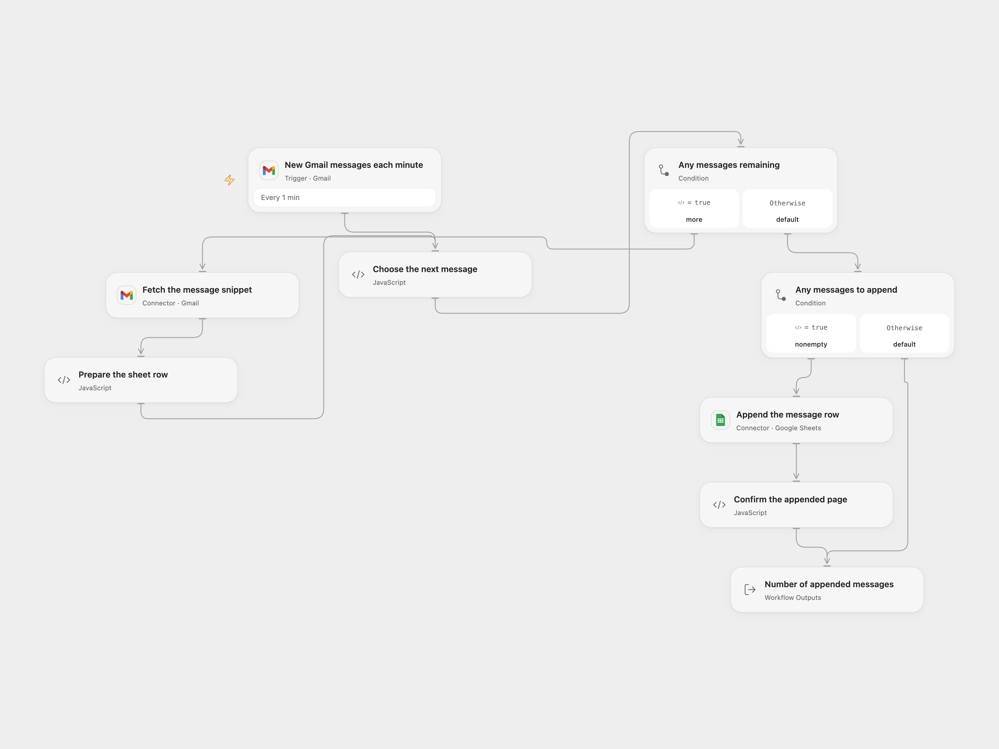

# Gmail Message Snippets to Google Sheets

Append the sender, subject and Gmail snippet of each new message to a Google Sheet.

<picture>
  <source media="(prefers-color-scheme: dark)" srcset="preview-dark.png">
  
</picture>

[Open Flow JSON](templates/gmail-message-snippets-to-google-sheets.openflow.json) · [n8n JSON](templates/gmail-message-snippets-to-google-sheets.n8n.json)

## Setup

Connect the same Gmail mailbox to **New Gmail messages each minute** and **Fetch the message snippet**. Connect Google Sheets in **Append the message row**, set the spreadsheet ID and A1 range, and arrange the destination columns as `Sender Email`, `Subject`, `body`. The body column receives Gmail’s snippet, not the full email body.

In n8n, select Gmail and Google Sheets credentials and select the spreadsheet and sheet in the Google Sheets node. Set the same three column names. Activate only one format to avoid duplicate rows.

## Behavior

The poll starts from the current mailbox position and processes new messages, not existing history. Each delivered message is fetched; all rows in a poll page are appended in one request after the reads succeed. An absent Gmail snippet is written as an empty cell. The poll may emit up to 50 messages per page; further pages are handled by later polls. Both formats exclude drafts, spam, trash and outgoing-only messages. The n8n trigger also excludes scheduled messages; the Open Flow trigger does not add that filter. Open Flow uses Gmail history checkpoints while n8n uses its own time cursor and queue. The source used n8n Trigger 1.2, which could include outgoing-only messages and read only the first list page. This version uses Trigger 1.4 with a 50-message budget and a backlog queue to match the incoming-mail purpose; check its warnings if the backlog exceeds the native queue limits. These mechanisms do not guarantee exactly-once delivery or redelivery after a failed spreadsheet write.

A failed read stops the page before the append. A failed or uncertain batch append may already have written rows; earlier poll pages may also have completed. Inspect the sheet before replaying. Spreadsheet cells use USER_ENTERED interpretation, so values beginning with a formula marker may be interpreted by Sheets. The fetched full Gmail response and Code inputs must fit the current execution limits; oversized messages can fail before the append. Restrict mailbox, sheet and run-history access to the people who should see these messages.

## Changes to the source

- Replace the original spreadsheet identifier with setup and make the three destination columns explicit.
- Fetch the original Gmail snippet and append one row per delivered message in a batch.
- Enable the native append option instead of adding a row and writing to a calculated position, reducing the risk of concurrent runs overwriting one another.
- Update the n8n trigger to version 1.4 to exclude outgoing-only messages and process a bounded backlog.

Source and license

Adapted from [Add new incoming emails to a Google Sheets spreadsheet as a new row.](https://github.com/Zie619/n8n-workflows/blob/ae8cf6dc5b873cbb4f74587aa9180ed3a9f70682/workflows/Googlesheets/1833_GoogleSheets_Gmail_Create_Triggered.json) in [Zie619/n8n-workflows](https://github.com/Zie619/n8n-workflows). The source export does not identify a separate template author or license.

The collection’s [MIT notice](https://github.com/Zie619/n8n-workflows/blob/94007c1445d9258a7da116646b79473e7c7c3282/LICENSE) is pinned at a later revision. This is the collection notice at that revision; it does not establish a separate original template author's license. Our changes are listed above; see [repository licensing](../../README.md#licensing).

> MIT License
>
> Copyright (c) 2025 Zie619
>
> Permission is hereby granted, free of charge, to any person obtaining a copy
> of this software and associated documentation files (the "Software"), to deal
> in the Software without restriction, including without limitation the rights
> to use, copy, modify, merge, publish, distribute, sublicense, and/or sell
> copies of the Software, and to permit persons to whom the Software is
> furnished to do so, subject to the following conditions:
>
> The above copyright notice and this permission notice shall be included in all
> copies or substantial portions of the Software.
>
> THE SOFTWARE IS PROVIDED "AS IS", WITHOUT WARRANTY OF ANY KIND, EXPRESS OR
> IMPLIED, INCLUDING BUT NOT LIMITED TO THE WARRANTIES OF MERCHANTABILITY,
> FITNESS FOR A PARTICULAR PURPOSE AND NONINFRINGEMENT. IN NO EVENT SHALL THE
> AUTHORS OR COPYRIGHT HOLDERS BE LIABLE FOR ANY CLAIM, DAMAGES OR OTHER
> LIABILITY, WHETHER IN AN ACTION OF CONTRACT, TORT OR OTHERWISE, ARISING FROM,
> OUT OF OR IN CONNECTION WITH THE SOFTWARE OR THE USE OR OTHER DEALINGS IN THE
> SOFTWARE.

