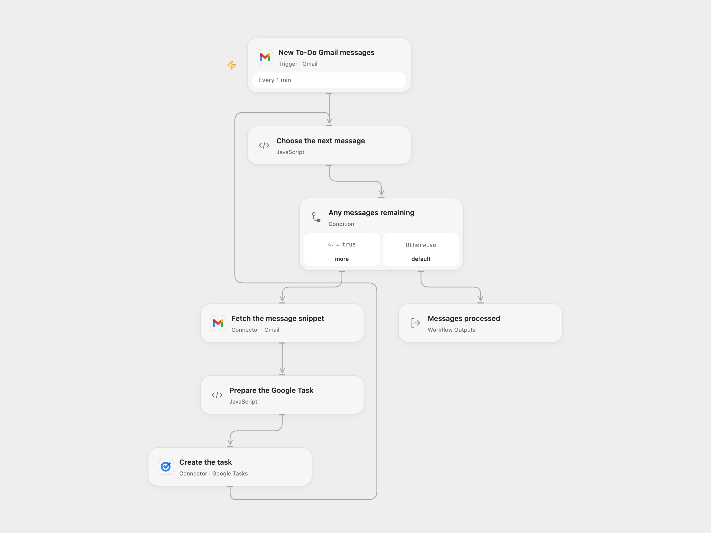

# Gmail To-Do Label to Google Tasks

Create a Google Task for each new Gmail message matching `label:To-Do`.

<picture>
  <source media="(prefers-color-scheme: dark)" srcset="preview-dark.png">
  
</picture>

[Open Flow JSON](templates/gmail-todo-label-to-google-tasks.openflow.json) · [n8n JSON](templates/gmail-todo-label-to-google-tasks.n8n.json)

## Setup

Create the `To-Do` label in Gmail and apply it to messages that should become tasks. Connect the same Gmail mailbox to **New To-Do Gmail messages** and **Fetch the message snippet**. Connect Google Tasks in **Create the task** and set the task list ID in **Prepare the Google Task**; `@default` selects the primary list.

In n8n, select Gmail OAuth2 and Google Tasks credentials and choose the task list in **Google Tasks**. Activate only one format to avoid duplicate tasks.

## Behavior

Every minute, the workflow checks new messages with the `To-Do` label. Open Flow resolves that label name to its Gmail ID; n8n uses the source query `label:To-Do`. It creates one task per delivered message, using the subject as title and the Gmail snippet as notes. The snippet is a preview rather than the full body. A missing or blank subject stops before task creation.

The task is scheduled for the next UTC calendar date at the time it is processed. [Google Tasks stores the date and discards the time portion](https://developers.google.com/workspace/tasks/reference/rest/v1/tasks). This is a scheduled day, not an hourly deadline. The workflow starts from the current mailbox position; adding the label to an older message does not guarantee a task. It does not remove the label, mark mail read or deduplicate tasks.

Both formats exclude drafts, spam, trash and outgoing-only messages. n8n also excludes scheduled messages; Open Flow does not add that filter. Open Flow uses Gmail history checkpoints and n8n uses a time cursor with a bounded backlog queue. Each page has up to 50 messages. A failed or uncertain create stops later items; earlier tasks may already exist. Inspect the list before replaying. No exactly-once or automatic failed-run replay is promised. Full fetched messages and Code inputs must fit execution limits.

Inspiration &amp; credits

## Changes to the source

- Replace private credentials and configure the destination task list.
- Read the actual Subject field and repair the invalid date expression to use the next UTC date.
- Upgrade the native Gmail trigger to 1.4 with a 50-message budget and incoming-only filtering.

Adapted from [New Email → Create Google Task](https://github.com/Zie619/n8n-workflows/blob/ae8cf6dc5b873cbb4f74587aa9180ed3a9f70682/workflows/Googletasks/2031_Googletasks_Gmail_Create_Triggered.json) in [Zie619/n8n-workflows](https://github.com/Zie619/n8n-workflows). The source export does not identify a separate template author or license.

The collection’s [MIT notice](https://github.com/Zie619/n8n-workflows/blob/94007c1445d9258a7da116646b79473e7c7c3282/LICENSE) is pinned at a later revision. This is the collection notice at that revision; it does not establish a separate original template author's license. Our changes are listed above; see [repository licensing](../../README.md#licensing).

> MIT License
>
> Copyright (c) 2025 Zie619
>
> Permission is hereby granted, free of charge, to any person obtaining a copy
> of this software and associated documentation files (the "Software"), to deal
> in the Software without restriction, including without limitation the rights
> to use, copy, modify, merge, publish, distribute, sublicense, and/or sell
> copies of the Software, and to permit persons to whom the Software is
> furnished to do so, subject to the following conditions:
>
> The above copyright notice and this permission notice shall be included in all
> copies or substantial portions of the Software.
>
> THE SOFTWARE IS PROVIDED "AS IS", WITHOUT WARRANTY OF ANY KIND, EXPRESS OR
> IMPLIED, INCLUDING BUT NOT LIMITED TO THE WARRANTIES OF MERCHANTABILITY,
> FITNESS FOR A PARTICULAR PURPOSE AND NONINFRINGEMENT. IN NO EVENT SHALL THE
> AUTHORS OR COPYRIGHT HOLDERS BE LIABLE FOR ANY CLAIM, DAMAGES OR OTHER
> LIABILITY, WHETHER IN AN ACTION OF CONTRACT, TORT OR OTHERWISE, ARISING FROM,
> OUT OF OR IN CONNECTION WITH THE SOFTWARE OR THE USE OR OTHER DEALINGS IN THE
> SOFTWARE.

